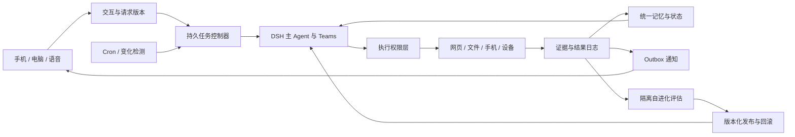

你列出的需求可以拆成 13 个功能模块；我会按“2026 年 9 月 1 日以来的论文”和“可接入 DeepSeek 的开源 agent harness／插件”分别核查。仓库部分会区分完整框架与真正的插件；如果日期窗口内没有合适论文，或无法验证 star 排名，我会明确标出，不拿旧论文或猜测补齐。

论文里已经出现一个关键结论：定时日报与新结果监测需要不同的唤醒机制，不能都交给模型自行决定何时行动。另外，手机界面不等于手机本地运行，语音输入加朗读也不等于全双工；我会在报告中把这些能力边界和插件缺口单独列清楚。

**这套系统最值得优先读的是 [ReLiveGym](https://www.alphaxiv.org/abs/2610.00710)：它直接研究“无人值守数周、定时或事件触发、利用反馈持续改进”的 agent，而工程上我建议采用 DeepSeek Harness 原生能力加少量插件，不要一开始就堆 13 个自主运行的插件。**

# 长期个人 Agent：13 项功能的论文与 DeepSeek Harness 插件研究报告

**研究窗口：2026 年 9 月 1 日—10 月 13 日。** 论文日期按首次公开发表日期处理，不把旧论文在窗口内更新的版本当作新论文。仓库 star 为本次读取 GitHub 页面时的显示值；`k` 为 GitHub 的近似显示。

先给出三个影响选型的结论：

1. **定时日报、事件监测、长任务执行是三种机制。** 晚上 21 点报告应由确定性调度器负责；新录取结果应由变化检测器触发；深度调研才交给目标驱动的 agent。
2. **“最成熟”和“star 最高”不能合并成一个未经证明的标签。** 本次能给出功能匹配、真实 star、兼容性与维护状态，但不能证明下面每一项都是全生态该类别的 star 第一。尤其不能拿底层项目的 star 冒充插件自己的 star。
3. **手机原生运行、真正全双工、统一认知世界模型、物理与数字统一行动，不能用邻近能力替代。** 以下会明确标出哪些论文与插件只是覆盖其中一部分。

因此，这是一份**可用于技术决策的选型报告**，不是已经全部满足“13 篇精确匹配论文＋13 个成熟且类别 star 第一插件”的清单。对于没有足够证据的项目，我保留缺口。

## 一、13 项功能的论文首选

同一篇论文可以成为两个功能的首选：重复使用真正相关的研究，比为了凑齐 13 篇而选弱相关论文更合理。

| Paper                                                        | 首次发表 | 对应功能                                              | 为什么选它，以及覆盖边界                                     |
| ------------------------------------------------------------ | -------- | ----------------------------------------------------- | ------------------------------------------------------------ |
| [ReMem: Rethinking Perception and Memory in Long-Context Recommendation Agents](https://www.alphaxiv.org/abs/2609.37311) | 09-29    | **① 每天收集白厄美图，21 点报告，反馈调整偏好**       | 最贴近“主动感知外部平台＋持续偏好记忆”；没有验证白厄图片推荐或准点推送 |
| [ShadowMiner v1 — An Experience Report on Implementing and Measuring a Problem-and-Hypothesis Discovery Engine](https://www.alphaxiv.org/abs/2610.04339) | 10-03    | **② 每天收集 AI 自进化论文成果，21 点报告，反馈调整** | 把论文处理成问题、假设和证据，适合从“标题日报”升级为“成果日报”；没有实现完整订阅反馈闭环 |
| [ReLiveGym: Evaluating Long-Lived Agents over Weeks of Replayed Reality](https://www.alphaxiv.org/abs/2610.00710) | 09-30    | **③ 监测 NTU EAI 新录取结果并主动报告**               | 直接覆盖持续监测、事件检测、报告时机；没有录取案例真实性验证 |
| [HGP: An on-device personalized agent memory via hybrid graph storage](https://www.alphaxiv.org/abs/2610.10071) | 10-07    | **④ 动态补充用户身份、目标、原因、方法的长短时记忆**  | 将情景、语义、程序与工作记忆分开，匹配用户画像和当前任务状态 |
| [Can AI Agents Make Open-Ended Scientific Discovery? Evidence from Station](https://www.alphaxiv.org/abs/2610.08927) | 10-06    | **⑤ 主动发现、构想、调研、行动和解决问题**            | 有开放问题探索、实验执行、监督与反思；不是通用生活助理验证   |
| [PROACT-Agent: Progressive Runtime Oversight and Active Circuit-breaking for Real-Time Safety](https://www.alphaxiv.org/abs/2609.34415) | 09-28    | **⑥ 一般事项自主行动，关键事项请求授权**              | 最值得借鉴的是运行时风险拦截；不是个性化授权策略的完整解决方案 |
| [Richard: Voice-First Mobile Interaction for Persistent Tasks](https://www.alphaxiv.org/abs/2609.39976) | 09-30    | **⑦ 手机在外独立使用 agent，不依赖电脑交互**          | 对移动端任务连续性最有价值；agent 后端运行在独立设备，不证明手机本地执行 |
| [SALMONN-duo: Adaptive Dual-System Coordination for Full-Duplex Voice Agents](https://www.alphaxiv.org/abs/2609.34247) | 09-28    | **⑧ 全双工实时语音对话**                              | 将常在线语音前端和异步工具执行后端解耦，最适合接入已有 harness |
| [ReLiveGym: Evaluating Long-Lived Agents over Weeks of Replayed Reality](https://www.alphaxiv.org/abs/2610.00710) | 09-30    | **⑨ loop、goal 等长期运行机制**                       | 直接比较 sleep、watcher、cron；是评估研究，不是持久执行引擎  |
| [Agentsensus: Consensus-Compressed Shared Memory for Multi-Agent Story Worlds](https://www.alphaxiv.org/abs/2609.32297) | 09-26    | **⑩ 本地多 Agent 可靠长期协作**                       | 共享记忆、确定性轮次和完整 checkpoint 有参考价值；实验仅覆盖故事世界，不证明生产可靠性 |
| [The Last AI Built by Humans: Toward Genuine Recursive Self-Improvement](https://www.alphaxiv.org/abs/2609.11873) | 09-10    | **⑪ 权重不变的插件、loop、上下文自进化与泛化**        | 适合作为系统级路线图，区分持久更新和真正递归改进；**是综述性质，不是一个方法的完整实证** |
| [HGP: An on-device personalized agent memory via hybrid graph storage](https://www.alphaxiv.org/abs/2610.10071) | 10-07    | **⑫ 从碎片 checkpoint 到统一认知世界模型**            | 提供统一检索的多类型记忆基础；**没有实现完整的行动条件预测世界模型** |
| [Not All Experience Belongs in the Weights: Component Routing for Self-Improving GUI Agents](https://www.alphaxiv.org/abs/2610.01787) | 10-01    | **⑬ 从特定工具调用到物理与数字全域行动**              | 对数字 GUI 行动经验复用有价值；**物理与数字统一操纵的精确匹配论文仍缺失** |

**完整能力匹配最不足的是第 ⑦、⑫、⑬ 项。** 它们分别缺少手机本地端到端 agent、完整认知世界模型、物理与数字统一行动的直接实证。第 ⑪ 项也应配合原始方法论文阅读，而不能把路线图当作泛用自进化已经实现。

## 二、论文中真正值得迁移的设计

### 1. 日报与监测：决定“何时醒来”的权力不应全部交给模型

[ReLiveGym](https://www.alphaxiv.org/abs/2610.00710) 把长期 agent 的关键变量拆成两部分：**何时行动，以及如何使用事后反馈**。它包含 8 类任务，其中既有每日摘要，也有事件检测和网页记录维护。实验显示，不同任务适合不同触发机制，某些 agent 会长期坚持最初选择的糟糕策略，或者运行一周后开始偏离原始要求。[Timing Failures](https://www.alphaxiv.org/abs/2610.00710?page=7)

这对你的前三项需求意味着：

- **美图日报和论文日报：** 定时负责发送，模型负责选取与解释。
- **录取结果监测：** 程序先检测新增内容，再让模型判断是否为目标项目的新案例。
- **主动调研：** 使用有预算、有结束条件的目标任务，不运行无止境的“自己找点事情做”。

我建议将“21 点报告”拆成两个任务：**提前收集并生成报告，21 点发送已落盘的报告**。在 21 点才启动搜索，只能保证准点开始，不能保证准点报告。

### 2. 偏好记忆：稳定兴趣和最近一次反馈必须分开

[ReMem](https://www.alphaxiv.org/abs/2609.37311) 使用截图感知与逐块更新的固定长度记忆，保存稳定兴趣、近期意图变化和任务约束。其完整方法包含强化学习训练，因此不能直接把完整实验收益归给“权重不变的记忆插件”。[Preference Memory](https://www.alphaxiv.org/abs/2609.37311?page=4)

论文在 Games、MovieTV、Books 上评估搜索、排序与判断，报告平均相对提升 5.16%；但 MovieTV 排序一项仍低于最强基线。这比“所有推荐任务都变好”的宣传更有选型价值。[Recommendation Results](https://www.alphaxiv.org/abs/2609.37311?page=8)

用于白厄美图时，我会采用以下**工程设计**，而不是声称论文已经实现：

- 长期偏好：画风、构图、角色表现、是否接受 AI 生成图。
- 短期偏好：今天想看壁纸、战斗场景、表情包还是同人插画。
- 明确排除项：不喜欢的内容类型、重复图、低清转载。
- 反馈证据：用户对哪一张图说了什么，避免把一次反馈扩展成永久结论。
- 推荐解释：每张图说明“为什么今天推荐它”，保留作者和原始链接。

论文日报和录取案例监测同样应保留不同的偏好空间，不能让“喜欢二次元”影响学术证据排序。

### 3. 论文日报：新颖性、证据强度、用户相关性应分别评分

[ShadowMiner](https://www.alphaxiv.org/abs/2610.04339) 的九阶段流程包括文献重排、知识图谱抽取、概念和问题归一化、图缺口检测、假设生成、新颖性搜索、评审与引用忠实度检查。它明确不包含实际实验执行闭环。[Research Pipeline](https://www.alphaxiv.org/abs/2610.04339?page=7)[System Boundary](https://www.alphaxiv.org/abs/2610.04339?page=5)

最值得借鉴的是：**先整理证据，再产生结论，最后检查结论是否真的由证据支持。** 它不适合作为直接部署依赖，因为代码和数据没有公开。[Availability](https://www.alphaxiv.org/abs/2610.04339?page=29)

你的 AI 自进化日报应该固定输出：

> 改了什么组件 → 权重是否变化 → 在什么任务上验证 → 是否测试跨任务迁移 → 代价与回归 → 是否值得接入自己的系统。

“最新成果”不等于“最新标题”，而“用户喜欢”也不能让低证据研究被写成可靠突破。

### 4. 用户记忆：检索过去与追踪现在是两件事

[HGP](https://www.alphaxiv.org/abs/2610.10071) 分别维护事件图、用户语义事实、程序规则和当前状态轨迹，再将相关证据合并进上下文。工作记忆负责“当前任务做到哪里、还有什么约束”，而不是仅从过去聊天里检索相似片段。[Memory Architecture](https://www.alphaxiv.org/abs/2610.10071?page=5)

其个性化选择评估中，完整系统的 S-score 为 35.58，统一向量记忆为 25.15，保留类型但去掉图结构的版本为 33.66。说明**先区分记忆类型，再考虑复杂图结构**，可能比先堆一个大向量库更重要。[Memory Ablation](https://www.alphaxiv.org/abs/2610.10071?page=7)

<!-- Bar Chart: HGP 个性化选择：记忆结构消融 -->

但该论文的“on-device”主要指在线路由和检索，不是整个生成与图构建过程都在手机上。工作记忆的有效性也主要来自定性案例，缺乏系统量化评估。[Deployment Limits](https://www.alphaxiv.org/abs/2610.10071?page=9)

### 5. 主动性：需要持续探索，也需要抵抗“做容易的事”

[Station 的开放发现研究](https://www.alphaxiv.org/abs/2610.08927) 引入 Supervisor 和周期性 Meta Reflection，要求 agent 对研究方向作出阶段性承诺，同时定期重新评估价值。Supervisor 不能自己执行实验，以免监督和执行混为一体。[Autonomy Design](https://www.alphaxiv.org/abs/2610.08927?page=4)

系统平均重新发现 62.7% 的参考论文子发现，但作者不能将收益单独归因于去中心化，因为模型组合和工作流也不同。[Discovery Results](https://www.alphaxiv.org/abs/2610.08927?page=1)[Attribution Limits](https://www.alphaxiv.org/abs/2610.08927?page=37)

对个人助理，我建议把主动性限制为三个输出等级：

- **发现：** 新工具、新研究、新内容，进入候选队列。
- **调查：** 在预授权预算内比较、验证、制作小型原型。
- **报告：** 只有重要、可靠且与用户目标相关的结果立即通知，其余进入日报。

“主动”应该表现为减少用户遗漏，而不是增加用户被打扰的次数。

### 6. 授权：风险分类器不能代替执行权限

[PROACT-Agent](https://www.alphaxiv.org/abs/2609.34415) 在上下文更新后、下一次模型推理前判断是否继续；它不能撤销已经执行并返回结果的工具调用。作者也将其定位为辅助防护，而不是替代系统安全控制。[Guard Boundary](https://www.alphaxiv.org/abs/2609.34415?page=9)

因此你的“只对关键事项要求授权”需要**工具执行前的确定性权限层**：

| 操作                                                       | 建议默认规则                   |
| ---------------------------------------------------------- | ------------------------------ |
| 阅读公开资料、生成摘要、整理允许目录中的内容               | 自主执行                       |
| 调整内容偏好、在配额内重新搜索                             | 自主执行并留记录               |
| 安装或更新插件、执行新生成的程序                           | 隔离验证；超出预授权范围时询问 |
| 发消息给第三方、公开发布、提交申请、支付、删除不可恢复数据 | 显式授权                       |
| 修改权限、密钥管理、安全控制或评估器                       | 不允许 agent 自行放行          |

关键不是“少弹几个确认框”，而是**授权范围可以复用，且 agent 不能自己扩大范围**。

### 7. 手机与语音：交互会话结束不应终止任务

[Richard](https://www.alphaxiv.org/abs/2609.39976) 将会话、任务执行、结果投递分开，保留请求版本、执行尝试和通知记录。结束语音连接、静音、取消任务是不同操作。[Task Continuity](https://www.alphaxiv.org/abs/2609.39976?page=3)

它的后端运行在 Jetson Nano，而不是 Android 手机；两个编程案例也没有生成可验收的程序文件。因此它证明的是**断连后的状态和失败反馈保留**，不是手机 agent 已经流畅完成任意任务。[Prototype Deployment](https://www.alphaxiv.org/abs/2609.39976?page=7)[Execution Evidence](https://www.alphaxiv.org/abs/2609.39976?page=8)

[SALMONN-duo](https://www.alphaxiv.org/abs/2609.34247) 则提供正确的语音架构：全双工前端负责实时听说和打断，异步后端负责推理与工具使用，后端可以是独立 agent 或多 agent 编排器。[Duplex Architecture](https://www.alphaxiv.org/abs/2609.34247?page=4)

**因此，不要把 DeepSeek 文本 agent 本身变成整个实时语音循环。** 应让它成为语音系统的异步任务后端。

### 8. 多 Agent 与自进化：持久状态和验证器必须有明确所有者

[Agentsensus](https://www.alphaxiv.org/abs/2609.32297) 将一条事件记忆赋予多个所有者，避免每个 agent 保存一份近似副本，并使用轮次屏障和完整 checkpoint 支持恢复。[Shared State](https://www.alphaxiv.org/abs/2609.32297?page=2)

但它不是可直接照搬的生产数据库设计：作者发现错误合并会永久保留，抽查的 147 次合并中有 5 次混淆了不同事件，且实验规模和重复次数有限。[Merge Risks](https://www.alphaxiv.org/abs/2609.32297?page=9)

[RSI 路线图](https://www.alphaxiv.org/abs/2609.11873) 最重要的区分则是：**产生持久更新，不等于后续执行真的受益；改善当前任务，也不等于改善了改进机制。** 它强调候选验证、技能库生命周期、固定验收与可回滚发布。[Evolution Governance](https://www.alphaxiv.org/abs/2609.11873?page=30)

这两条原则共同导向：agent 可以提出变化，但**任务状态、预算、权限、评估与发布权不能全部由同一个自主 agent 控制**。

## 三、13 项功能的 DeepSeek Harness 工程首选

下面区分“可选插件”和“完整功能缺口”。**除明确注明外，不宣称类别 star 第一。** 成熟度判断依据是文档中的安装、版本验证、恢复、权限与维护证据，不是仅看 star。

| 功能                | 工程首选                                                     |                GitHub star | 已覆盖的能力                                                 | 仍需补齐 / 选型判断                                          |
| ------------------- | ------------------------------------------------------------ | -------------------------: | ------------------------------------------------------------ | ------------------------------------------------------------ |
| ① 白厄美图日报      | [dsh-tasks](https://github.com/weibaohui/dsh-tasks)          |                          9 | cron、新会话执行、工作区绑定、执行记录、借助 IM 插件推送     | 只负责调度；图片来源、视觉筛选、去重和反馈偏好另做           |
| ② 自进化论文日报    | [dsh-rss-daily](https://github.com/shangjian2023/dsh-rss-daily) |                          3 | RSS、编辑、失败降级、错过补跑、outbox 投递                   | 默认是综合资讯日报；须改为学术源并增加全文验证和偏好闭环     |
| ③ NTU EAI 录取监测  | [dsh-web-search-pro](https://github.com/anweat/dsh-web-search-pro) |                         78 | 多源搜索、网页读取、历史、缓存、可配置平台与登录态           | 不是变化监测器；须增加轮询、稳定案例 ID、差分和通知          |
| ④ 用户长短时记忆    | [OpenViking DSH Memory Plugin](https://github.com/volcengine/OpenViking/tree/main/examples/dsh-memory-plugin) |         **母仓库约 39.8k** | 自动召回、会话捕获、偏好和经验存储、技能接入、失败写入队列   | 本次最强主记忆候选；需要 OpenViking 服务，插件没有独立 star  |
| ⑤ 主动发现与行动    | [dsh-brainagent](https://github.com/stas130286-blip/dsh-brainagent) |                          6 | 目标栈、好奇心调研、主动消息、反馈账本、上下文选择           | 实验性；非商业许可，不应当作成熟生产主控制器                 |
| ⑥ 关键事项授权      | [dsh-actions](https://github.com/pure-craft/dsh-actions)     |                          4 | 人与 agent 共用动作定义、审批闸门、可复用工作流              | 适合固定操作；不是全工具权限系统，须保留宿主权限层           |
| ⑦ 手机本地运行      | [dsh-phone](https://github.com/railgun0325/dsh-phone)        |                         31 | 手机 Termux＋Node.js 运行 DSH；Root/Shizuku 两种安卓操作通道 | 最贴近完整需求；是 APK＋插件组合，不是纯插件；仍用模型 API   |
| ⑧ 实时语音          | [dsh-talk](https://github.com/PerryLink/dsh-talk)            |                         15 | STT、TTS、语音打断、事件播报                                 | **不是原生全双工语音模型**；真正全双工插件首选仍未建立       |
| ⑨ 长目标执行        | [dsh-task-supervisor](https://github.com/gosomea/dsh-task-supervisor) |                          0 | 持久任务、DAG、计划审查、阶段验收、受控续行                  | 功能贴近但仍早期；宿主重启后默认手动恢复，不满足完全无人值守 |
| ⑩ 多 Agent 长期协作 | **DSH 原生 Agent Teams**，见[迁移说明](https://github.com/PerryLink/dsh-team-rooms) | 无独立 star；宿主约 248.9k | 原生持久邮箱、共享任务 DAG、比较并交换更新                   | 我优先选原生；原第三方 team-rooms 已退役，不再推荐新装       |
| ⑪ 权重不变自进化    | [dsh-self-evolving](https://github.com/timwhitez/dsh-self-evolving) |                          7 | 有界插件生成、真实 Loader 验证、预算、日志、崩溃恢复         | 最值得借鉴工程纪律；没有证明通用能力或完整基准提升           |
| ⑫ 统一认知状态      | [OpenViking DSH Memory Plugin](https://github.com/volcengine/OpenViking/tree/main/examples/dsh-memory-plugin) |         **母仓库约 39.8k** | 统一记忆、知识检索和技能接入                                 | 是上下文数据库，不是完整世界模型；状态与预测层仍需开发       |
| ⑬ 物理与数字行动    | [computer-control](https://github.com/JohnXu22786/computer-control) |                          0 | Windows 桌面截图、键鼠、无障碍树、急停、确认                 | 仅数字桌面；**完整物理＋数字插件未找到**，不作为成熟全域方案 |

### 为什么不按全生态 star 排名直接选？

[GitHub 的 dsh-plugin 热门页](https://github.com/topics/dsh-plugin?o=desc&s=stars) 同时包含完整 harness、设计软件、文档库、技能和第三方适配器。带这个 topic 并不意味着它是可直接安装的 DSH 插件。

例如：

- [DeepSeek Harness](https://github.com/deepseek-ai/deepseek-harness) 的约 **248.9k star** 属于整个宿主，不能分别赋给 cron、goal、teams 等内置模块。
- [OpenViking](https://github.com/volcengine/OpenViking) 的约 **39.8k star** 属于上下文数据库及整个仓库，不能说 DSH 适配插件自身有 39.8k。
- [dsh-team-rooms](https://github.com/PerryLink/dsh-team-rooms) 虽然有完整持久化设计，但已在 **10 月 7 日归档**，维护者建议改用原生 Agent Teams。

**我的取舍是：先满足功能和维护边界，再在合格候选之间看 star。** 当前证据不足以把上述 13 行写成“全类别 star 第一”。

## 四、最重要的插件审计发现

### OpenViking：主记忆首选，但自动任务必须测试召回路径

[OpenViking DSH 插件](https://github.com/volcengine/OpenViking/tree/main/examples/dsh-memory-plugin) 有实际包发布、多个 DSH 版本验证、自动捕获和失败写入队列。它将召回内容作为带来源的 pre-step 消息注入，而不是仅加入系统提示词，避免被某些完整 persona 配置覆盖。

**需要特别注意：自动召回由用户输入触发。** 仅由插件注入的消息组成的批次不会触发搜索。因此 cron 日报和自主 loop 必须验证是否实际获得最新偏好，必要时在任务入口显式读取偏好，而不能假设“装了记忆插件，每个后台任务自然都会记得”。

此外，“本地存储”不等于“内容不出设备”：使用远程模型做总结、抽取或回答时，相关文本仍会进入模型请求。

### RSS 日报：投递机制优于简单“跑完就发”，但不是学术阅读器

[dsh-rss-daily](https://github.com/shangjian2023/dsh-rss-daily) 使用 `fetch → outbox → 投递 → confirm`，确认成功前不将内容计入已投递去重历史，并提供失败降级与错过时段补跑。

这很适合日报投递，但 AI 自进化论文需要额外加入：

- 首次发表时间与更新版本区分；
- 方法正文读取，而非只摘要改写；
- 同一工作的预印本、代码、博客合并；
- 权重更新与 harness 更新分类；
- 证据强度与用户相关性分离；
- 用户反馈的显式记录。

### 自进化插件：工程证据清楚，但能力证据有限

[dsh-self-evolving](https://github.com/timwhitez/dsh-self-evolving) 将候选视为不可信代码，固定控制器、评估器、数据划分与安全策略，采用有界生成、隔离 Loader、持久日志和恢复机制。

它明确说明：当前证据覆盖稳定迭代和固定回放中的工程变化，**没有宣称 Terminal-Bench 提升、完整封存评估或 SOTA**。这恰恰使它比“自动改自己代码所以越来越聪明”的演示更值得研究。

其环境依赖 Ubuntu、Docker、Python、Bubblewrap 等，不适合一开始直接放进手机主运行环境。

### 统一状态：不建议同时安装多个自动写入记忆的系统

[dsh-statecore](https://github.com/yul761/dsh-statecore) 有证据链、事实审计和压缩后的重新注入，值得研究。但文档也明确列出长期进程中若干缓存与作用域池不淘汰的问题，因此我没有将其选为你的长期主记忆。

主系统应只设一个记忆权威：

> 原始证据日志 → 有版本的用户事实与偏好 → 当前任务状态 → 可失效的检索索引。

其他 agent 可以提出修改，不能各自维护一个互相冲突的“用户真相”。

## 五、推荐总体架构

**我建议的核心不是 13 个插件，而是 6 个明确职责的子系统。** 以下是工程方案，不是任何单篇论文已经验证的完整产品。

### 1. 三个业务任务共用基础设施，不共用业务偏好

| 业务         | 独立保存的关键状态                                           |
| ------------ | ------------------------------------------------------------ |
| 白厄美图     | 原图来源、作者、图片指纹、已推荐历史、画风反馈               |
| 自进化论文   | 论文 ID、首次日期、版本、组件更新类型、实验和代码证据        |
| NTU EAI 录取 | 项目名称、入学批次、案例标识、原始来源、发布时间、首次发现时间、证据等级 |

尤其是录取监测，**“新发布”不等于“新录取”，“中介宣传”不等于“已确认录取”**。报告应区分本人自报、中介案例、可核验材料以及重复转载，不能默认把不同平台的相同案例当成多个新结果。

### 2. 长期运行采用短执行单元，不保持无限长对话

每次唤醒只完成一个有界步骤：收集、提取、判断、验证或投递。结束后持久化，下一次从状态恢复。

建议的任务状态包括：

`queued → running → waiting → completed / failed / cancelled`

每次执行另有 attempt ID；请求修改使用版本号；外部写入和通知使用幂等键。断电或重启后先核对外部操作是否已经成功，不盲目重做。

**多 Agent 的“不崩溃”应改为“崩溃不会丢状态、不会重复产生副作用、可以恢复”。** 没有实际系统能承诺永不崩溃。

### 3. 手机采用双路径，不要求手机承担所有长期服务

我会选择：

- **手机本地路径：** [dsh-phone](https://github.com/railgun0325/dsh-phone) 执行手机工具、轻量整理和本地交互，先用 Shizuku 版本与备用机测试。
- **常驻任务路径：** NAS、小服务器或其他可持续在线节点承担日报、轮询和重型自进化实验。

这不是手机遥控桌面：手机有自己的 runtime 和本地行动能力；但在手机休眠、断网、系统回收进程时，常驻节点仍能维护任务连续性。模型推理是否也本地运行，是另一个独立决定。

### 4. 世界模型先做可审计状态，再做预测

“统一认知世界模型”至少需要四种不同内容：

1. **事实：** 用户是谁、偏好是什么。
2. **状态：** 哪个任务正在执行、哪些结果已发送。
3. **关系与规则：** 某个行动需要什么前提。
4. **预测：** 做这个行动可能产生什么结果，置信度是多少。

[HGP](https://www.alphaxiv.org/abs/2610.10071) 和 OpenViking 可以帮助前三类的一部分，但不应将知识图谱或向量检索直接称为第四类预测世界模型。我的建议是先建立前三类的版本、来源和冲突处理，再加入可验证的行动预测。

### 5. 全域行动统一上层契约，不统一底层执行器

桌面、手机、浏览器与物理设备可以共享同一目标和证据记录，但不应共享一个无差别的执行权限。

每种动作都应声明：

> 前置条件、作用对象、权限范围、是否可逆、成功检查、失败补偿、紧急停止方式。

[GUI 经验路由研究](https://www.alphaxiv.org/abs/2610.01787) 将经验拆为定位、程序、状态事实和教训，而不是整条轨迹直接复用；其中状态事实和程序更适合保留在上下文，且状态匹配被去掉后收益下降。[Experience Components](https://www.alphaxiv.org/abs/2610.01787?page=4)[State Dependence](https://www.alphaxiv.org/abs/2610.01787?page=9)

这个原则适用于数字执行器设计，但物理设备还需要独立的硬件安全、速度和空间限制，不能从 GUI 结果推导出机器人可靠性。

## 六、落地顺序与验收标准

**第一阶段先实现三个业务闭环，第二阶段补移动与协作，最后才打开自进化。**

| 阶段             | 实施内容                                 | 必须通过的验收                                               |
| ---------------- | ---------------------------------------- | ------------------------------------------------------------ |
| **P0：可用**     | 日报调度、搜索、主记忆、outbox、基础授权 | 21 点发送已生成报告；失败可补送；同一图、论文或案例不重复通知；反馈进入下一次推荐 |
| **P1：可靠**     | 原生 Teams、任务版本、恢复、手机本地执行 | 杀进程与重启后状态保留；不会重复外部写入；手机断连不取消后台任务 |
| **P2：自然交互** | 全双工前端与 DSH 异步后端                | 同时听说、打断、继续任务；旧请求的迟到结果不会覆盖新请求     |
| **P3：受控进化** | 隔离候选、固定评估、版本发布、回滚       | 新任务有收益；旧任务不明显回归；权限不扩大；成本和通知噪声不失控 |

自进化验收必须包含你真正关心的三类任务：**图片推荐、学术调研、录取监测**。只在编码测试上变好，不足以证明你的个人助理获得了泛用能力。

## 最终选型意见

**主运行时选 DeepSeek Harness，主记忆选 OpenViking DSH 插件，多 Agent 优先原生 Agent Teams，手机本地试用 dsh-phone；调度、变化检测、权限和通知保持确定性。**

首轮阅读顺序我会定为：

1. [ReLiveGym](https://www.alphaxiv.org/abs/2610.00710)：决定长期运行与唤醒架构。
2. [HGP](https://www.alphaxiv.org/abs/2610.10071)：决定用户记忆和当前任务状态。
3. [SALMONN-duo](https://www.alphaxiv.org/abs/2609.34247)：决定语音与任务后端分离。
4. [Station 的开放发现研究](https://www.alphaxiv.org/abs/2610.08927)：决定主动探索的监督与反思。
5. [RSI 路线图](https://www.alphaxiv.org/abs/2609.11873)：决定自进化验收和发布边界。

**我不会现在就把“自主修改插件＋无限 loop＋多个记忆插件＋自动批准”一起打开。** 最先值得做到的是：每天确实准点报告、新录取案例有证据、反馈确实改变下一次推荐、重启不丢任务。只有一组兼容版本在这些任务的持续运行与故障注入测试中通过，才值得扩大自主行动和自进化范围。