# DS Bot · Mission Loop｜市场调研与产品需求文档（PRD v1.0）

**日期**：2026-10-14  
**阶段**：0→1 / 公开开源插件 + 商业托管可行性验证  
**目标底座**：[Fei2411/DeepSeek-Bot](https://github.com/Fei2411/DeepSeek-Bot)（`ds-bot@0.1.5`）和 [DeepSeek Harness](https://github.com/deepseek-ai/deepseek-harness)  
**一句话定位**：让一个有个性、有记忆的 Bot，对用户交付的长期目标持续关注、主动发现重要变化，并通过手机交付成果和接受反馈。

## 0. 决策与关键假设

**立项：PASS；首发方向：开发者的长期任务哨兵 + 主动交付，使用二次元角色与兴趣偏好形成情感差异化。**

优先开发三个功能：
1. **Mission：持续目标与事件哨兵**（核心付费动机）
2. **Taste：基于明确反馈的个性化推荐与成果卡**（留存与二次元特色）
3. **Reach：跨设备主动通知与授权**（实际使用与付费承载）

**关键假设 A**：用户为「持续交付具体结果」付费的倾向高于为单次 AI 对话付费。撤掉 A，托管订阅的主商业模型失效，应该转向角色订阅/内容体验。  
**关键假设 B**：DS Bot 的现有 Bot、记忆、Session 和 DSH 调度能力可以继续复用。撤掉 B，工程规模不再属于 0→1 插件，应停止当前方案并重选底座。  
**关键假设 C**：第一批高频用户同时关注 GitHub / AI 论文 / 特定兴趣源的持续变化。撤掉 C，仍能做通用 Watcher，但首个获客故事需要换成采购/求职/价格监控等垂直场景。  
**关键假设 D**：首版使用现有 DSH Web / Desktop + Telegram 通知即可构成有效跨端闭环。撤掉 D，必须先做手机原生/完整远程团队协议，首版周期与成本显著增加。

## 1. 现状核验：哪些不能重复造

### 1.1 确认存在的基础能力

- DS Bot 不是聊天 Demo：主 Bot、持久 Bot、多 Bot 群聊、消息交接、Bot/team Markdown 记忆、FTS5 对话检索、上下文续接与中断恢复、权限请求转交、Usage 计量、模型切换均已有实现。
- `src/host/schedules.js` 已接入 **DSH Schedule Service**，支持按日/周/间隔以及已有任务迁移到新 Session；`src/client/schedules.js` 已有创建和管理界面。
- `src/host/memory.js` 负责共享/个人记忆；`src/client/feedback.js` 的“Feedback”实际上是向 GitHub 提交诊断问题，不是用户对日报的兴趣反馈。
- `src/client/voice.js` 已有「录音→ASR→生成文本回复→浏览器 TTS」的轮换式语音交互；真正实时全双工尚待建设。
- `src/host/approvals.js` 已处理审批卡和群隐藏 Session 的人工决策；不能另造独立的授权真相源。
- 根仓 Apache-2.0，DeepSeek Harness MIT：可以开展商业化衍生，必须保留许可证与 NOTICE；不得暗示官方合作。

### 1.2 现有缺口有直接社区证据

- [Issue #133](https://github.com/Fei2411/DeepSeek-Bot/issues/133)（2026-10-13）：维护者明确确认**群聊 `/goal` 尚不支持**；现成定时提醒不能作为完整持续目标循环。
- [Issue #104](https://github.com/Fei2411/DeepSeek-Bot/issues/104)（2026-10-12）：远程 Bot Team 的发现、身份映射、会话换代与回连尚未落地。
- [Issue #147](https://github.com/Fei2411/DeepSeek-Bot/issues/147)（2026-10-13）：已有用户反馈成果卡无法直接在 DS Bot 内正常显示。
- [dsh-zen-remote](https://github.com/KyoMio/dsh-zen-remote) 和 [dsh-mobile](https://github.com/saya-ch/dsh-mobile) 已存在：手机 UI/PWA/推送可以参考或复用；DS Bot 的远程 Bot 路由仍须单独处理。因版本变化快，首版不把任何一款远程 UI 插件当成核心运行依赖。

## 2. 市场与竞争格局

### 2.1 可核验竞争格局（截至 2026-10-14）

| 阵营 / 产品 | 已有产品价值 | 付费锚点或商业信号 | 我们切入的具体缝隙 |
|---|---|---|---|
| [OpenClaw](https://github.com/openclaw/openclaw) | 自托管、消息渠道、cron/hooks/webhook、移动节点 | 开源免费；需自行支付模型和服务器 | 在 **DeepSeek Harness / DS Bot 的现有多 Bot 工作区**中提供更具体的任务结果与偏好闭环 |
| [OpenAI dots](https://openai.com/index/introducing-dots/) | 全天候云电脑、目标推进、长期记忆、插件和语音 | 含于部分 Pro/Business Premium 套餐，存在高端需求 | 开放代码、本地数据、轻量垂直 Watcher、BYOK 成本控制 |
| [Meta Muse](https://ai.meta.com/muse/) | 长期目标、主动建议、网页行动、手机/WhatsApp、审批 | 平台级免费入口与增值产品竞争 | 独立部署、透明来源、开发者自定义内容源及记忆数据可携带 |
| [Kindroid](https://kindroid.ai/v2/docs/subscriptions/) | 角色记忆、群聊、语音、图片、主动消息和自拍 | 官网 2026-10-01 报价：Web **$13.99/月**、移动端 **$15.99/月** | 让有性格的 Bot **做真实世界的持续任务**，而非单纯陪聊 |
| [Character.AI](https://support.character.ai/hc/en-us/articles/51248493096987-c-ai-Summer-Flash-Sale-Offer-Terms) | 角色聊天、快速响应及订阅权益 | 标准 c.ai+ **$9.99/月** | 开源可定制的角色 + 可审查任务结果，聚焦二次元×极客交叉人群 |
| [changedetection.io](https://github.com/dgtlmoon/changedetection.io)、[RSSHub](https://github.com/DIYgod/RSSHub) | 来源采集、差异检测、订阅流 | 基础设施类产品已成熟 | **变化发生之后的内容理解、任务相关性、交付、反馈和持续优化** |

**市场判断**：广义“长期自主 Agent”不是空白赛道；“在 DS Bot 上、从个人目标持续产生可追溯成果、移动触达、偏好自适应”是明确的小切口。只开发聊天、原始 cron、浏览器或通用记忆会与现成能力正面重复。

**付费意愿证据等级**：Kindroid / Character.AI 的公布订阅价证明角色陪伴存在付费商品；dots 的高端订阅和 Muse 的投入表明市场在重视持久执行；均不能替代本产品的真实付费转化数据。需做预售/试用实验。

### 2.2 用户分层与购买任务

| 客群 | 要完成的工作（JTBD） | 最痛点 | 付费触发 | 商业优先级 |
|---|---|---|---|---|
| 独立开发者 / 极客 | 持续追踪仓库、Issue、模型/插件更新，重要才打扰 | 过量噪声、跑一阵就停止、出门无法处理 | 守护稳定性、移动推送、可审计结果 | **P0** |
| AI 研究者 / 技术创作者 | 论文/技术机会发现、自动初筛，按照研究偏好持续变化 | 每日大量低价值标题、无新颖性过滤 | 高质量研究情报节省时间 | **P0** |
| 二次元核心爱好者 | 与有性格的角色聊天，同时获得持续的兴趣内容和日常帮助 | 角色只会被动回复、记忆不稳定 | 角色主动陪伴、理解审美、个性化惊喜 | **P1** |
| 普通大众用户 | 获得全能贾维斯 | 复杂部署、权限担忧 | 开箱即用 | **P2（首版不做）** |

### 2.3 13 项原始需求优先级

评分为本次产品判断（1–5，越高越好），**不是用户调查数据**。缺口仅指产品组合中的可用缺口；可行性以一名熟悉 TypeScript、DSH 的工程师复用现有库为前提。

| # | 需求 | 缺口 | 付费潜力 | MVP 可行性 | 决策 |
|---|---|---:|---:|---:|---|
| 1 | 二次元美图日报 | 2 | 3 | 5 | Taste 示例场景，不单卖爬图 |
| 2 | AI 论文日报 | 2 | 4 | 5 | 首发示范模版 |
| 3 | 录取/网页新结果监测 | 3 | 4 | 5 | Mission 示例模版，可迁移到任意信息源 |
| 4 | 长短期动态记忆 | 2 | 3 | 4 | 复用已有记忆，新增任务级偏好 |
| 5 | 开放式主动探索 | 4 | 5 | 2 | 先收敛为受限目标探索，后续研发 |
| 6 | 关键审批/常规自治 | 2 | 4 | 4 | 复用 DSH approval；增加手机处理 |
| 7 | 移动端使用 | 2 | 5 | 3 | 首版通知+授权，次版接完整 PWA |
| 8 | 真全双工语音 | 2 | 3 | 2 | 暂缓；现有半双工可继续用 |
| 9 | Goal / Loop 持续目标 | 5 | 5 | 3 | **最优先 P0** |
| 10 | 多 Agent 高可用 | 1 | 2 | 4 | 沿用 DS Bot，不重构 |
| 11 | 插件 / Loop 自进化 | 5 | 3 | 1 | 研究支线，不做首版承诺 |
| 12 | 统一认知世界模型 | 5 | 3 | 1 | 不做首版 |
| 13 | 物理与数字全域操控 | 4 | 2 | 1 | 不做首版 |

**最缺、最值得开发、最值得付费是三个不同问题**：技术最缺的是统一世界模型/泛化自进化；产品最缺的是可信长时间持续交付；当前最有商业机会的是后台执行成果 + 手机触达。选择第 9 项为主轴，把第 1/2/3/4/6/7 项收敛成三项功能，而不逐项造七个插件。

## 3. 产品目标、范围和衡量标准

### 3.1 North Star

**每周按约定交付、用户认为有价值的 Mission 成果数（Weekly Valuable Deliveries, WVD）**。一次交付必须有来源链接、任务关联理由、被动/主动反馈（显式收藏/有用）或后续点击/行动记录；“模型说了话”不计入成功交付。

### 3.2 第一版交付边界

- **支持的 Mission**：定时 Digest、按变化触发 Watch；每个 Mission 可设来源、频率、重要性规则、时区、运行预算和目标 Bot。
- **首批源**：arXiv RSS、GitHub Releases/Issues、通用 RSS/Atom、RSSHub 路由、可选 changedetection.io webhook。
- **交付渠道**：DS Bot 成果卡 + Telegram 消息（单一首发通知渠道）。消息可「有用 / 无用 / 稍后 / 打开来源」；需要高风险工具审批时跳到已有审批流程。
- **二次元模板**：角色/作品偏好筛选、预览、跳转原站；不做未获许可的商业图片再分发。
- **暂不支持**：任意网页智能接管、自动购买、全双工语音、物理设备、通用自治研究员、任意浏览器登录态爬取和无人监督修改自身插件。

### 3.3 目标（试用 Beta，计划值）

- 30 位种子用户，至少 20 人完成首个 Mission 配置，至少 15 人在首周收到 3 次有效交付。
- 在宿主在线且上游源可访问的条件下，**计划交付准点率 ≥95%**（约定时刻 ±5 分钟）；事件命中后 p95 **10 分钟内**形成卡片并发送（上游轮询等待时间单独显示）。
- 重复成果卡比例 **<1%**；所有成果均有原始来源链接和命中理由；任务失败可见状态/下次计划。
- 有明确评分的交付中，**有用率 ≥60%**；完成反馈的用户中，下一次推送的显式偏好至少发生一次可见排序或过滤调整。
- 付费意愿门槛：在一周至少收到 3 次价值交付的活跃试用者中，**≥15% 愿意真实支付首月**，才进入大规模托管建设。

## 4. 核心功能 P0：Mission 持续目标与事件哨兵

### 4.1 用户故事

> 作为开发者，我告诉 Bot：「每天晚上九点把值得看的 Agent 自进化论文发给我；GitHub 某项目发布重大 breaking change 时立刻告诉我。」第二天即使不打开聊天窗口，系统仍能检测变化、避免重复、给出内容价值和来源。

### 4.2 需求规则

- 创建 Mission 时识别 `digest` 或 `watch`；复杂表述先转成可编辑 Mission 卡，保存后启用。
- 支持 `source[]`、`filters`、`interval` 或 `daily time+timezone`、`delivery`、`budget`、`ownerBotId`。
- 采集和 diff 不默认调用大模型：Adapter 以 HTTP/RSS/API/已有 webhook 获取条目，使用 URL + 内容指纹去重；仅新事件进入 LLM 意义判断与摘要。**轮询由插件宿主的确定性定时器驱动，不把每次空轮询做成 DSH Schedule 发往 Session 的模型提示。**
- 任务状态机为 `active → fetching → evaluating → delivered`，并允许 `paused / error / awaiting_approval`；每次处理完成返回 `active`。
- 每次执行是有明确上限的短任务，结束后释放 Session；下次从数据库里的 cursor/resume point 继续，不把无限 Loop 放进模型上下文。
- 任务预算：最大每次新条目数、每日评估次数、日 token 预算、工具权限；超额进入 `paused_budget` 并发出简明提示。
- 删除/停用 Mission 不删除 DS Bot 对话或 Bot 长期记忆；用户可分别清空 Mission 的 observations 和反馈历史。
- 重要成果写入 outbox 后再发送，推送失败可以重试；以 `mission_id + item_fingerprint + delivery_channel` 保证幂等。

### 4.3 两个开箱模板

1. **研究前沿**：arXiv `cs.AI/cs.LG/cs.MA` + 关注关键词；每晚 21:00 报 3–5 篇，按研究矛盾、方法贡献、结果、来源证据、用户相关性排序。仅摘要/元数据不足时标记需要全文阅读。
2. **事件哨兵**：GitHub Release / Issues 或 RSS / changedetection 网页监测。只有“新增、源可信、与指定目标相关”才推送，原始链接必须保留。

## 5. 核心功能 P0：Taste 反馈式个性化推荐

### 5.1 用户故事

> 我连续对论文评价「太旧」「机制上不新」「与自进化无关」，对动漫图评价「更喜欢冷色调与完整构图」，之后 Bot 应把这些反馈作用到对应 Mission 的下一次排序，同时不污染另一类兴趣。

### 5.2 产品与数据规则

- 不做第二套全局 Memory Store。使用 DS Bot 既有 Bot/team memory 保留稳定事实；**新增 mission-level PreferenceProfile** 保留兴趣权重、负面约束、来源可信度、反馈记录。
- 显式按钮：`有用`、`不感兴趣`、`看过`、`收藏`；文字纠正优先级高于简单点赞，冲突时保留修改时间和可撤销入口。
- 反馈影响下次 `rank(items, profile)`，不是改用户全局人设；同一来源重复推荐必须提示“有重大新进展”才可重新出现。
- 排序三段：硬过滤（去重/时间/禁忌）→ 基于规则与语义相关性的评分 → 有预算上限的个性化理由生成。
- 每条成果卡展示：标题、来源、时间、重要性、为何与用户相关、反馈动作；图像卡只预览来源授权可展示的内容并跳转原站。
- Bot 可以引用历史反馈解释排序，但不虚构用户曾经给出的喜好。

### 5.3 分域模板

- **技术与科研**：新颖性、证据完整度、可复现性、与关注研究方向相关性；收藏/拒绝会改变下一批摘要深度。
- **二次元**：作品与角色、画风、构图、颜色、来源白名单；保留角色属性与个人审美为独立表；首版是内容兴趣能力，不做角色语音表演或生成受保护 IP 资产。

## 6. 核心功能 P0：Reach 移动主动交付和授权

### 6.1 用户故事

> 我出门只有手机时收到：「GitHub 目标仓库刚出现兼容性变更，已整理修复建议」，点击可看摘要和来源；如果 Agent 要公开提交 Issue、推送代码或发送邮件，它先给出操作预览，等我批准。

### 6.2 需求规则

- 首版提供 Telegram Bot 通知适配器（通过用户 Chat ID 配对），不要求电脑界面长期开着；**执行主机必须保持在线**。Web UI 仍是详细任务管理入口。
- 通知类型分为 `digest / actionable_event / approval_required / failure`，按用户配置的安静时段、紧急度决定推送方式。
- 通知必须能反向定位到 `mission_id、delivery_id、observation_id`；用户反应通过签名/一次性 nonce 校验，避免重复提交反馈。
- **权限真相源仍是 DSH** `approval/request`；移动端只是答复现有审批单，不能绕过权限服务。对外发送、删除、购买、公开发布必须批准；获取公开信息和生成本地草稿不打断用户。
- 授权卡显示行动、影响范围、目标系统、可预览变更和“同意一次/拒绝”选项；超时保持挂起，不自动批准。
- 需要完整手机远程操控时，另行评估 dsh-zen-remote / dsh-mobile 插件，遵循 DS Bot [#104](https://github.com/Fei2411/DeepSeek-Bot/issues/104) 的版本化 Bot 身份映射协议，不直接复用原始 `/api/bot` 路径。

## 7. 核心流程与架构契约

```mermaid
flowchart LR
U[User goal + preference] --> M[Mission definition]
M --> S[DSH schedule / event watcher]
S --> A[Source adapters: RSS/GitHub/webhook]
A --> D[Cursor + dedup + importance rule]
D -->|new/important| B[Target DS Bot bounded session]
B --> C[Evidence-linked result card]
C --> O[Persistent outbox]
O --> W[DS Bot UI / Telegram]
W --> F[Feedback / approval]
F --> P[Mission preferences + DSH approval]
P --> M
```

### 7.1 模块边界

| 模块 | 落地文件（建议新增） | 所有权 / 依赖 |
|---|---|---|
| Mission registry | `ds-bot/src/host/missions.js` | Mission CRUD + 状态，独立于群聊轮次 |
| Source adapters | `ds-bot/src/host/mission-sources/` | `poll(cursor) → observations[]`；可选 webhook |
| Mission store | `ds-bot/src/host/mission-store.js` | `node:sqlite`，不改现有 `state.json` 格式 |
| Mission runner | `ds-bot/src/host/mission-runner.js` | Node 定时器轮询 / 幂等执行 / 命中后投递 Bot Session；DSH schedule 复用于已支持的用户提醒/日报场景 |
| Taste | `ds-bot/src/host/mission-preferences.js` | 明确的每 Mission 偏好，单来源真实用户反馈 |
| Reach | `ds-bot/src/host/mission-delivery.js` | Telegram / DS Bot UI outbox，审批桥接 |
| Frontend | `ds-bot/src/client/missions.js` | Mission 列表、编辑、成果卡、反馈按钮 |

**强约束**：不修改 DS Bot 现有 `groups.js` 的轮次协议，不接管 DSH 核心 Loop，不重写 Bot Memory 或 Approval Service。外部变更监测触发执行，再由现成 Bot 负责高价值认知工作。

### 7.2 最小持久化模型

- `mission(id, owner_bot_id, kind, title, spec_json, schedule_json, cursor_json, state, budget_json, created_at, updated_at)`
- `observation(id, mission_id, source_url, fingerprint, payload_json, first_seen_at)`，UNIQUE `(mission_id, fingerprint)`
- `delivery(id, mission_id, observation_refs_json, card_json, status, delivered_at)`
- `feedback(id, delivery_id, user_action, labels_json, comment, created_at)`
- `outbox(id, delivery_id, channel, destination, status, attempt_count, next_attempt_at)`
- 审批使用 DSH 已有 `approval/request` 机制，通过 `request_id` 关联；不自定义第二套审批终态。

### 7.3 预算规则与任务服务等级

- 默认每个 Watcher 轮询间隔 ≥1 小时；摘要每次 3–5 项，单批最多 20 条候选进入模型；允许用户改频率并展示估算调用量。
- 常规摘要只在更新时调用模型；空批次不产生模型摘要调用。
- 每 Mission 可暂停；与用户无关的候选不主动打扰；API 错误只在异常持续时汇总。
- 首版维持一台 DSH Host 单主写入。不要启动 Web/Desktop 两个会竞争相同 `$DSH_HOME` 写锁的独立进程。

## 8. 交互与关键页面

**新建 Mission**：用户一句话 → 结构化确认卡（类型、监测源、时间/频率、重要性、Bot、推送渠道）→ 确认启用。  
**Mission 首页**：活跃/暂停/异常状态、最近成功、下次检查、当日模型调用/预算、历史成果。  
**成果卡**：任务名、摘要、原始链接、为何重要、个性化理由、反馈四按钮；从手机点击返回相同结果。  
**审批卡**：操作预览、可影响资产、一次性同意/拒绝、有效期；不能用文字伪造后台许可。  
**角色层**：复用 DS Bot 已有 Bot 名称、头像、颜色；同一 Bot 使用统一口吻但把研究任务与二次元偏好分域管理，不新建三套人格系统。

## 9. 商业化与定价验证

### 9.1 定价结构（待市场实验验证）

| 档位 | 计划报价 | 价值主张 |
|---|---:|---|
| Open Source / Self-Hosted | 免费，用户自付模型和主机 | 完整基础代码与本地 Mission，开发者传播和社区插件协作 |
| Hosted Starter | **¥39/月**（实验价） | 24×7 常驻托管、低频持续目标、手机推送、备份与健康状态 |
| Hosted Pro | **¥79/月**（实验价） | 更多 Mission / 更短检查间隔、可配置来源、优先运行及高级推送 |

首轮按 **BYOK 或透明模型用量计费**，不提供无上限模型调用；套餐主要出售托管可靠性、结果交付和随身触达。报价是价格实验，不是观测到的消费者支付意愿。角色皮肤或语音不进入第一版付费墙。

### 9.2 转化实验（在建设多租户云平台之前）

- 招募约 30 位种子用户：开发者/研究者 20 人，二次元核心用户 10 人；每人创建至少 2 个 Mission。
- 观察 14 天：有效交付次数、错误/重复、触达打开、显式反馈、留存，以及完成任务后的主观价值。
- 第 7 天对收到 ≥3 次有用成果的用户展示 **¥39/月真实付费或预付试用**，记录支付而非口头“愿意”。
- **Go / No-Go**：有效交付成功且真实首月付费比例 ≥15% 进入商业托管；若技术达标但付费低，则保留开源工具，调整目标人群/场景；若技术不达标，先修交付链。

### 9.3 单位经济关键变量

每付费用户月贡献 = 实收订阅费 − 云主机/存储与通知成本 − 平台交易费用 − 客服与失败重跑费用 − 产品承担的模型费用。对于自带 API Key 的用户，模型由用户承担；托管的单位资源成本必须在开放付费前实测。若每人独占一个完整 DSH 进程导致毛利过低，改为共享基础采集/调度、隔离任务执行，不通过提升提示词复杂度解决成本。

## 10. 分阶段工程实施与投入

**资源假设**：一名熟悉 TypeScript/Node/DSH 生态的开发者；复用 `ds-bot@0.1.5`；不改 DeepSeek Harness 核心。估算 **30–40 工程人日，约 5–7 周**。

| 阶段 | 任务 | 人日估算 | 可交付结果 |
|---|---|---:|---|
| 1 · Mission | 固定兼容版本；Mission schema/SQLite；SourceAdapter；RSS/Arxiv/GitHub；去重与 runner | 12–15 | 定时和事件 Mission 实际产出成果 |
| 2 · Taste | 卡片 UI；每 Mission 显式反馈与排序；科研/二次元模板 | 8–10 | 今天反馈能改变明天结果，来源可追溯 |
| 3 · Reach | Telegram 通知/反馈交互；审批透传；预算/重试；部署说明 | 10–15 | 手机收到成果、能处理审批、断线恢复后不重复通知 |

**工程接入点**：复用 `src/host/schedules.js` 所接的 DSH Schedule Service 做面向用户的准点调度；高频 Watcher 轮询使用插件宿主定时器，只有命中才通过现有 Bot Session 与 `delivery.js`/`channel.js` 路径唤醒模型；在 `src/client/` 补充成果卡/任务页；沿用 `approvals.js`。开源版发布为现有 DS Bot 的可选模块或配套 Cordis 插件，尽量避免长期维护一个不能合并上游的硬分叉。

## 11. 验收场景（产品，不追加无关扩展）

**AC-01｜持续成果**：安装并启动 DSH Host，创建「每天 21:00 Agent 论文」Mission；次日按时得到 3–5 条有来源的成果，空更新时不重复推送旧内容。

**AC-02｜事件触发**：订阅一个 GitHub Release；新增 Release 后下次扫描命中并生成一次卡片；宿主重启不会将同一个 Release 重发两次。

**AC-03｜偏好闭环**：用户对一条论文反馈“不关注模型训练、关注 Harness 设计”，下一次该 Mission 的过滤/打分可见更新，二次元 Mission 的偏好不变化。

**AC-04｜跨端触达**：用户退出电脑前台窗口，但 DSH Host 仍在线；手机收到 Telegram 成果，点击可看到来源与任务 ID，可反馈有用/无用。

**AC-05｜审批**：执行涉及删除文件或对外发布的动作前，现有 DSH Approval 阻止执行；移动端批准一次后只放行对应请求，拒绝/过期则保持阻断。

**AC-06｜有限自主**：循环遇到没有新事件时不启动 LLM；达到每日预算主动停止；任务故障清楚记录并在下次有效计划继续。

## 12. 关键风险及优先处理

- **DSH 版本迁移**：DeepSeek Harness 仍在快速迭代；以 `0.2.1-alpha.1`（与 `ds-bot@0.1.5` 文档测试环境一致）为首发兼容基线，逐版本跟进，防止界面/宿主 API 漂移。
- **误报与版权**：科研/信息监测保留来源 URL 与发现时间；二次元图片首版以受许可的缩略图或链接卡展现，不将他人原画作为付费自有内容转售。
- **通知滥用与权限**：轮询不读取私有账号凭据；原始网页与用户消息不赋予系统权限；高风险请求沿用 DSH 审批，审批链不能被手机回调绕过。
- **运行成本与可用性**：手机端“关掉前台还会收到消息”的条件是后台 DSH 主机常驻；用户关掉整台主机时不能执行任务。商业版的核心付费价值就是解决这一部署、在线率与通知到达问题。
- **群聊 Goal**：当前 DS Bot 的群聊 `/goal` 不受支持；首版 Mission 使用专属 Bot/Session 工作，不改群聊协议，避免继承无效自动轮次。

## 13. 未来路线（不进入首发范围）

**V1.1**：更完整的手机 PWA、任务可视化进度与可下载交付物；评估 DS Bot 远程 Team 的版本化连接。  
**V1.2**：开放式主动发现与跨 Mission 机会归纳，但仍受预算与客观触发边界约束。  
**V2**：实时可打断语音、角色个性/动画系统和用户可控的插件级自改进，仅在有付费和留存验证后进入开发。

## 14. 证据来源与调研记录

**第一手代码与问题**：  
- `Fei2411/DeepSeek-Bot`: https://github.com/Fei2411/DeepSeek-Bot  
- `ds-bot/README.md`: https://github.com/Fei2411/DeepSeek-Bot/blob/main/ds-bot/README.md  
- `src/host/schedules.js`: https://github.com/Fei2411/DeepSeek-Bot/blob/main/ds-bot/src/host/schedules.js  
- `src/host/approvals.js`: https://github.com/Fei2411/DeepSeek-Bot/blob/main/ds-bot/src/host/approvals.js  
- `src/client/voice.js`: https://github.com/Fei2411/DeepSeek-Bot/blob/main/ds-bot/src/client/voice.js  
- GitHub Issues #104、#133、#147：分别关于远程 Team、Goal 和成果卡。  

**竞争产品与现有模块（已核官网/仓库）**：  
- OpenAI dots：https://openai.com/index/introducing-dots/  
- Meta Muse：https://ai.meta.com/muse/  
- OpenClaw：https://github.com/openclaw/openclaw  
- Kindroid：https://kindroid.ai/v2/docs/subscriptions/  
- Character.AI：https://support.character.ai/hc/en-us/articles/51248493096987-c-ai-Summer-Flash-Sale-Offer-Terms  
- RSSHub：https://github.com/DIYgod/RSSHub  
- changedetection.io：https://github.com/dgtlmoon/changedetection.io  
- DSH remote：https://github.com/KyoMio/dsh-zen-remote  

**用户提供的参考报告**：`Research.md`、`Argon.md`、`Flash.md`、`Normal(3).md`、`deep-research-report (4).md`、`个人Agent十三项功能深度研究报告.md`、`拆解13项核心功能：以DeepSeek生态为基石构建下一代自主Agent系统.md`、`贾维斯式个人AI助手选型指南.pdf`。这些报告主要用于完整梳理 13 个需求和候选技术路线；对其中插件 Star、论文数据与“目前空白”的陈述，以此次实查官方代码、文档和竞品资料为准。

**最终裁决**：先把“有人真的在用、每周真的收到有用成果、有人真的愿意付钱”三个事实做出来。技术路线只围绕 Mission → Taste → Reach 推进；移动原生、全双工、世界模型和自主进化暂不挤占首版资源。
