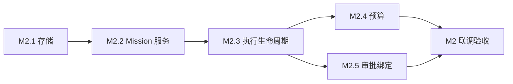

# M2 计划：持续委托与执行生命周期

日期：2026-10-14 · 状态：待执行 · 上游依据：[DEVELOPMENT_PLAN.md](DEVELOPMENT_PLAN.md) §3 M2、[PRD.md](PRD.md) §8 · 前置：[M1_PLAN.md](M1_PLAN.md)（已交付并验收核心链路）

## 0. M2 新增接口核对结论

M1 已核对：插件加载、Bot 身份解析、`sessionController.prompt` 交付、审批服务存在性、定时器。M2 设计前补充核对：

| 接口点 | 核对结论 | 依据 |
|---|---|---|
| SQLite | 桌面运行时 Node `24.18.1`（`resources/runtime/versions.json`），内置 `node:sqlite`，无需原生依赖 | runtime versions.json |
| 自建执行会话 | `sessionController.create({sessionId?, workspaceId? \| cwd?, agentPreset?})` 可创建普通 Session，幂等 adopt；`session/created` 事件存在 | `dsh-api-session-controller/lib/types/commands.js` |
| 执行观察 | `ctx.on('session/event', (session, event) => …)` 暴露 `turn/start`、`user/message`、`assistant/message`、`tool/call`、`tool/result`、`turn/end`（`reason.kind`: completed/error） | ds-bot `turns.js` 的成熟用法 |
| 实际用量 | `assistant/message` 事件的 `data.usage`，或流 chunk `type:'usage'`：`inputTokens/cacheReadTokens/cacheWriteTokens/outputTokens` | ds-bot `usage.js` |
| 审批审计 | 宿主在 Session 日志内追加 `approval/asked` 与 `approval/decided`（含 requestId）；审批只能在打开的 turn 内请求 | `dsh-user-approval` README |
| Bot 会话边界 | ds-bot 的回合路由只接管 `isBotSession` 的 Session；Icarus 自建执行会话不被 Bot 逻辑接管，双方互不干扰 | ds-bot `turns.js` L262 |

执行决定（拍板）：

1. **执行模型 = Icarus 自建执行会话**。Run 创建自己的 Session（cwd 取 Icarus 数据目录下的执行工作区），用 `prompt` 驱动，用 `session/event` 观察到 `turn/end`，从事件流收成果文本与实际 usage。不借用 Bot 的会话：Bot 只收最终交付。这样审批天然落在执行会话的 turn 里（宿主通道有效），usage 归属清晰，Bot 的聊天上下文不被任务执行污染。
2. **存储用 `node:sqlite`**。WAL 模式、单写方假设（与 ds-bot 的 state.lock 同款约束，写进文档）；数据目录 `$DSH_HOME/icarus/`：`icarus.sqlite` + `artifacts/`（原始资料与成果文件）+ `workspace/`（执行会话 cwd）。
3. **调度自管 due time，Cordis 定时器只负责唤醒**（PRD §8.3）。不注入宿主 `schedule` 服务，避免与现有提醒双调度。
4. **schema 一次建全，逻辑分期接线**。PRD §8.1 八张表在 M2.1 全部落库（迁移框架管理）；Source/Observation 的采集逻辑在 M3、Feedback/PreferenceRevision 的整理逻辑在 M4，M2 只让 Mission/Run/Deliverable/Outbox 跑通。
5. **M2 无 UI**。「可查看」= 插件对宿主暴露的内部服务 `ctx.icarus`（查询/操作 API）+ 测试与联调脚本驱动。界面在 M5。

## 1. 子阶段划分

```
M2.1 存储地基 ──> M2.2 Mission 域服务 ──> M2.3 执行生命周期 ──> M2.4 预算 ──> M2.5 审批绑定与错误档案
                                          （调度/租约/恢复 ↑ 依赖 2.1/2.2）
```

### M2.1 存储地基

任务：
- 数据目录与打开方式：`$DSH_HOME/icarus/icarus.sqlite`，WAL、`busy_timeout`、外键开启；打开即跑迁移。
- 迁移框架：`schema_migrations(version PRIMARY KEY, appliedAt)`；迁移为编号 SQL 串，事务内执行，可重复打开幂等。
- 0001 迁移：PRD §8.1 八张表，字段按 PRD 原样落（Mission/Source/Run/Observation/Deliverable/Feedback/PreferenceRevision/Outbox）。关键约束：
  - `Mission.revision` 单调递增，`(id, revision)` 落历史表 `MissionRevision`（每次修改一行快照），当前行保存最新 revision。
  - `Run (missionId, missionRevision, preferenceRevision, status, sessionId, leaseOwner, leaseUntil, generation, …)`；唯一约束 `(missionId, generation)` 防重复领取。
  - `Outbox` 唯一约束 `(deliverableId, channel)` 防重复投递；状态含 `pending/sent/delivery_unknown/failed`。
  - `Deliverable.content` 存摘要与指纹，正文与原始资料落 `artifacts/` 文件，库存引用路径。
- 导出/删除占位：表设计预留 ownerBotId 维度的级联删除路径（M5 才接 UI，M2 先把删除函数写对）。

验收：迁移重复执行结果一致；八张表 DDL 与 PRD §8.1 字段一一对应；node:test 覆盖迁移幂等与唯一约束。

### M2.2 Mission 域服务

任务：
- 状态机 `active/paused/completed/cancelled`：转换表显式定义，非法转换抛错（如 cancelled 不可复活）。循环委托成功交付后保持 `active`；单次委托（`kind: 'once'`）交付成功 → `completed`。
- CRUD：create（kind/objective/requirements/schedule/timezone/budget/authorizationRef/ownerBotId）、modify（产生 revision+1，快照入 `MissionRevision`）、pause/resume、cancel。每次修改即新 revision，**不接受对旧 revision 的写入**。
- 服务面：`ctx.icarus.missions`（create/get/list/modify/pause/resume/cancel/history），插件内装配，供 M3–M5 与测试调用。
- due time 计算：`schedule`（daily HH:mm + IANA 时区 / cron / once）→ 下一到期时刻入库 `nextDueAt`；修改 schedule 立即重算。

验收：node:test 覆盖状态机全转换、revision 快照链、due time 在时区边界（含夏令时不存在的本地时刻取较早瞬间）的计算。

### M2.3 执行生命周期

任务：
- 调度器：每 60s（`ctx.interval`）扫 `nextDueAt <= now AND status='active'` 的 Mission，事务内创建 `Run(queued)` 并把 `nextDueAt` 推进到下一周期——崩溃也只丢一次唤醒，不重复建 Run（唯一约束兜底）。
- 租约与代次：事务内将 `queued` 领取为 `running`，保存实例及租约。`generation` 在每个 Mission 内递增，`missionRevision` 固定该次执行采用的定义。提交前校验执行状态、租约所有者与有效期，并核对当前 revision；过期执行者不能提交新结果。
- 执行器：为 Run 创建执行会话（`sessionController.create`，cwd=`$DSH_HOME/icarus/workspace`），装载 Mission 当前 objective/requirements 为任务 prompt，`prompt` 驱动；监听 `session/event` 至 `turn/end`：
  - completed → 收 `assistant/message` 文本为候选成果；
  - error → `failed`，保留原始错误（code/status/requestId）入 `errorRef`；
  - 中途宿主重启 → 重启恢复逻辑见下。
- 要求核对：Run 结束前按 `requirements` 逐条核对候选成果（M2 用程序可判的结构核对：非空、含来源引用标记、长度下限；语义判断留 M3 起交给模型），核对过 → 持久化 `Deliverable` + artifacts 文件 → `Outbox(pending)` → BotBridge 交付 → 成功回执（prompt 无错返回）→ `sent`；prompt 超时无法确认 → `delivery_unknown`；核对不过 → `failed` 并保留原因。
- 重启恢复：启动及后续扫描读取租约过期 Run 的宿主会话。已完成回合在重新领取租约后提交原成果；中断回合保留实际用量，再登记新 generation。`queued` 由调度器领取。旧版本成果提交遵守同一条 revision 与租约校验。
- Run 查询：`ctx.icarus.runs`（get/list by mission/状态、含 usage 与成果引用）。

验收（对应 DEVELOPMENT_PLAN 完成依据）：
- 关闭窗口（插件卸载/宿主重启）后 Mission 仍在，重启后调度继续。
- 修改 Mission 后，基于旧 revision 的在途执行提交被拒（superseded），新执行遵循新要求。
- 长期委托一次交付后仍 `active`；`once` 委托交付后 `completed`。
- node:test 覆盖：租约过期抢占、代次拒绝、重启恢复分支、delivery_unknown 转换。

### M2.4 预算

任务：
- Mission `budget`：token 硬上限（input+output 合计），价格未知时只展示 token 用量（PRD §8.3）。
- 预留/结算：每次 `llm/stream` 请求前，按完整输入与最大输出保存 `ModelCall` 预留。调用结束按真实 usage 结算到 Mission；Run 保存调用总用量。标题、压缩与交付阅读等辅助调用共用预算，工具发起的关联调用携带同一委托的归属。
- 上限闸门：预留超过 Mission 剩余预算 → Run 直接 `budget_exhausted`，不发起任何模型调用；结算后更新 Mission 累计用量。
- 用量查询并入 `ctx.icarus.runs` 返回。

验收：预算为 0 时不建立执行会话；预算不足以预留时零模型请求；真实回合中剩余额度不足会阻止下一次请求。Mission 的总用量包含交付后的 Bot 阅读，用户总预算同样阻止新增请求。

### M2.5 审批绑定与错误档案

任务：
- 审批记录：监听执行会话日志中的 `approval/asked`/`approval/decided`，把 requestId、动作、结果绑定到 `Run.id` + `missionId` + `missionRevision` 落 `Run.approvalRefs`。宿主要求审批的动作（沙箱升级等）在执行会话 turn 内发生，天然满足「打开的 turn」前提。
- 状态映射：Run 被审批挂起时为 `awaiting_approval`。拒绝记录在审批链中，Run 的终局由宿主回合结果和成果核对共同决定；交付正文说明未获通过的审批。执行超时取消宿主回合并保存失败档案。
- 错误档案：所有失败保留原始错误结构（code/message/status/requestId/堆栈摘要）于 `errorRef` 指向的 artifacts 文件，DB 存摘要；禁止把失败改写为成功文本。
- 移动端答复审批、过期 request 重发属于 M5；本阶段定义记录契约并联调桌面路径。

验收：一次真实需要审批的执行（如执行会话内触发沙箱升级）在 Run 上留下完整审批链；拒绝路径产生 `failed` 与原始记录。

## 2. 依赖与顺序



M2.4 依赖 M2.3 的执行器收口；M2.5 依赖 M2.3 的执行会话。M2.3 是最长路径。

### 已确认的实现接缝（验收记录）

- `Mission.kind` 落地为生命周期型（`once` / `recurring`），不是 PRD 的业务模板型（论文/申请/兴趣/investigate）。DB 对 kind 无 CHECK，M4 接三个模板与 investigate 时在域层扩类型或加 `template` 列（走新迁移），届时显式决策。
- `ctx.icarus` 服务面：`ctx.provide('icarus', { missions, runs })`，其他插件声明 `inject: ['icarus']` 取用。
- 交付确认与 `missions.recordDelivery(id)` 在同一 Outbox 结算事务内完成。Outbox 的原子领取与状态负责防止重复发送。
- 代次校验用 `revision`，不用 `updatedAt`（pause/resume 也改 updatedAt）。
- **请求前预留**：0003 迁移增加 `ModelCall`，保存调用归属、预留与实际用量。文本输入按 UTF-8 字节数及协议开销保守预留，附件使用模型路由的上下文上限。输出由 `execution.maxOutputTokens` 限制，默认 8192。
- **共同预算**：事务内检查 Mission 的已用量及未结算预留；配置 `execution.userTokenBudget` 后同时检查本机用户的总额度。调用结束按真实 usage 结算一次。用量未知的调用保持预留，Run 预算视图展示 `reserved` 及扣除预留后的 `remaining`。
- **实际进展与费用**：后续请求被预算拒绝时，Run 保存 `budget_exhausted`、已有进展及实际用量。已经发生的费用完整记录；历史调用或适配器异常造成的超支保留原成果与超支记录，阻止后续新增调用。
- **M2.5 审批绑定（已落地）**：绑定不新增宿主接口——执行器监听自己创建的会话，把 `approval/asked`（`{id, toolName, callId?, reason?}`）与 `approval/decided`（`{id, outcome}`）折叠进 `Run.approvalRefs`（0002 迁移，`TEXT NOT NULL DEFAULT '[]'`，DB 存结构化链，原文留在执行会话日志）。Icarus 不注册应答者、不自动放行、不起自己的审批计时器；outcome 词表是宿主的封闭集合 `allowed-once/rejected/cancelled/unavailable`。
- **审批等待**：`awaiting_approval` 保持执行租约，多个未决请求全部关闭后恢复 `running`。模型请求各自结算；审批事件本身不产生用量。租约丢失时取消宿主回合。
- **拒绝/取消/无应答都不杀 Run（D4 拍板）**：宿主拒绝只废那一次工具调用，回合照常 `completed`，一见 `rejected` 就判死会造成「turn 在跑、Run 已终态」的自残冲突，与 M2.4 超支同理。终局由 turn 收口 + 要求核对决定：核对通过 → 交付，交付文本必带「本次执行有 N 次审批未获通过：<工具>（<outcome>）」，绝不静默交付；核对不过 → `failed`，`runs/<id>/error.txt` 必含完整 asked/decided 配对（`requestId`/`toolName`/`callId`/`outcome`/两个时间戳）。
- **错误档案固定结构（已落地）**：`runs/<id>/error.txt` = 头部（Run / Mission / revision / generation / 时间 / kind / detail / session / usage）+ 审批链（含仍 open 的请求）+ 工具错误（`tool/result` 的 `message` 与 `error.info`，按 callId 反查 `tool/call` 的名字）+ raw JSON（turn reason 原文；未捕获异常记 name、message 与前四行堆栈）。只有失败路径写这份档案，交付路径不碰它。
- **`sessionController.prompt` 的第二参 signal 必传（联调打回修复）**：宿主 gateway 的 `prompt(request, signal)` 里是无条件 `signal.throwIfAborted()`（0.2.0-rc.2 `dsh-api-session-controller/lib/index.js:3096`），漏传会在受理前抛 `TypeError: Cannot read properties of undefined (reading 'throwIfAborted')`，Run 落 `failed / execution-error`。宿主自家 ds-bot 的传法是 `AbortSignal.timeout(30_000)`。现在两个调用点都传：`bridge/deliver.ts` 用投递超时，`execution/executor.ts` 用 `AbortSignal.any([unload, AbortSignal.timeout(30s)])` 只包受理阶段（回合由执行超时兜）。`types/host.d.ts` 把它标成必填，test harness 的 prompt 桩也断言第二参是 AbortSignal——这类「宿主签名必传参漏传」从此在 node:test 阶段就炸。
- **单次委托重新排期**：编辑仍为 `active` 且已消费到期时间的 `once` 委托时，将新 revision 的 `schedule` 与 `nextDueAt` 设为 `now + 5s`。旧成果保留在原 revision 中，旧交付不能完成新的要求。`awaitingReschedule` 根据当前 revision 的成果及在途执行计算；恢复已暂停且尚无当前成果的单次委托时重新排期。失败本身保留原状态，后续执行由用户的编辑或恢复动作触发。
- **`recoverExpired()` 并入每个 pass（总验收收尾补丁）**：原先只在插件加载时跑一次，宿主在租约窗口内重启会让没有归属的 `running` Run 一直挂到下次重启。现在 `tick()` 的顺序是 续租 → recovery → 排队 → 领取执行，租约成为唯一栅栏；`TickReport.recovered` 把这次治愈的 Run 暴露出来。
- **成果正文只取收尾答复（总验收收尾补丁）**：`TurnTracker` 按段收集 assistant 文本，`resultText()` 返回**最后一个 tool result 之后**的段落（多个按序拼接）；整轮没有 tool 调用时取最后一条 assistant 消息。理由：工具型回合的过场旁白（"作者信息已补齐，现在落盘"）不是成果。usage 累计仍收全部 assistant 消息，不受影响。

## 3. M2 总验收（联调，真实宿主）

执行方式、逐步驱动脚本与检查点见 [M2_ACCEPTANCE_RUNBOOK.md](M2_ACCEPTANCE_RUNBOOK.md)；驱动插件在 `.work/m2-acceptance-driver/`（本地 harness，不进包）。

1. 通过 `ctx.icarus.missions` 创建一个长期委托（每日 21:00 Asia/Singapore 的假日报任务，预算有限），重启宿主后委托存在且 `nextDueAt` 正确。
2. 到期后产生 Run、真实执行会话跑一个最小任务、成果经 outbox 交付到绑定 Bot（Chief），Run 显示实际 token 用量。
3. 执行中途修改委托：在途 Run 提交被拒（superseded），下一 Run 用新 revision。
4. 把 Mission 预算调到 0：到期 Run 为 `budget_exhausted`，无模型调用。
5. 长期委托交付一次后仍 `active`；单次委托交付后 `completed`。

## 4. 明确不做（M2 边界）

- 不接真实来源采集（M3），M2.3 的「成果」由执行会话直接产出。
- 反馈与偏好整理安排在 M4，界面与 QQ 接入安排在 M5。
- 不写宿主 `schedule` 服务、不改 ds-bot 任何文件、不写 `state.json`（M1 已立禁令，延续有效）。

## 5. M2.5 实现计划（Dev 提交，待 Chief 过）

日期：2026-10-14 · 依据：本文 §M2.5 任务、§0 接口核对、宿主审批运行面核验（只读 `.work/host-0.2.0-rc.2`，核验时间 2026-10-14）

### 5.1 已钉死的宿主事实

| 点 | 事实 | 依据 |
|---|---|---|
| 审计事件 | `approval/asked` = `{id, toolName, callId?, reason?}`；`approval/decided` = `{id, outcome}`；`approval/policy` = `{policy}` | `dsh-user-approval/lib/types/index.js:129-136` |
| outcome 词表 | `allowed-once` / `rejected` / `cancelled` / `unavailable`，封闭集合 | 同上 `:15`、`lib/types/invariant.js:202-215` |
| 可观察性 | `session.append` 之后对**全部**事件类型广播 `session/event`，含以上三种 | `dsh-session/lib/index.js:1441-1474` |
| 轮次前提 | 审批只在未结束的轮次内发生，事件对同轮配对 | `dsh-user-approval/lib/types/index.js:123-127` |
| 谁应答 | 桌面走 scoped Remote（GUI：同意→`allowed-once`，拒绝→`rejected`）；ACP 为另一应答者，必须带 callId | `dsh-api-remotes/lib/index.js:147-157`、`dsh-client-ui-approval/lib/client.js:79,124,131,355-357`、`dsh-acp/lib/index.js:1116-1138` |
| 无人应答 | waterfall 兜底 `unavailable`（fail closed）；非法返回值与监听器抛错同样归一为 `unavailable` | `dsh-user-approval/lib/index.js:176` |
| 超时 | 审批侧没有自己的计时器；超时来自调用方 signal（工具 `timeoutMs` 造的 deadline），一响即 `cancelled` | `dsh-timeout/lib/index.js:57-73`、`dsh-tool-call-timeout-policy/lib/index.js:80-108` |
| 错误素材 | 工具拒绝物化为 `{content:[{type:'text',text:'Error: '+reason}], isError:true, error:{message, info?}}`；**没有 code/status/requestId**，requestId 只存在于 `approval/asked.id` | `dsh-tools/lib/index.js:3243-3257, 3463-3490, 3616-3630` |
| 回合结局 | 工具错误不终止回合，`turn/end` 通常仍是 `{kind:'completed'}`；只有被打断才是 `{kind:'aborted'}` | `dsh-agent-loop/lib/index.js:731-745, 1008-1030` |

结论：绑定不需要宿主开新接口，也不由 Icarus 发起审批——沙箱升级这类敏感动作在执行会话内自会被宿主路由到审批 seam，Icarus 只需监听自己创建的会话。

### 5.2 设计决定

**D1 审批绑定复用执行器的 `session/event` 监听。** 按 Run 的 sessionId 核查事件归属，保存当前执行的审批记录。

**D2 存储 = 0002 迁移给 Run 加 `approvalRefs TEXT NOT NULL DEFAULT '[]'`。** DB 存结构化链（每条：`requestId / toolName / callId? / reason? / outcome / askedAt / decidedAt`），原始证据不复制——执行会话日志本身就是原文，`Run.sessionId` 已有指针。这是 §M2.5 写了、但 0001 没落的列：补迁移，不改已应用迁移。

**D3 `awaiting_approval` 保持执行中的租约与用量记录。** 提交与结束均检查租约及当前 revision；审批等待不改变请求的计费次数。

**D4 审批拒绝保留在链中，终局由宿主回合与成果核对共同决定。** `rejected`、`cancelled` 与 `unavailable` 均保存原始结果。核对失败时记录 `failed` 并保留完整审批链；核对通过时交付正文，并明确说明未获通过的审批。

**D5 错误档案 = 一份固定结构的原文文件。** `errorRef` 仍指向 `runs/<id>/error.txt`（失败）或 `budget.txt`（闸门/超支），DB 不新增摘要列。文件结构：头部（Run / Mission / revision / generation / 时间 / kind / detail）+ 审批链 + 工具错误（按序，`message` + `info`）+ turn 结束时 reason 原文 JSON + usage。失败档案只能由失败路径写，交付文本不能覆盖它。

**D6 审批答复由宿主已有的用户通道处理。** 执行超时负责取消仍在等待的回合；移动端答复安排在 M5。

### 5.3 改动清单

| 文件 | 动作 | 要点 |
|---|---|---|
| `src/storage/schema/0002-run-approvals.ts` | 新增 | `ALTER TABLE Run ADD COLUMN approvalRefs TEXT NOT NULL DEFAULT '[]'` |
| `src/storage/schema/index.ts` | 改 | 追加 0002，编号保持连续 |
| `src/execution/runs.ts` | 改 | `Run.approvalRefs`、`ApprovalRef` 类型、`RunView.approvals`；新增 `markAwaitingApproval` / `resumeFromApproval` / `recordApproval`；状态条件放宽（D3） |
| `src/execution/executor.ts` | 改 | 审批事件折叠进 TurnTracker；`tool/result` 错误原文收集；状态翻转；失败档案结构 |
| `src/execution/index.ts` | 改 | 导出 `ApprovalRef` |
| `test/execution-approval.test.js` | 新增 | 见 5.5 |
| `test/execution-errors.test.js` | 新增 | 失败档案内容 |
| `test/storage-schema.test.js` | 改 | 0002 幂等 + 老库升级 |
| `test/helpers/execution-harness.js` | 改 | `approvalAsked` / `approvalDecided` / `toolError` 事件构造器 |
| `docs/M2_PLAN.md` | 改 | 本节定稿后把拍板结论并入 §1 已确认接缝 |

### 5.4 状态流

```
claim(running)
  ├─ approval/asked        → awaiting_approval（asked 入链，租约照续）
  ├─ approval/decided      → running（outcome 入链）
  │    allowed-once                        → 继续
  │    rejected/cancelled/unavailable      → 只入链，继续（D4）
  ├─ turn/end completed    → 核对 → commit(succeeded) / finish(failed + 档案)
  ├─ turn/end 非 completed → finish(failed + 档案)
  ├─ 执行超时              → finish(failed；链尾仍是 asked 时档案 kind: approval-timeout)
  └─ 租约过期 / 宿主重启   → superseded（人工答复作废，新 generation 重排队）
```

### 5.5 测试与验收

node:test（预计新增 12 条左右）：

1. asked → allowed-once：执行中 Run 为 `awaiting_approval`，链落库，最终 `succeeded`。
2. asked → rejected 且成果成立：`succeeded`，交付文本含审批被拒标注，链里有 outcome。
3. asked → rejected 且成果不成立：`failed`，`error.txt` 含审批链 + 工具错误 `message`/`info`。
4. `cancelled`（signal abort）与 `unavailable`（无应答者）各一条断言。
5. 挂起期间 `renew` 生效：跨过 `leaseMs` 仍可 commit，不被 supersede。
6. 挂起 Run 租约过期 → `recoverExpired` 转 superseded + 重排队，且人工答复不再能提交。
7. 审批不改变结算次数：挂起前后各一次终态写，`budgetUsed` 只加一次。
8. 0002 迁移：只有 0001 的老库升级后历史 Run `approvalRefs` 为 `[]`；重复打开幂等。

真实宿主联调（Chief 验收）：

- 执行会话内跑一个必须升级权限的动作（工作区外写入）→ GUI 弹审批 → 同意：Run 链里 `allowed-once`；拒绝：链里 `rejected`，检查后续 Run 状态与档案。
- 无人应答场景（无头/无应答者）：链里 `unavailable`，动作以拒绝关闭，Run 不自动放行。

### 5.6 风险

- 执行超时默认 10 min 可能短于人工审批等待：超时后走 fail-closed，档案标明链尾仍在等待。M5 接移动端答复时再评估是否给审批期单独计时。
- `session/event` 是提交后的观察者，写库失败不影响宿主派发；审批链落库失败只 warn（与 usage 记录同一策略），不阻断执行。
