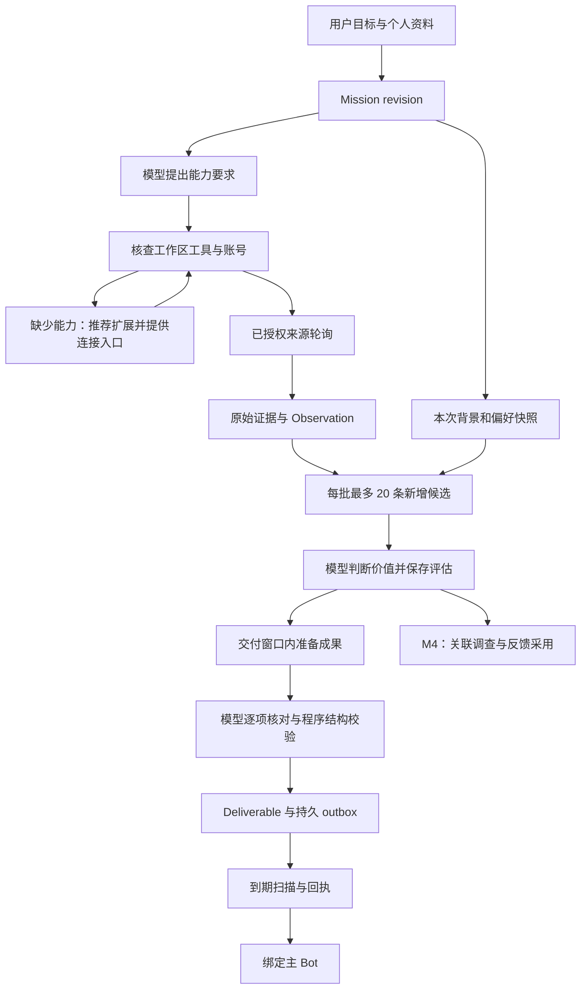

# M3：持续关注、按需扩展与准点交付

日期：2026-10-15 · 状态：完成

实施依据：[PRD v1.3](PRD.md)、[开发计划](DEVELOPMENT_PLAN.md)、[M3_BEGIN 全文](M3_BEGIN.md)与 [AGENTS.md](../AGENTS.md)。本文件定义 M3 的完整实施方案，当前实现与真实调用进度见第 9 节。

## 1. 目标与关键假设

M3 交付一条连续工作的业务链：用户交代持续关注的目标，Icarus 结合个人背景确定资料与能力，使用原生来源及已连接工具发现变化，判断对当前研究或项目的价值，保存证据，并在约定时刻交付。用户需要额外能力时，能够得到具体推荐、完成连接，并让同一委托继续工作。

| 关键假设 | 撤掉后，结果是否成立 |
|---|---|
| 用户有持续关注主题及可引用的项目背景 | 采集与通知仍可运行；结合个人目标判断价值的验收失效 |
| 桌面 `0.2.0-rc.2`、DS Bot `0.1.6` 与 M2 执行服务可用 | 产品目标保留；当前插件接入和交付方案失效 |
| 所选 MCP 或 DSH 插件在任务工作区实际可调用 | 原生来源仍可采集；依赖该扩展的读取或行动暂停 |
| 用户完成所选账号的认证，允许读取指定材料 | 已授权的公开来源仍可工作；对应私有资料和账号能力不可执行 |
| 常驻主机与来源在准备及交付时段可访问 | 任务与证据仍持久保存；准点发送失效，恢复后执行补交 |
| 模型配置有效，委托预算覆盖阅读和要求核对 | 非模型采集可继续；评估与成果生成保持待执行或明确预算耗尽 |

执行决定：**沿用 M2 的 Mission、Run 与 outbox，补齐资料和能力绑定，将来源轮询、模型准备与投递拆开调度。** 模型负责理解目标和判断价值，代码负责协议、状态及权限。按本文件的依赖顺序连续实施。

## 2. 本阶段交付与后续衔接

| M3 交付 | 具体结果 |
|---|---|
| 持续来源 | RSS/Atom、arXiv、GitHub 实际可用；接通一种公开网页变化来源，保存游标及故障状态 |
| 个人背景 | 引用选定项目文件，并通过核实的 BotBridge 装载相关 Bot 背景；能够接入用户选择的文献或笔记工具 |
| 按需扩展 | 根据完整目标给出候选，说明用途与免费条件；绑定工作区工具，实际核查可用性，显示连接入口 |
| 模型选择 | 每批最多 20 条新增候选，结合目标与背景判断价值，保存实际阅读范围及评估结果 |
| 准点交付 | 提前准备，核对要求后持久化；约定时间发送，空日报与来源失败分别处理 |
| 连续运行 | 修改、暂停、会话换代及重启后保留正确身份和进度；不重复生成已确认窗口的成果 |

M3 用论文与开源项目两个真实目标验证通用机制；三个模板的完整体验、反馈采用及关联调查由 M4 完成。M3 暴露服务与已有 Bot 可调用入口，完整委托卡及移动交互由 M5 完成。M4 工程调查沿用 M3 保存的来源、资料及能力引用，按项目标准命令交付实际运行结果。

扩展按目标选装。至少一项 MCP 与一项 DSH 工具须在本机后台会话真实调用，其余候选保留独立验证状态。日历和邮件属于按需连接能力，具体写入按委托授权执行。角色互动与 AIGC 创作沿用后续扩展安排。

## 3. 已有代码与必须改造的连接处

| 当前文件或能力 | 已有事实 | M3 改动 |
|---|---|---|
| `src/domain/mission.ts`、`missions.ts` | `kind` 为 `once / recurring`，已有 revision 和调度 | 扩展 revision 内容，保存资料引用、能力要求和交付策略；场景名称使用模板或目标描述 |
| `src/storage/schema/0001-core-records.ts` | 八类核心表已建立，Source 和 Observation 尚无采集服务 | 追加迁移，实现来源配置、消费进度与交付窗口 |
| `0002-run-approvals.ts`、`0003-model-calls.ts` | 审批绑定和模型预算预留已持久化 | 延续既有绑定与计费，覆盖背景读取、评估及核对调用 |
| `src/execution/executor.ts` | 创建独立执行会话；提交成果后立即调用 `outbox.attempt()` | 先装载背景和能力快照；成果准备完成后交给到期投递扫描 |
| `src/execution/scheduler.ts`、`index.ts` | 扫描 `Mission.nextDueAt` 后串行执行；默认每分钟一次 | 增加来源与准备时间，投递扫描独立运行，长模型回合不阻塞发送 |
| `src/execution/requirements.ts` | M2 使用标题、长度及来源标记核对 | 改为模型逐项核对语义，程序校验结构和证据引用 |
| `src/execution/outbox.ts` | 发送前保存未知状态，支持 `receiptRef` 与 `nextAttemptAt` 字段 | 实现到期约束、可查询回执和补交；使用已有回执字段 |
| `src/bridge/identity.ts` | 稳定 Bot ID 与当前 Session 解析已实现 | 继续每次解析身份；新增背景读取通过核实的桥接接口提供 |
| `src/types/host.d.ts` | 类型边界仅覆盖 M2 用到的宿主服务 | 按实际源码补充工具可见性与工作区接口，固定真实签名 |
| `src/storage/data.ts` | 已有任务数据导出与删除逻辑 | 覆盖新增窗口、评估记录和证据快照 |

当前源码中的 M1 arXiv 演示用于说明已有真实来源链；正式 RSS/Atom 和 XML 接入使用成熟解析库。当前包运行依赖只有 `markdown-it`，新依赖随实际实现加入 lockfile 与第三方说明。

## 4. 业务流与所有权



Icarus 拥有来源游标、候选消费进度及投递状态，DS Bot 拥有身份与聊天记忆。宿主拥有会话、工具权限和审批，选定管理插件拥有 MCP 连接或插件安装过程。Icarus 只保存这些能力的引用与实际核查结果；认证值留在原认证服务。

原生来源通过确定性 HTTP 轮询，空轮询不调用模型。需要搜索或交互的网站由获授权的任务调用已连接工具，工具结果进入同一证据服务。调度器根据持久时间和来源进度触发运行，模型根据完整上下文决定需要检索什么、读取什么和怎样表达。

## 5. 数据与服务契约

### 5.1 追加迁移

从下一条 schema 迁移开始扩展，不修改已应用的 `0001` 至 `0003`。既有 M2 数据可正常读取，默认空的资料或能力引用表示原委托没有额外绑定；保留不可变 revision 约束。

| 记录 | M3 增加或启用的内容 |
|---|---|
| Mission、MissionRevision | `workspaceRef`、`contextRefs`、`capabilityRequirements`、`deliveryPolicy`；变更这些定义产生新 revision |
| Source | 启用 `adapter / locator / cursor / health`，增加来源配置、`nextPollAt`；读取范围和凭据引用属于配置，凭据值不入库 |
| Observation | 使用已有 `(sourceId, nativeId, contentHash)` 唯一约束；正文、元数据及阅读记录通过 `evidenceRef` 引用 |
| ObservationAssessment | 保存 observation、Mission revision、偏好版本、Run、选用决定和理由、实际阅读证据引用；消费结果与有效租约绑定 |
| DeliveryWindow | 保存 Mission、revision、`windowKey`、`prepareAt / dueAt / timezone`、状态、最终成果引用及窗口结果引用 |
| Run | 关联 `deliveryWindowId`，保存背景和能力快照引用；`inputRefs` 固定本批 Observation 与前批评估 |
| Outbox | 使用已有 `receiptRef` 和 `nextAttemptAt`；首次投递时间设为窗口到期时间，失败重试另记下一次尝试 |

DeliveryWindow 以 `(missionId, missionRevision, windowKey)` 唯一标识。日报 key 使用交付时刻，变化通知 key 使用本批首条 Observation 的稳定 ID，并在创建时固定批次输入；同一时刻采集的多个批次可以分别处理。状态为 `open / prepared / suppressed / failed / superseded`。`outcomeRef` 保存来源覆盖、空结果或失败原因。`prepared` 表示成果已保存，实际发送结果读取 outbox。

ObservationAssessment 对同一观测、Mission revision 和偏好版本只确认一次有效评估；没有偏好版本时在唯一键使用 `0`，含义为未设置偏好。Run 中的 `preferenceRevision` 保存实际版本值或 `null`。评估提交在同一事务中校验租约和 revision，通过后确认候选消费结果。失败批次的输入继续保留，恢复通过相同窗口登记新的执行尝试。

暂停或修改 Mission 后，未发送窗口重新检查状态。修改产生的新 revision 使用新窗口，旧成果保持历史；尚未发出的旧 outbox 不执行发送。恢复积压多个日报时，按最新目标与来源准备一次补交，历史窗口注明被合并的交付时点和原因。

### 5.2 资料、能力与证据

`contextRefs` 记录用户选定的资料位置、用途和访问范围，可指向项目文件、Bot 背景接口或个人资料工具。Run 快照保存本次实际读取的版本与片段引用，材料内容来自用户授权的具体来源。大文件按章节或需要的范围读取，记录所读范围；读取失败时保存原始错误。

`workspaceRef` 固定该委托的执行工作区，后台 Session 创建时使用已核实的 workspaceId 或 cwd。能力核查在该工作区完成；读取其他位置的材料通过明确资料引用授权。旧 M2 委托没有工作区绑定时保留既有 Icarus workspace，新绑定产生 revision。

`capabilityRequirements` 保存自然语言用途、必需性、选定提供者，以及工作区和工具绑定引用。核查结果使用 `available / missing / needs_auth / unavailable / unknown`，并保存时间和错误引用。`available` 必须有当前工作区的真实工具调用依据；目录中的描述或安装记录单独保留。

证据文件保存来源 URL、原生 ID、发布时间、观测时间、内容指纹，以及真实正文或工具结果。阅读记录区分摘要、部分正文、章节与全文，保留返回内容是否截断及继续读取位置。将外部缓存中的已用材料保存到 Icarus 所有的证据路径，使扩展退出后成果仍可追溯。

原始文件先完整写入，再事务提交数据库引用和来源游标。失败页面不推进游标；已经保存的页面可继续读取下一页。只包含凭据名称或连接标识的配置进入快照，日志不输出令牌、Cookie 或账号会话。

### 5.3 新增服务与模块

下列为本项目待实现的服务职责，具体宿主调用在 M3.1 核实后编写。

| 模块 | 职责与对外操作 |
|---|---|
| `src/capabilities/` | 提供候选元数据、模型推荐上下文、Mission 绑定与运行前核查；调用宿主设置入口与实际工具 |
| `src/context/` | 按 revision 解析资料引用，读取相关背景和当前偏好，生成 Run 输入快照 |
| `src/sources/` | 创建及修改来源，执行到期轮询，查询游标、健康和积压观测；适配器返回规范条目及下一游标 |
| `src/execution/` | 分批领取候选、提交评估、准备窗口成果、核对要求、扫描到期 outbox |
| `src/storage/` | 追加迁移，保存窗口与评估记录，扩展导出删除 |
| `src/bridge/` | 读取相关 Bot 背景并向已有 Bot 暴露来源、能力和成果查询；继续使用稳定身份交付 |

同一套服务供 Bot 入口和后续界面调用。查询应返回真实状态与证据引用，入口仅校验协议；推荐、资料相关性和内容价值均由模型理解。

## 6. 按依赖顺序实施

### M3.1 核实宿主与扩展调用

在本机桌面 `0.2.0-rc.2` 核查工具注册、工作区可见范围和 Session 创建接口，确认已有 Bot 记忆通过什么接口提供相关背景。M2 类型边界中的 `sessionController.create` 支持工作区与 `cwd`，须实际确认后台会话继承所需工具。接口缺失时登记所需操作，并将必要的桥接扩展维护在项目源码中。

选择一项免费 MCP 做真实只读调用，优先采用 Fetch 或 MarkItDown；选择一项 DSH 工具做真实调用，优先采用 `@anweat/dsh-browser` 读取公开页面。网络资料和用户选定项目文件同时进入背景链。安装过程使用当前桌面 profile，注意 README 中的宿主独占要求；可逆配置在已有安装请求范围内连续完成，账号登录由本人操作。

优先核查 `dshmarket` 的扩展入口和 `Nichts0v0/dsh-mcp-manager` 的连接能力。管理器不满足当前宿主接口时，使用已核实的宿主连接能力或范围明确的桥接扩展；具体失败和实现选择同步写入本计划的实施状态。后台会话必须取得与任务工作区一致的工具范围。

交付：准确的宿主类型边界；一项 MCP 和一项 DSH 工具的真实调用记录；明确可用的资料读取方式。记录存入 Icarus 数据目录或 `.work/`，不附带认证内容。

### M3.2 追加存储并建立资料和能力绑定

按第 5 节追加迁移，建立来源配置、交付窗口和候选消费记录。迁移兼容现有真实 Mission；执行中不改写 M2 的历史 revision。资料与能力引用跟随 revision 保存，运行状态另外记录。

实现候选元数据与按目标推荐入口，元数据包含来源、准确包名或 MCP 地址、用途、认证方式、免费条件和版本核查依据。模型读取候选描述及实际工具描述后提出匹配关系，程序保存结构化结果。

实现 Mission 能力与资料绑定。用户明确选择安装后，复用宿主或管理插件执行安装和配置，再用具体只读调用确认能力。安装状态、连接状态及当前会话的调用状态分别显示。MCP 管理器仅桥接 Tools 时，资料读取必须通过其实际工具完成。

必需能力不可用时，保存具体条件并停止依赖它的模型执行；来源轮询中仍独立可用的部分继续工作。配置提醒按受影响的能力状态去重，连接恢复后重新核查并触发待准备窗口。替代提供者遵循用户的访问及费用授权，保留原提供者的失败状态。

交付：可从现有 Bot 请求推荐、绑定资料及检查能力；关闭并重开会话后，原 Mission 仍能查到绑定。目录中的未验证扩展明确保持 `unknown`。

### M3.3 建立来源服务

在 M3.2 的存储与绑定服务上接入真实来源，轮询结果通过证据服务和数据库事务保存。

来源协议采用以下实现：

| 来源 | 接入方式 | 游标与证据 |
|---|---|---|
| RSS/Atom | 使用 `rss-parser`，按来源能力发送条件请求 | 保存 ETag、Last-Modified 和条目原生 ID；保存真实条目内容及发布时间 |
| arXiv | 调用真实 Atom API，使用成熟 XML 解析库读取所需元数据 | 保存查询、时间范围及分页进度；版本 ID 与实际阅读链接分别记录 |
| GitHub | 使用 REST API 读取所选仓库的 Release 或 Issue，按 API 分页与条件请求 | 保存仓库、资源类型、原生 ID、版本内容指纹与 API 时间；认证由宿主管理 |
| 公开网页变化 | 为明确 URL 保存正文快照并比较内容指纹；使用 `@mozilla/readability` 与 `linkedom` 解析 HTML | URL 为稳定来源身份，记录正文变化与抓取时间；变化触发新的 Observation |
| 外部订阅或变化服务 | RSSHub 作为订阅 URL；已有 changedetection.io 可通过其真实接口接入 | 消费实际返回的版本和原始链接，原服务的失败单独保存 |

arXiv 需要的 XML 结构使用 `fast-xml-parser`，新增依赖随实际调用固定版本。URL 通过标准 URL 库解析，JSON 通过标准库解析。动态页面按已授权浏览器能力读取，不手写成熟格式的 parser。

首次启用保存明确回看范围；来源全部历史不自动进入模型。普通变化轮询默认每小时，并遵守上游限制。HTTP 304 记为成功检查且无新增，限流与请求失败保留原始状态和明确的下次尝试时间。重试登记为真实的新尝试，不切换成成功文本。

对稳定内容字段生成指纹，排除本次抓取时间。来源内完全重复通过已有唯一键处理，内容变化产生新版本；跨来源合并交给模型并保留全部出处。分页条目完整保存，来源游标记录采集进度，ObservationAssessment 记录候选消费进度。

交付：四种原生来源真实读取；同一条目重复采集不增加观测，版本变化可查询；失败来源有原始错误与恢复进度。

### M3.4 装载背景并评估候选

执行前固定 Mission revision、当前 PreferenceRevision 和选定资料版本，写入 Run 输入引用。M4 尚未建立反馈整理时，使用已有明确要求及实际存在的偏好版本；没有偏好就记录未设置。

背景包括当前目标、相关项目事实和既往决定，读取范围遵守用户绑定。Bot 的稳定身份沿用现有桥接，背景经已核实接口装载；个人笔记可提供研究事实，任务偏好的唯一记录继续由 Icarus 管理。

每批最多领取 20 条未评估新增观测。模型可以使用已连接工具补充阅读，返回选择决定、具体价值、阅读范围和证据引用。只有当前租约和 revision 有效时才能确认评估结果，成功确认的候选后续无需重复评估；余下候选保留在持久队列。

为阅读工具保存原始返回、分页位置和截断状态。模型声称全文阅读时，实际记录必须覆盖全文；只读摘要或部分章节的成果按该范围呈现。论文解释对当前研究的方法价值，开源项目解释与现有产品结构的关系。资料中的命令作为来源内容处理，不获得工具权限。

交付：真实来源的选择有背景依据，阅读范围可追溯；同一批次不重复消费；会话换代后仍能装载该委托的当前背景。

### M3.5 准备成果并核对要求

按窗口汇集已确认的评估。新增候选评估受每批 20 条限制，最终汇总读取已保存的评估及证据；每次模型调用进入现有预算预留与结算。超过预算保留进展，明确该窗口尚未完成。

生成候选成果后，模型按用户 requirements 核对是否满足目标，给出每项判断及所用证据。程序校验结果结构、引用是否存在和读取范围是否与记录一致。移除 M2 的标题完全匹配和固定长度要求，允许内容自然表达；语义判断不写入关键词、正则或意图词典。

核对通过后保存最终成果、附件引用和 outbox，最终成果与窗口关联在同一事务确认。每个窗口只能关联一份最终成果；重启后读取已准备结果。核对失败保存实际候选和失败原因，后续重新执行属于新尝试，继续使用原预算与窗口。

健康来源没有合格内容时，保存空结果及来源覆盖，按 `deliveryPolicy` 决定是否生成空日报。部分来源失败时在成果中显示实际缺失；全部来源失败时窗口与对应 Run 保存 `failed`，故障通知沿既有授权关联失败记录发送。窗口最终提交前可继续接纳新条目，提交时固定输入版本；提交后新到条目进入下一窗口，已确认最终成果保持不可变。

交付：可查询成果、逐项核对及原始证据；空结果、部分缺失与整体失败有各自真实状态。

### M3.6 分离准备和投递调度

`deliveryPolicy.mode` 为 `digest / changes`。日报沿用当前 schedule 与 IANA 时区计算下一交付时点，为该时点创建唯一 DeliveryWindow。`deliveryPolicy` 保存准备提前量与空日报设置；首次启用立即采集，准备未完成时保留真实进度。来源的 `nextPollAt`、窗口的 `prepareAt` 及 outbox 的 `nextAttemptAt` 分别驱动对应工作。

变化通知读取持久化的待评估观测，事务创建窗口并固定本批输入，`prepareAt` 和 `dueAt` 采用首条观测的实际观测时间。来源内重复观测不会创建新窗口，重启从已创建窗口继续。模型选出值得报告的发现后生成成果并进入到期投递；没有合格变化时窗口保存 `suppressed`，不发送空变化通知。未纳入本批的新观测继续形成后续窗口。来源失败沿独立故障状态处理。

来源扫描和模型准备保持各自的单次执行保护，Run 继续使用 M2 租约及代次。投递扫描独立调度，等待模型的执行 Promise 期间仍持续扫描到期成果。到期精度以实际调度间隔计入延迟，明确保留原约定时刻；空轮询由确定性定时器驱动。

窗口调度成为来源型委托 Run 的唯一创建入口，统一接收既有 Mission 到期事件；同一 Mission 继续遵守 M2 的单次执行约束。`once / recurring` 和现有 schedule 保留各自语义，普通 M2 委托按其实际交付策略执行。

将 executor 中提交后直接 `outbox.attempt()` 的流程改为提交待投递队列。发送前重新检查窗口、Mission 状态和 revision，只有已准备且到期的有效成果可以发送。暂停停止未发送成果投递，恢复后按当前窗口和补交规则处理；取消终止后续发送。常驻轮询和投递在插件卸载时结束，并等待已开始操作保存实际状态。

确认成功保存渠道接受的真实引用与时间。BotBridge 当前以宿主接受 prompt 为确认范围，M3 核查能否保存 request、Session 事件等可查询引用，并如实标明回执含义。超时或发送结果不明继续使用 `delivery_unknown`，不自动重发；明确失败登记下一次尝试。窗口 prepared 与 outbox sent 分开查询。

重启时先读取窗口和既有成果，再检查未结束会话；优先恢复已确认评估及待投递记录。已经发送的窗口复用原成果；停机错过的多个时点按一次补交处理并标注延迟。提交与发送均校验当前有效代次、revision 及动作所需的审批。

交付：提前准备的真实成果在所选时区的约定时刻进入绑定 Bot，确认记录可查询；恢复不会重复生成或静默重发结果未知的消息。

### M3.7 接通 Bot 入口与完成业务验证

将 Mission 资料和能力绑定、来源状态、窗口成果及投递查询接入已有 Bot。主 Bot 调用现有服务并安排工作 Agent；资料或工具缺失时给出具体配置入口与受影响的任务。Bot 交付时读取本次证据和背景，解释推荐如何推进原目标。

同步扩展导出与删除范围。证据按所属任务及引用关系清理，资料引用的删除范围限定在 Icarus 数据内，外部原始文献和笔记由原应用管理。更新 README 的实际命令和可用能力，第三方说明按实际引入情况登记依赖。

交付：第 8 节的真实场景通过，M3 标记完成；M4 从已保存发现继续实现反馈与调查。

## 7. 扩展选择与接入安排

| 能力 | 本阶段安排 | 后续使用 |
|---|---|---|
| 扩展发现 | 核查 dsh-market，保留候选来源和准确包名 | M5 在委托卡显示对应设置入口 |
| MCP 管理 | 核查 Nichts0v0 版本的 stdio、HTTP 与 OAuth，完成真实工具调用 | 按目标连接额外个人服务 |
| 搜索与正文 | 原生来源配合 Fetch；有 SearXNG 时绑定实例；ModSearch 可供用户选用 | 明确显示托管额度与实际渠道 |
| 浏览器 | 优先验证 `@anweat/dsh-browser`；已有 Playwright MCP 则复用 | 动态网页调查及工程成果检查 |
| 研究与项目资料 | 本机文件作为必经链，arXiv 与 GitHub 用原生来源；Zotero、Obsidian、MarkItDown 按需连接 | 形成结合历史工作的关联调查 |
| 视觉 | 核查 Vision Toolkit 的模型配置和实际图像结果，按兴趣任务需要启用 | M4 完成真实作品策展与反馈 |
| 成果展示 | Better Sidebar 与 GenUI 作为用户可选扩展，保留成果文件身份 | M5 将交互事件接回 Icarus 反馈服务 |

候选完整链接见 [第三方说明](../THIRD_PARTY_NOTICES.md)。上游声明兼容、本机已安装、账号已连接和后台调用成功分别保存。安装请求已经明确时直接执行可逆步骤；新增费用与对外动作按具体授权处理。绑定失效时显示真实状态，恢复调用前核对所选账号和费用授权。

## 8. 运行验证与完成依据

遵循 AGENTS.md，使用真实宿主、公开来源及用户选择的本地材料；不新增用户未要求的测试用例，不使用 mock 或假数据。每个实现步骤完成后运行匹配的构建和真实调用，失败修复到原业务链通过。开发命令为：

```powershell
cd E:\AI\dsh-icarus\packages\dsh-icarus
pnpm install --frozen-lockfile
pnpm build
```

首次新增依赖时通过 pnpm 正常安装并更新 lockfile，再验证冻结安装。安装与加载仍使用 README 中的 desktop profile 命令。`.work/` 已由 Git 忽略，临时产物保存在该目录；持久任务证据保存在 Icarus 数据目录。以下是真实业务验收，复用 PRD 场景和已有运行入口：

| 真实操作 | 必须观察到的结果 |
|---|---|
| 创建论文关注任务，绑定当前研究材料 | 真实论文进入证据记录，成果明确说明对当前研究的价值，实际阅读范围准确 |
| 创建开源项目关注任务，读取真实 Release 或 Issue | 发现关联当前项目背景，重复采集保持相同观测，实际内容变化出现新版本 |
| 以真实来源的分页与积压继续处理 | 每批最多 20 条新增候选，未处理部分仍可查询；重启后从已保存进度继续 |
| 从目标获得推荐并选择一个 MCP 和一个 DSH 工具 | 在正确工作区真实调用成功；后台会话同样可见，记录提供者和调用依据 |
| 撤销所选工具连接，再恢复连接 | 任务显示对应缺失条件，已存进度保留，恢复后继续；故障期间没有伪造成功或无更新 |
| 在真实 IANA 时区约定近未来交付时刻 | 提前生成的成果到时进入绑定 Bot，保存原约定时间、实际发送时间和回执引用 |
| 暂停或修改已经准备成果的任务 | 未发送旧成果不再投递，新执行遵循新 revision，历史证据仍可查询 |
| 主动重启宿主，并进行 Bot 会话换代 | 已提交窗口不重复生成，投递解析到当前 Bot Session，资料及能力绑定延续 |
| 在本地可控连接中实际中断发送或停止服务 | 明确失败与结果未知分别保存，`delivery_unknown` 不自动重发；保留原始错误 |
| 对真实窄范围来源运行无合格内容与来源访问失败 | 空日报遵循设置，故障单列；不把失败解释为没有更新 |
| 核查 Run 使用量及预算耗尽后的状态 | 阅读、评估、核对与 Bot 交付辅助调用进入预算；扩展未知费用明确保存 |
| 查询并导出所选真实任务 | 窗口、评估、证据和能力快照都可关联，认证值不进入结果 |

发送与通知沿用户已有委托授权，其他账号的消息不用于验收。中断实验限本地可恢复服务，不影响无关任务；所有恢复都实际执行。验证通过且无新改动时进入下一项，避免重复运行相同检查。

M3 完成须同时具备：可连续运行的来源链、当前背景下的明确判断、真实扩展调用与到期交付，以及重启后正确续接的记录。未具备的外部条件保持具体待完成状态，独立工作连续推进。M3 的交付内容是本文件第 2 节定义的能力，M4 与 M5 继续按总开发计划实施。

## 9. 当前实施状态

截至 2026-10-15，M3 核心业务链已完成，下表记录本机真实验收结果。资料与能力绑定、四种原生来源、分批评估、要求核对及交付窗口均已实现，SQLite 迁移至 v8；来源扫描与到期投递独立调度，GitHub 请求额度跨进程共享并持久保存。评估和核对通过原生工具 `icarus_submit_step` 提交，格式错误由宿主返回当前模型回合处理，语义判断由模型负责。

桌面 `0.2.0-rc.2` 与 `ds-bot@0.1.6` 已启动，`dsh-mcp-manager@0.6.0` 管理的 Fetch `2026.10.10` 与 `@anweat/dsh-browser@0.2.1` 在所选后台工作区读取真实网页成功。桌面 profile 持久保留这些配置，不依赖临时覆盖文件；浏览器复用本机缓存，Fetch 入口补齐 SOCKS 依赖并转换 Python 代理绕过格式。

来源行为按真实公开来源核对：RSS 与网页的条件请求返回真实 304 且不增加观测；arXiv 保存真实论文；GitHub 保存真实发布记录，连续请求由共享额度控制在额度内顺延；同一地址内容变化产生新版本（Wikipedia 统计页两次轮询得到同一原生 ID 的两个指纹）；新增条目按原生 ID 分别进入观测（hnrss 在 150 秒内新增 19 条，GitHub 议题新增 1 条）；访问失败保存 HTTP 403 与原始错误。

真实委托的运行结果：

| 验证 | 实际结果 |
|---|---|
| 论文与开源项目两个委托的准点交付 | 均提前准备到 prepared，实际延迟 782 ms 与 828 ms，Chief 完成整轮回复并分别产生 3 条与 4 条消息 |
| 修改已准备成果的委托 | 旧 revision 的 prepared 窗口标记 superseded，其 outbox 保持 pending、尝试次数 0；新 revision 独立准备并交付 |
| 暂停已准备成果的委托 | 投递调用返回 `attempted: false`，恢复后按当前窗口继续 |
| 结束宿主进程后重启 | 重新读取同一 prepared 窗口并直接投递原成果，deliverable 与 outbox 均未改变，实际延迟 1452 ms，Chief 完成回复 |
| Bot 会话换代 | 通过 DS Bot 工作目录迁移完成真实换代，稳定 Bot ID 保留；换代后 `recall` 在新 Session 读取背景；换代前后各准备一份成果，均进入新 Session，投递延迟 993 ms 与 1005 ms；旧 Session 无对应投递，每份仅接收一次、尝试一次，Bot 两轮回复均完成 |
| 停用再恢复 Fetch 连接 | 能力检查为 `missing`，准备被阻止并保存 capability 结果，故障单记录并向 Chief 通知；恢复后检查为 `available`，故障清除，新代次重新准备并以 68 ms 延迟交付 |
| 投递被中断 | 在投递进入未确认状态时终止进程；重启后该 outbox 仍为 `delivery_unknown`、尝试次数 1、回执为空，扫描没有自动重发，`reconcile` 依据 Session 事件判定仍未确认 |
| 空结果与来源失败 | 健康来源没有合格内容时窗口保存 `suppressed` 与 `no-qualified-content`；来源访问失败时窗口保存 `sources` 失败结果，来源健康记录 HTTP 403 与原始错误，故障单单独通知 |
| 要求核对与失败重试 | 模型在核对阶段判定成果声称的全文阅读与实际 Reading 记录不符而拒绝，窗口保存失败原因；显式重试后新代次重新准备并交付 |
| 数据导出 | 两项真实委托各导出 19 张表的范围记录与 80 余个证据文件，引用完整、不含凭据字段 |

运行记录保存在 Icarus 数据目录与 `.work/m3-evidence/`。M3 的交付内容即第 2 节定义的能力；M4 沿用已保存的来源、资料与能力引用实现反馈与进一步调查。
