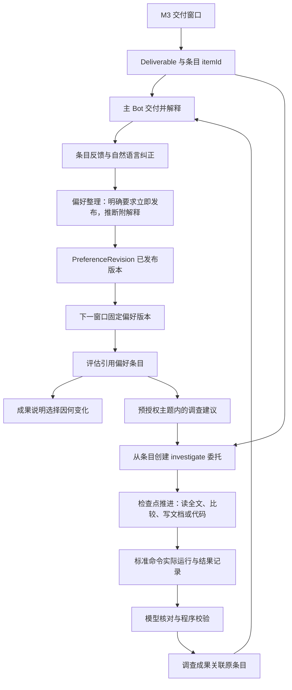

# M4：三个场景、反馈采用与进一步调查

日期：2026-10-16 · 状态：待执行 · 前置：[M3.99 均衡联网搜索](M3.99_PLAN.md)

实施依据：[PRD v1.3](PRD.md)、[开发计划](DEVELOPMENT_PLAN.md)、[M3 开发计划](M3_PLAN.md)、[M3.99 开发计划](M3.99_PLAN.md)、[ReAct 机制采纳建议](../deliverables/M3-ReAct-机制采纳建议.md)与 [AGENTS.md](../AGENTS.md)。本文件定义 M4 的完整实施方案，实施进度见第 9 节。

## 1. 目标与关键假设

M4 让 M3 的成果链变成用户能评价、能纠正、能继续推进的工作关系。用户对具体成果说“有用”或“更喜欢这种构图”，这句话保存为该委托的偏好版本，下一次选择明确装载并说明它改变了什么；用户说“把第二篇与 GNOSIS 的失败比较”，Icarus 创建关联调查，读取全文与项目材料，交付可打开的文档或实际运行过的代码。论文、申请和兴趣三个模板共用这套机制，各自保留成果要求与偏好。

| 关键假设 | 撤掉后，结果是否成立 |
|---|---|
| M3 的窗口、评估、阅读记录与投递链稳定运行 | M4 的反馈与调查没有可关联的成果；必须先修复 M3 |
| 用户愿意对具体条目给出评价或文字纠正 | 模板与调查仍可交付；偏好采用的验收缺少输入，只能由本人使用产生 |
| 成果能拆成带稳定身份的条目 | 反馈只能挂在整份日报上，“第二篇”无法定位，偏好归因失效；这是 M4 的核心抽象 |
| 执行模型在 8 次请求内能完成一次有界调查 | 调查仍按上限停止并保存进展；成果深度下降，需要拆成连续调查 |
| 兴趣来源提供公开图像，Vision Toolkit 在后台会话可调用 | 论文与申请不受影响；兴趣策展退化为只读元数据，按图像内容解释的验收不能通过 |
| 申请案例存在可公开访问的来源 | 机制可用真实历史回看验证；持续监测价值依赖用户选定的来源 |
| M3.99 的联网搜索至少一家可用，搜索调用进入证据与预算 | 原生来源与已绑定页面仍可读取；申请与兴趣的开放主题监测、调查中的资料发现失去入口，相关验收等待搜索恢复 |
| 工程调查的目标项目有标准构建或测试命令 | 研究类调查不受影响；工程调查只能交付集成判断，缺少实际运行结果 |

执行决定：**把成果拆成带稳定身份的条目，让反馈、偏好采用与调查都挂在条目上；模板只决定要求和结构化字段，调查复用 Mission 与 Run，作为独立的 `investigate` 委托运行。** 模型理解反馈含义、判断偏好适用范围和调查方向，程序校验身份、归属、结构和预算。

## 2. 本阶段交付与后续衔接

| M4 交付 | 具体结果 |
|---|---|
| 成果条目 | 每份成果的每个发现有稳定 `itemId`、序号、关联观测与证据；Bot 追问“第二篇”时按条目身份定位 |
| 反馈 | “有用 / 不感兴趣 / 看过 / 收藏”与自然语言纠正关联具体条目；打开链接单独记为阅读行为；没有反馈保持未知 |
| 偏好版本 | 明确要求立即生成新版本，系统推断附解释、可撤销、有适用期限；按 Mission 隔离，每次执行固定一个版本 |
| 偏好采用 | 评估与成果引用实际采用的偏好条目，成果说明本次选择因哪条偏好发生变化；保存偏好与采用偏好分别可查询 |
| 三个模板 | 论文、申请、兴趣模板提供默认要求、结构化字段与表达要求；通用委托覆盖开源项目和模型动态 |
| 关联调查 | 从条目创建 `investigate` 委托，继承背景与能力引用；交付全文精读、方法比较、本地文档或运行过的代码 |
| 主动调查 | 预授权主题内由模型提出并启动调查；未授权的方向作为建议附在成果中，转为长期委托由用户决定 |
| 调查边界 | 每个委托同时最多一次执行，单次最多 10 分钟、8 次模型请求，遵守 token 上限；到达上限保存实际进展 |

M4 通过服务和已有 Bot 交互完成。卡片按钮、首页和 QQ 引用回复在 M5 接入同一套反馈与调查服务，M5 只增加渠道与界面，不新增业务语义。

## 3. 已有代码与必须改造的连接处

| 当前文件或能力 | 已有事实 | M4 改动 |
|---|---|---|
| `src/execution/curation.ts` 的 `draft` 步骤 | 返回纯文本成果，条目只存在于正文 | 改为经 `icarus_submit_step` 提交 `{content, items}`；程序校验每个条目引用已选中的评估，与成果同一事务写入 `DeliverableItem` |
| `ObservationAssessment` | 已按 `preferenceRevision` 区分，`0` 表示未设置 | 增加 `preferenceRefs`，记录本次判断实际使用的偏好条目；增加 `relation` 保存跨来源合并 |
| `Feedback`、`PreferenceRevision`（`0001`） | 表已建立，没有服务写入 | 追加迁移扩展字段；新建 `src/feedback/` 负责写入、整理与版本发布 |
| `windows.ts` 的 `preferenceOf` | 读取最大偏好版本并固定到窗口 | 保持该入口，改为读取已发布版本；窗口固定后晚到反馈进入下一窗口 |
| `context/index.ts` | 快照中整行装载 `PreferenceRevision` | 装载结构化偏好条目及其来源原话，供评估引用条目身份 |
| `domain/mission.ts` | `kind` 为 `once / recurring` | 增加 `investigate`；revision 增加 `template`、`investigationPolicy` 与调查来源字段 |
| `execution/executor.ts` | 来源型委托走 `executeCurated`，普通委托走单回合 prompt | 增加 `executeInvestigation`，按检查点推进；执行轨迹与工具结果一同持久化 |
| `execution/model-budget.ts` | 按 token 预留和结算，ModelCall 关联 Run | 增加每次 Run 的模型请求上限，调查默认 8 次；达到上限时拒绝新请求并保存进展 |
| `execution/faults.ts` | 记录来源与能力故障 | 增加重复工具调用与无信息检索两类调查故障 |
| `src/search/`（M3.99） | `icarus_web_search`、`icarus_web_fetch`、`search` 来源适配器；SearchCall 计量与 Mission `searchBudget` | 模板默认来源使用 `search` 适配器；调查的资料发现与补读经这两个工具；SearchCall 进入调查成本与故障判定 |
| `bridge/tools.ts` | 委托、来源、能力、证据与结果五个工具 | 增加 `icarus_feedback`、`icarus_items` 与 `icarus_investigations`；`icarus_results` 返回条目 |
| `storage/data.ts` | 导出与删除覆盖 19 张表 | 覆盖条目、反馈、偏好条目、调查及其工作区产物 |

## 4. 业务流与所有权



Icarus 拥有条目、反馈、偏好版本、调查委托与产物引用。DS Bot 拥有身份、聊天记忆与表达；Bot 通过工具读取偏好与成果，偏好的唯一记录留在 Icarus。宿主拥有工具权限、Shell 执行与审批。目标项目的源码仍归用户，工程调查的改动在独立 worktree 中产生，合并由用户决定。

## 5. 数据与服务契约

### 5.1 追加迁移

M3.99 占用 `0009-web-search`，M4 从 `0010` 开始追加，不修改已应用的迁移。M3 的 Deliverable 没有条目记录，迁移后保持原样可读；Bot 对旧成果的追问按整份成果处理。

| 记录 | M4 增加或启用的内容 |
|---|---|
| DeliverableItem（新） | `id`、`deliverableId`、`ordinal`、`observationIds`、`assessmentIds`、`evidenceRefs`、`fields`、`title`、`url`、`preferenceRefs`；`(deliverableId, ordinal)` 唯一 |
| Feedback | 启用已有字段；增加 `source`（bot / qq / ui）、`channelEventRef`、`sessionId`、`status`（`recorded / applied / superseded / withdrawn`）、`preferenceRevision` |
| ReadEvent（新） | `itemId`、`channel`、`at`；打开链接只写这里，不进入偏好 |
| PreferenceRevision | 启用已有字段；增加 `basedOn`、`changeRef`、`publishedAt`；revision 从 1 递增，不可改写 |
| PreferenceEntry（新） | `id`、`missionId`、`introducedIn`、`retiredIn`、`origin`（`explicit / inferred`）、`statement`、`scope`、`quote`、`feedbackIds`、`explanation`、`expiresAt` |
| ObservationAssessment | 增加 `preferenceRefs`、`relation`（`{ duplicateOf, sameSubjectAs }` 及理由） |
| Mission、MissionRevision | `kind` 允许 `investigate`；revision 增加 `template`、`investigation`（`originItemId`、`originMissionId`、`question`、`deliverableSpec`、`stopCondition`）与 `explorationPolicy` |
| InvestigationCheckpoint（新） | `runId`、`seq`、`phase`、`summaryRef`、`traceRef`、`artifactRefs`、`createdAt`；预算或超时停止后从最后检查点继续 |
| RunCommand（新） | `runId`、`cwd`、`command`、`exitCode`、`stdoutRef`、`stderrRef`、`startedAt`、`endedAt`、`worktreeRef`；只记录宿主实际执行的命令 |
| Mission | 增加 `maxModelRequestsPerRun`、`exploreBudget`；默认调查 8 次模型请求、10 分钟；搜索次数沿用 M3.99 的 `searchBudget`，调查默认每次执行 20 次 |

偏好条目用 `introducedIn / retiredIn` 表达版本区间，某个版本的有效偏好是 `introducedIn <= r` 且 `retiredIn` 为空或大于 `r` 的条目集合。撤销推断、明确纠正覆盖旧条目都只发布新版本并设置旧条目的 `retiredIn`，历史 Run 引用的版本内容保持不变。

### 5.2 条目身份

成果生成步骤提交 `{ "content": "...", "items": [{ "ordinal": 1, "assessmentIds": [...], "title": "...", "url": "...", "fields": {...}, "preferenceRefs": [...] }] }`。程序校验：每个条目至少引用一条本窗口 `selected=1` 的评估，每条选中评估恰好出现在一个条目中，`fields` 满足模板声明的结构，`preferenceRefs` 属于本 Run 固定的偏好版本。正文按序号呈现条目，Bot 展示的“第二篇”即 `ordinal=2`。

条目与 Deliverable 在同一事务提交，Deliverable 不可变，条目也不可变。调查成果同样产生条目，可以继续被反馈和调查。

### 5.3 反馈与偏好整理

反馈写入只做身份和归属校验：条目属于调用 Session 所拥有的 Mission，`action` 属于固定集合或者 `comment` 非空。写入后立即返回 `feedbackId`，状态 `recorded`。

偏好整理是一次模型步骤，输入为当前已发布版本的全部有效条目、新增反馈原话、反馈对应条目的内容与证据、以及模板的偏好维度说明。模型返回一组变更：新增明确要求、新增推断（附解释与适用期限）、撤销或覆盖既有条目，每项引用触发它的 `feedbackId`。程序校验引用、校验 `explicit` 条目只能来自含原话的反馈，然后发布新 PreferenceRevision，反馈转为 `applied`。

用户的文字纠正与明确要求进入整理后立即发布，下一次窗口固定该版本。“有用”“不感兴趣”这类单次点击由模型决定是否形成推断；单次点击形成推断时附 30 天默认期限，期限到达后在下一次整理时退役。整理的模型调用进入该 Mission 预算，登记为 `purpose=preference`。

整理触发条件：有 `recorded` 状态反馈且下一窗口的 `prepareAt` 到达前；用户的明确纠正立即触发。窗口固定偏好版本后到达的反馈进入下一窗口，与 PRD 第 6.3 节一致。

### 5.4 偏好采用的可见性

评估提示附带有效偏好条目的 `id`、陈述与原话，评估结果的 `preferenceRefs` 列出实际影响该判断的条目。成果生成时，模型对因偏好改变选择的条目写明原因，例如“按你上周说更喜欢俯视构图，本次优先选了这两张”。`icarus_feedback` 的 `adoption` 查询返回：某偏好条目在哪些 Run 中被引用、影响了哪些评估、选中与未选中的数量，以此区分“已保存”与“已采用”。

### 5.5 调查委托

调查是 `kind=investigate` 的 Mission，`schedule` 为立即执行的 once，通过已有 Mission 服务创建，拥有独立 revision、预算与历史。创建时继承原委托的 `workspaceRef`、`contextRefs`、`capabilityRequirements`；原条目的证据引用写入 `investigation`，调查运行时可直接读取这些证据。原委托的监测不受影响。

`deliverableSpec` 由模型从用户原话整理，取值为 `reading`（全文精读）、`comparison`（方法比较）、`document`（本地文档）、`code`（工程改动）之一或组合，附自然语言交付要求和结束条件。`code` 类必须有 `workspaceRef` 指向目标仓库和 `verifyCommand`；`verifyCommand` 来自项目自身的构建或测试配置，模型在读取 `package.json`、`pyproject.toml` 等文件后提出，用户在创建调查时看到并可修改。

### 5.6 新增服务与模块

| 模块 | 职责与对外操作 |
|---|---|
| `src/feedback/` | `record`、`withdraw`、`read`、`consolidate`、`current(missionId)`、`adoption(entryId)`；只有该模块写入 Feedback、PreferenceEntry 与 PreferenceRevision |
| `src/templates/` | 三个模板的默认要求、条目字段结构、偏好维度说明、来源建议与表达要求；纯数据与结构校验，不含语义判断 |
| `src/investigation/` | 从条目创建调查、检查点推进、工程 worktree 管理、命令记录、成果核对；主动调查的建议与启动 |
| `src/execution/` | 条目化成果提交、调查执行入口、每 Run 请求上限、轨迹持久化与重复调用故障 |
| `src/bridge/` | 新增三个 Bot 工具；`icarus_results` 返回条目；交付文本带条目序号与 `itemId` |
| `src/storage/` | 追加迁移，扩展导出删除 |

## 6. 按依赖顺序实施

### M4.1 成果条目化

追加 `0010` 迁移，建立 DeliverableItem 与 Mission 新字段。`curation.ts` 的 `draft` 步骤改为结构化提交，`verify` 步骤同时核对条目与正文一致：正文中的每个发现对应一个条目，条目引用的证据与阅读范围和 Reading 记录一致。

Bot 交付文本按序号呈现条目并附 `itemId`，交付正文仍然保持自然表达，`itemId` 只出现在结尾的记录行。`icarus_items` 提供按 Mission、Deliverable、序号查询条目，返回证据、阅读范围和所属评估；Bot 收到“第二篇为什么值得看”时用当前成果 ID 和序号定位，不按聊天位置推断。

交付：真实论文窗口产出带条目的成果；Bot 在会话换代后仍能按序号读取条目证据。

### M4.2 三个模板

`src/templates/` 定义模板，创建委托时由模型根据用户目标选择模板并填入 revision；模板只提供默认值，用户原话中的要求优先并覆盖默认项。

| 模板 | 条目字段 | 默认要求与表达 | 偏好维度 |
|---|---|---|---|
| `paper` | `arxivId`、`version`、`methodChange`、`evidenceStrength`、`relevance`、`readingScope` | 默认 3–5 项；说明方法改变了什么、证据支持到哪里、对当前研究有什么用；声明实际阅读范围 | 研究方向、方法类型、证据门槛、阅读深度 |
| `application` | `programFullName`、`round`、`originalPublishedAt`、`sourceKind`（官方 / 自报 / 中介 / 转载）、`applicantBackground`、`relevance` | 保留项目全名、申请轮次和原始发布时间；转载合并到原始出处，保留全部来源证据 | 目标项目、背景相似度、来源可信度 |
| `interest` | `author`、`authorUrl`、`originalUrl`、`previewAllowed`、`visualDescription`、`subjectTags` | 按真实图像内容解释选择；保留作者与原站链接；预览由来源权限决定 | 角色、画师、构图、色彩、题材 |

开源项目与模型动态使用通用委托，条目字段为 `repo`、`version`、`change`、`impactOnProject`。

模板同时给出默认来源组合，由模型结合用户目标填写，用户可增删：

| 模板 | 默认来源 | 搜索的作用 |
|---|---|---|
| `paper` | arXiv 查询、相关会议或实验室 RSS | 可选：`search` 来源按方法关键词补充 arXiv 之外的技术报告与博客，`timeRange: week` |
| `application` | `search` 来源，按“项目全名 + 轮次 + 录取”组织查询，`timeRange: month`；用户提供的论坛或公众号 RSS | 主要发现入口；结果只有摘要时由评估步骤补读原帖 |
| `interest` | 画师主页与作品站的 RSS 或网页变化来源 | 可选：按角色名与画师名搜索新作品，结果的图像经 Vision Toolkit 读取 |
| 通用委托 | GitHub Release/Issue、项目 RSS | 可选：按项目名搜索社区讨论与集成案例 |

搜索来源的结果按 M3.99 第 6.2 节以规范化 URL 去重，阅读范围为 `snippet`。条目声明“已读原文”时必须有直接读取或 `vendor_extract` 的阅读记录；`vendor_extract` 在成果中写作“经搜索服务抽取的正文”。

申请模板的转载合并使用 ObservationAssessment 的 `relation` 字段：评估提示附带本 Mission 近 30 天已选中条目的摘要，模型判断新观测是否为已有案例的转载或同一申请人的不同帖子，返回 `duplicateOf` 与理由。程序只校验引用的观测属于本 Mission。合并后的条目在 `fields` 中保留全部来源及各自的 `sourceKind`。

兴趣模板的图像理解通过 Vision Toolkit：评估步骤对图像候选调用视觉工具，视觉结果经 `capabilities.capture` 进入 ToolReading，`visualDescription` 必须引用该证据。`previewAllowed` 依据来源条款或页面声明由模型判断并保存依据；不允许预览时成果只给原站链接。Vision Toolkit 的模型费用按 PRD 第 8.3 节记录，提供者没有返回用量时记录费用未知。

交付：三个模板各运行一个真实委托并产生成果；申请委托出现至少一组真实转载合并，兴趣委托的选择理由引用视觉证据。

### M4.3 反馈服务与偏好版本

追加 `0011` 迁移，建立 ReadEvent、PreferenceEntry，扩展 Feedback 与 PreferenceRevision。实现 `src/feedback/` 与 `icarus_feedback` 工具：`record`、`withdraw`、`read`（阅读行为）、`current`、`history`、`adoption`。

Bot 收到用户评价时调用 `record`，原话进入 `comment`；用户说“看过”“收藏”时记录对应动作。整理步骤按 5.3 节在执行服务中运行：调度器在窗口 `prepareAt` 前检查是否有 `recorded` 反馈，有则先运行一次 `consolidate`，产生的新版本被该窗口固定。明确纠正由 `record` 的调用方触发即时整理，整理使用独立 Run（`purpose=preference`），遵守 Mission 预算与单次执行约束。

`withdraw` 撤回反馈时，若该反馈形成的条目仍有效，整理会发布退役该条目的新版本。用户说“不要再按这个推荐了”这类话，由模型在整理时识别为撤销对应推断，程序校验被撤销条目存在且有效。

交付：真实反馈形成偏好版本，原话、关联条目与发布时间可查；同一用户的两个委托偏好互不影响。

### M4.4 偏好采用进入选择

`context/index.ts` 的快照改为装载已发布版本的有效条目（id、陈述、原话、来源、期限）。评估提示要求每条判断列出实际起作用的 `preferenceRefs`；程序校验引用属于本 Run 固定的版本。成果生成时，因偏好改变选择的条目在正文中说明原因，条目的 `preferenceRefs` 同步保存。

偏好版本变化后，同一观测按新版本重新评估的规则沿用 M3 的唯一键：已经交付的窗口不重新评估，尚未交付的新窗口使用新版本。

交付：兴趣委托中对具体作品的纠正，在下一窗口的评估与成果中被引用并改变选择；论文委托的评估不引用兴趣委托的任何条目。

### M4.5 调查执行

追加 `0012` 迁移，建立 InvestigationCheckpoint、RunCommand，Mission 增加请求上限。`model-budget.ts` 在预留时同时检查本 Run 的已登记请求数，达到 `maxModelRequestsPerRun` 抛出 `BudgetExhaustedError`（`reason=requests`），执行器保存进展并结束 Run 为 `budget_exhausted`。10 分钟上限沿用 `DEFAULT_EXECUTION_TIMEOUT_MS`。

`executeInvestigation` 在执行会话中按检查点推进。每个模型回合自主交错思考与工具调用，Icarus 不按固定步数要求思考；回合结束时模型经 `icarus_submit_step` 提交检查点：已完成的工作、产物引用、下一步和是否满足结束条件。每个检查点同时持久化本回合的思考文本与工具结果，形成可查的执行轨迹。下一回合从最后检查点继续；预算或超时停止后，重试从同一检查点恢复。

调查直接读取原条目证据和原委托背景快照。需要补充资料时用 `icarus_web_search` 发现相关工作、复现报告或接口文档，`timeRange` 按问题的时效设置；需要全文时，优先通过已绑定的 Fetch、浏览器或 MarkItDown 读取，直接读取失败或被代理拦截时使用 `icarus_web_fetch`。结果进入 ToolReading 与 SearchCall；成果声明的阅读范围按实际记录核对，沿用 M3 的阅读核对逻辑，并区分直接读取与 `vendor_extract`。

调查创建时，`capabilityRequirements` 继承原委托并追加 `icarus_web_search` 为可选能力；用户明确要求联网调研的调查将其设为必需，搜索不可用时按 M3 机制阻止准备并给出设置页入口。调查成本同时报告模型 token、搜索次数及各提供者消耗，达到 `searchBudget.perRun` 时与模型请求上限一样保存进展并结束为 `budget_exhausted`。

执行器登记两类可观测故障：同一工具以相同参数在一次 Run 内重复调用三次，以及检索类工具返回空结果或错误。搜索的空结果依据 SearchCall 的 `resultCount = 0` 判定，搜索服务整体不可用依据 M3.99 的提供者状态判定，两者分开登记。登记写入 Fault 并在下一回合的提示中告知模型，最终成果的过程说明中如实列出。

交付：从真实论文条目创建的方法比较调查，在上限内完成并交付文档；人为压低请求上限后，Run 为 `budget_exhausted`，检查点与已产出材料可查，重试从检查点继续。

### M4.6 工程调查

`code` 类调查在目标仓库创建独立 git worktree，路径保存在 `RunCommand.worktreeRef`，执行会话以该 worktree 为 cwd。模型按用户规格修改代码，构建与测试通过宿主 Shell 工具执行，宿主事件中的命令、退出码和输出写入 RunCommand 与证据文件。

`verify` 步骤读取 RunCommand：`verifyCommand` 至少实际执行一次且最后一次退出码为 0，才能声称“运行通过”；失败时成果如实交付失败输出、已完成的改动与判断。改动以 worktree 中的提交和 diff 文件交付，合并、推送由用户决定。写入目标仓库之外的路径、安装新依赖、联网发布等动作沿用宿主审批，审批绑定调查的 Mission revision。

交付：从真实开源项目条目发起集成调查，在 Icarus 自身仓库的 worktree 中按规格完成改动，`pnpm build` 实际通过；成果包含集成判断、diff 与命令记录。

### M4.7 主动调查与授权边界

`explorationPolicy` 保存用户预授权的主题范围、每周次数上限与 token 上限，属于 Mission revision。评估步骤允许模型对选中条目提出调查建议：问题、价值、与原目标的关系、预计交付。

建议落在预授权范围内且次数与预算未用完时，执行服务自动创建 `investigate` 委托并在成果中说明已启动；范围之外或预算不足的建议附在成果中，由用户回复决定。主题范围的匹配由模型判断并给出理由，程序校验次数、预算和委托状态。无活动、预算不足时不启动。

调查成果说明它如何推进原目标。模型认为值得长期跟踪的新方向，在成果中提出建议，转为长期委托需要用户明确同意。

交付：预授权主题内的一次主动调查真实运行并交付；范围之外的建议出现在成果中，未自动执行。

### M4.8 Bot 入口、导出与文档

新增 `icarus_feedback`、`icarus_items`、`icarus_investigations` 三个工具，授权沿用 `authorize`：读取允许 Mission 所有者和其执行 Session，写入只允许所有者。`icarus_investigations` 支持 `create`（从 itemId）、`get`、`list`、`checkpoints`、`commands`、`retry`。

导出与删除覆盖新增表、调查 worktree 引用与证据文件；删除调查不删除目标仓库中的 worktree 目录，导出中给出其路径。更新 README 的能力说明，THIRD_PARTY_NOTICES 登记 Vision Toolkit 等实际接入的扩展。

交付：第 8 节的真实场景通过，M4 标记完成；M5 在委托卡、成果页与 QQ 上接入同一套服务。

## 7. 扩展选择

| 能力 | 本阶段安排 |
|---|---|
| 视觉 | 安装 `@anionex/dsh-vision-toolkit`，核查模型配置，在兴趣委托的后台会话真实调用；费用与资料去向单列 |
| 联网搜索 | 使用 M3.99 的 `icarus_web_search` 与 `search` 来源；三家 key 在设置页配置，不另装搜索插件 |
| 全文读取 | 沿用 M3 的 Fetch 与 `@anweat/dsh-browser`；PDF 与本地文档优先连接 MarkItDown MCP；直接读取失败时使用 `icarus_web_fetch` |
| 工程调查 | 使用宿主 Shell 与文件工具；需要准确版本接口文档时按需连接 Context7 或 GitHub MCP |
| 个人资料 | Zotero、Obsidian 按用户实际使用选装，作为调查的 contextRefs |

扩展核查结果按 M3 的 `available / missing / needs_auth / unavailable / unknown` 保存，未在后台会话调用的保持 `unknown`。

申请模板的搜索来源通过 `locator` 保存查询式，`config` 保存 `timeRange`、`maxResults` 与可选 `site`；默认每 6 小时检索，最短 1 小时。创建来源时自动声明 `icarus_web_search` 为必需能力。调查的 `searchBudget` 默认 `{ perRun: 20, perMonth: 600 }`，作为 Mission revision 的一部分；达到上限沿用 `budget_exhausted` 并保存已有证据。`Run.searchUsage` 与导出的 SearchCall 提供实际调用及费用记录。

阅读核对沿用搜索实现的范围：`snippet` 只支持摘要，`vendor_extract` 表示厂商服务器抽取，直接读取继续使用 Fetch MCP 或浏览器的记录。查询只写主题，个人资料原文保留在本机背景读取环节。Bot 的连接与恢复提示统一指向“DSH 插件 → dsh-icarus → 联网搜索”。

## 8. 运行验证与完成依据

遵循 AGENTS.md，使用真实宿主、真实来源与本人反馈，不新增用户未要求的测试用例。每个步骤完成后运行：

```powershell
cd E:\AI\dsh-icarus\packages\dsh-icarus
pnpm install --frozen-lockfile
pnpm build
```

联调脚本与临时产物放在 `.work/m4-*`，持久证据在 Icarus 数据目录。

| 真实操作 | 必须观察到的结果 |
|---|---|
| 论文委托交付后，用户追问“第二篇为什么值得看” | Bot 按 `ordinal=2` 读取条目证据回答；会话换代后同样定位 |
| 对论文条目反馈“有用”并纠正“少推纯 benchmark” | Feedback 保存原话；明确纠正发布新偏好版本；下一窗口评估引用该条目，成果说明选择变化 |
| 对兴趣作品说“更喜欢这种构图” | 偏好进入兴趣委托；下一次选择引用视觉证据与该偏好；论文委托的偏好版本不变 |
| 撤回一条推断偏好 | 发布退役该条目的新版本，历史 Run 仍引用原版本 |
| 打开成果链接 | 只写 ReadEvent，偏好版本不变 |
| 申请委托通过搜索来源读取真实公开案例 | 条目保留项目全名、轮次与原始发布时间；转载合并且保留各自来源；只读摘要的条目如实声明阅读范围 |
| “把第二篇与 GNOSIS 的失败比较” | 创建关联调查，读取论文全文与 GNOSIS 实验交付文档，交付引用真实资料的比较文档，明确结论与关键假设 |
| 从开源项目条目发起工程调查 | worktree 中按规格改动，`pnpm build` 实际执行并通过；成果含集成判断、diff 与命令记录 |
| 压低请求上限运行调查 | 第 N+1 次请求被拒，Run 为 `budget_exhausted`，检查点可查；重试从检查点继续；原委托监测继续交付 |
| 调查中模型重复调用同一工具 | Fault 登记重复调用，成果过程说明如实列出 |
| 预授权主题内出现值得调查的发现 | 自动启动一次调查并交付；范围外建议只出现在成果中 |
| 调查中搜索服务全部 key 失效 | 可选搜索时调查使用已有资料继续，成果声明缺少的检索；必需搜索时阻止准备并给出设置页入口，恢复后从检查点续接 |
| 核查 Run 用量 | 偏好整理、评估、调查、视觉与搜索调用全部进入预算；搜索按提供者记录消耗，扩展未返回用量记为费用未知 |
| 导出并删除一个兴趣委托 | 条目、反馈、偏好与调查记录全部导出；删除后对应派生记录清空，其他委托不受影响 |

M4 完成须同时具备：条目化成果、偏好从反馈到采用的完整链、三个模板的真实运行、研究与工程两类调查的真实交付，以及预算和授权边界的实际生效。外部条件缺失的部分保留具体待完成状态，其余工作连续推进。

## 9. 当前实施状态

截至 2026-10-16，M4 尚未开始。M3 的窗口、评估、阅读记录与投递链已在真实宿主上验证；M3.99 完成后开始 M4.1。M4.1 与 M4.3 不依赖搜索，M3.99 期间遇到外部阻塞时可先行实施。
