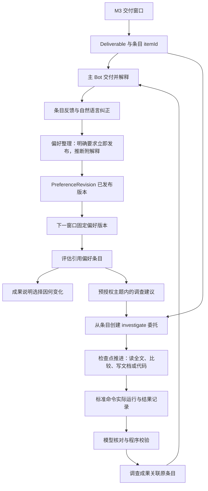

# M4：三个场景、反馈采用与进一步调查

日期：2026-10-16 · 细化更新：2026-10-17 · 状态：M4 代码、迁移与构建完成，真实宿主验收部分通过（逐项见第 9 节） · 前置：[M3.99 均衡联网搜索](M3.99_PLAN.md)

实施依据：[PRD v1.3](PRD.md)、[开发计划](DEVELOPMENT_PLAN.md)、[M3 开发计划](M3_PLAN.md)、[M3.99 开发计划](M3.99_PLAN.md)、[ReAct 机制采纳建议](../deliverables/M3-ReAct-机制采纳建议.md)与 [AGENTS.md](../AGENTS.md)。本文件定义 M4 的完整实施方案，实施进度见第 9 节。

## 1. 目标与关键假设

M4 让 M3 的成果链变成用户能评价、能纠正、能继续推进的工作关系。用户对具体成果说“有用”或“更喜欢这种构图”，这句话保存为该委托的偏好版本，下一次选择明确装载并说明它改变了什么；用户说“把第二篇与 GNOSIS 的失败比较”，Icarus 创建关联调查，读取全文与项目材料，交付可打开的文档或实际运行过的代码。论文、申请和兴趣三个模板共用这套机制，各自保留成果要求与偏好。

| 关键假设 | 撤掉后，结果是否成立 |
|---|---|
| M3 的窗口、评估、阅读记录与投递链稳定运行 | M4 的反馈与调查没有可关联的成果；必须先修复 M3 |
| 用户愿意对具体条目给出评价或文字纠正 | 模板与调查仍可交付；偏好采用的验收缺少输入，只能由本人使用产生 |
| 成果能拆成带稳定身份的条目 | 反馈只能挂在整份日报上，“第二篇”无法定位，偏好归因失效；这是 M4 的核心抽象 |
| 执行模型在 8 次请求内能完成一次有界调查 | 调查仍按上限停止并保存进展；成果深度下降，需要拆成连续调查 |
| 兴趣来源提供公开图像，Vision Toolkit 在后台会话可调用 | 论文与申请不受影响；兴趣策展退化为只读元数据，按图像内容解释的验收不能通过 |
| 申请案例存在可公开访问的来源 | 机制可用真实历史回看验证；持续监测价值依赖用户选定的来源 |
| M3.99 的联网搜索至少一家可用，搜索调用进入证据与预算 | 原生来源与已绑定页面仍可读取；申请与兴趣的开放主题监测、调查中的资料发现失去入口，相关验收等待搜索恢复 |
| 工程调查的目标项目有标准构建或测试命令 | 研究类调查不受影响；工程调查只能交付集成判断，缺少实际运行结果 |

执行决定：**把成果拆成带稳定身份的条目，让反馈、偏好采用与调查都挂在条目上；模板只决定要求和结构化字段，调查复用 Mission 与 Run，作为独立的 `investigate` 委托运行。** 模型理解反馈含义、判断偏好适用范围和调查方向，程序校验身份、归属、结构和预算。

## 2. 本阶段交付与后续衔接

| M4 交付 | 具体结果 |
|---|---|
| 成果条目 | 每份成果的每个发现有稳定 `itemId`、序号、关联观测与证据；Bot 追问“第二篇”时按条目身份定位 |
| 反馈 | “有用 / 不感兴趣 / 看过 / 收藏”与自然语言纠正关联具体条目；打开链接单独记为阅读行为；没有反馈保持未知 |
| 偏好版本 | 明确要求立即生成新版本，系统推断附解释、可撤销、有适用期限；按 Mission 隔离，每次执行固定一个版本 |
| 偏好采用 | 评估与成果引用实际采用的偏好条目，成果说明本次选择因哪条偏好发生变化；保存偏好与采用偏好分别可查询 |
| 三个模板 | 论文、申请、兴趣模板提供默认要求、结构化字段与表达要求；通用委托覆盖开源项目和模型动态 |
| 关联调查 | 从条目创建 `investigate` 委托，继承背景与能力引用；交付全文精读、方法比较、本地文档或运行过的代码 |
| 主动调查 | 预授权主题内由模型提出并启动调查；未授权的方向作为建议附在成果中，转为长期委托由用户决定 |
| 调查边界 | 每个委托同时最多一次执行，单次最多 10 分钟、8 次模型请求，遵守 token 上限；到达上限保存实际进展 |

M4 通过服务和已有 Bot 交互完成。卡片按钮、首页和 QQ 引用回复在 M5 接入同一套反馈与调查服务，M5 只增加渠道与界面，不新增业务语义。

## 3. 已有代码与必须改造的连接处

| 当前文件或能力 | 已有事实 | M4 改动 |
|---|---|---|
| `src/execution/curation.ts` 的生成与核对步骤 | M4.1 已以 `draft-items / verify-items` 提交结构化成果；待真实宿主验证 | M4.2 接入模板字段；M4.4 接入偏好引用；M4.5 为调查成果接入独立的来源契约 |
| `ObservationAssessment` | 已按 `preferenceRevision` 区分，`0` 表示未设置 | 增加 `preferenceRefs`，记录本次判断实际使用的偏好条目；增加 `relation` 保存跨来源合并 |
| `Feedback`、`PreferenceRevision`（`0001`） | 表已建立，没有服务写入 | 追加迁移扩展字段；新建 `src/feedback/` 负责写入、整理与版本发布 |
| `windows.ts` 的 `preferenceOf` | 读取最大偏好版本并固定到窗口 | 保持该入口，改为读取已发布版本；窗口固定后晚到反馈进入下一窗口 |
| `context/index.ts` | 快照中整行装载 `PreferenceRevision` | 装载结构化偏好条目及其来源原话，供评估引用条目身份 |
| `domain/mission.ts` | `kind` 为 `once / recurring`，扩展定义通过 `bindings` 保存 | 增加 `investigate`；revision 的 bindings 增加 `template`、`investigation`、`explorationPolicy` 与预算定义 |
| `execution/executor.ts` | 来源型委托走 `executeCurated`，普通委托走单回合 prompt | 增加 `executeInvestigation`，按检查点推进；执行轨迹与工具结果一同持久化 |
| `execution/model-budget.ts` | 按 token 预留和结算，ModelCall 关联 Run | 增加每次 Run 的模型请求上限，调查默认 8 次；达到上限时拒绝新请求并保存进展 |
| `execution/faults.ts` | 记录来源与能力故障 | 增加重复工具调用与无信息检索两类调查故障 |
| `src/search/`（M3.99） | `icarus_web_search`、`icarus_web_fetch`、`search` 来源适配器；SearchCall 计量与 Mission `searchBudget` | 模板默认来源使用 `search` 适配器；调查的资料发现与补读经这两个工具；SearchCall 进入调查成本与故障判定 |
| `bridge/tools.ts` | 已接入 `icarus_items`，Run 查询已返回条目 | 接入反馈与调查工具，补齐各服务的查询和操作 |
| `storage/data.ts` | 已导出 DeliverableItem，删除沿用 Mission 级联关系 | 继续覆盖反馈、偏好与调查派生记录及其文件 |

## 4. 业务流与所有权



Icarus 拥有条目、反馈、偏好版本、调查委托与产物引用。DS Bot 拥有身份、聊天记忆与表达；Bot 通过工具读取偏好与成果，偏好的唯一记录留在 Icarus。宿主拥有工具权限、Shell 执行与审批。目标项目的源码仍归用户，工程调查的改动在独立 worktree 中产生，合并由用户决定。

## 5. 数据与服务契约

### 5.1 追加迁移

M3.99 占用 `0009-web-search`，M4 从 `0010` 开始追加，不修改已应用的迁移。M3 的 Deliverable 没有条目记录，迁移后保持原样可读；Bot 对旧成果的追问按整份成果处理。

| 迁移 | 所属阶段 | 具体内容 |
|---|---|---|
| `0010-deliverable-items` | M4.1，已写入代码 | DeliverableItem、序号唯一约束，以及成果与条目的不可改写约束 |
| `0011-template-assessments` | M4.2 | ObservationAssessment 的 `relation`；模板定义通过现有 Mission / MissionRevision 的 bindings 保存 |
| `0012-feedback-preferences` | M4.3 | ReadEvent、PreferenceEntry，扩展 Feedback 与 PreferenceRevision；ObservationAssessment 增加 `preferenceRefs`；Run 增加执行用途与反馈整理输入引用 |
| `0013-investigations` | M4.5 | InvestigationCheckpoint、RunCommand，Run 的恢复来源、调查产物与调查条目的来源关系；调查定义和请求上限写入 bindings |
| `0014-exploration-allocations` | M4.7 | 主动调查建议、启动身份及每周预算预留；保留父委托与子调查的计量关系 |

`template`、`investigation`、`explorationPolicy`、`maxModelRequestsPerRun` 与 `exploreBudget` 作为 MissionBindings 的类型化字段保存，由 `parseBindings` 校验。修改时随 Mission revision 一起生成不可改写的快照；执行器只读取 Run 固定 revision 的定义。需要查询或防止重复启动的关系使用独立记录保存。尚未创建的迁移按上表分配编号。

| 记录 | M4 增加或启用的内容 |
|---|---|
| DeliverableItem（新） | `id`、`deliverableId`、`ordinal`、`observationIds`、`assessmentIds`、`evidenceRefs`、`fields`、`title`、`url`、`preferenceRefs`；`(deliverableId, ordinal)` 唯一；M4.5 增加调查来源类型、原条目快照引用与检查点关联 |
| Feedback | 启用已有字段；增加 `source`（bot / qq / ui）、`channelEventRef`、`sessionId`、`status`（`recorded / applied / superseded / withdrawn`）、`preferenceRevision` |
| ReadEvent（新） | `itemId`、`channel`、`at`；打开链接只写这里，不进入偏好 |
| PreferenceRevision | 启用已有字段；增加 `basedOn`、`changeRef`、`publishedAt`；revision 从 1 递增，不可改写 |
| PreferenceEntry（新） | `id`、`missionId`、`introducedIn`、`retiredIn`、`origin`（`explicit / inferred`）、`statement`、`scope`、`quote`、`feedbackIds`、`explanation`、`expiresAt` |
| ObservationAssessment | 增加 `preferenceRefs`、`relation`（`{ duplicateOf, sameSubjectAs }` 及理由） |
| Mission、MissionRevision | `kind` 允许 `investigate`；revision 增加 `template`、`investigation`（`originItemId`、`originMissionId`、`question`、`deliverableSpec`、`stopCondition`）与 `explorationPolicy` |
| InvestigationCheckpoint（新） | `runId`、`seq`、`phase`、`summaryRef`、`traceRef`、`artifactRefs`、`createdAt`；预算或超时停止后从最后检查点继续 |
| RunCommand（新） | `runId`、宿主调用身份、`cwd`、`command`、`status`、`exitCode`、`stdoutRef`、`stderrRef`、`startedAt`、`endedAt`、`worktreeRef`；命令尚未结束或结果未知时 exitCode 为空，只记录实际宿主事件 |
| Mission、MissionRevision 的 bindings | 增加 `maxModelRequestsPerRun`、`exploreBudget`；默认调查 8 次模型请求、10 分钟；搜索次数沿用 M3.99 的 `searchBudget`，调查默认每次执行 20 次 |
| Run | 增加 `purpose`（`execution / preference / investigation`）、结构化输入引用与 `resumedFromRunId`；已有 Run 迁移为 `execution` |
| ExplorationProposal、ExplorationAllocation（新） | 建议关联父 Mission revision、itemId 与模型给出的范围判断；预留记录关联子 Mission、周起点、token 配额与结算状态，防止重复启动和并发超额 |

偏好条目用 `introducedIn / retiredIn` 表达版本区间，某个版本的有效偏好是 `introducedIn <= r` 且 `retiredIn` 为空或大于 `r` 的条目集合。撤销推断、明确纠正覆盖旧条目都只发布新版本并设置旧条目的 `retiredIn`，历史 Run 引用的版本内容保持不变。

### 5.2 条目身份

成果生成步骤提交 `{ "content": "...", "items": [{ "ordinal": 1, "assessmentIds": [...], "title": "...", "url": "...", "fields": {...}, "preferenceRefs": [...] }] }`。程序校验：每个条目至少引用一条本窗口 `selected=1` 的评估，每条选中评估恰好出现在一个条目中，`fields` 满足模板声明的结构，`preferenceRefs` 属于本 Run 固定的偏好版本。正文按序号呈现条目，Bot 展示的“第二篇”即 `ordinal=2`。

条目与 Deliverable 在同一事务提交，Deliverable 不可变，条目也不可变。调查成果同样产生条目，可以继续被反馈和调查。

以上选中评估约束适用于策展窗口。M4.5 的调查条目使用调查来源契约：关联原 itemId 的快照、检查点与本调查的阅读证据，允许 assessmentIds 为空；程序校验引用来自继承证据或本次执行。调查成果的条目通过来源类型区分校验规则，沿用同一份身份、序号和反馈契约。

### 5.3 反馈与偏好整理

反馈写入只做身份和归属校验：条目属于调用 Session 所拥有的 Mission，`action` 属于固定集合或者 `comment` 非空。写入后立即返回 `feedbackId`，状态 `recorded`。

偏好整理是一次模型步骤，输入为当前已发布版本的全部有效条目、新增反馈原话、反馈对应条目的内容与证据、以及模板的偏好维度说明。模型返回一组变更：新增明确要求、新增推断（附解释与适用期限）、撤销或覆盖既有条目，每项引用触发它的 `feedbackId`。程序校验引用、校验 `explicit` 条目只能来自含原话的反馈，然后发布新 PreferenceRevision，反馈转为 `applied`。

用户的文字纠正与明确要求进入整理后立即发布，下一次窗口固定该版本。“有用”“不感兴趣”这类单次点击由模型决定是否形成推断；单次点击形成推断时附 30 天默认期限，期限到达后在下一次整理时退役。整理的模型调用进入该 Mission 预算，登记为 `purpose=preference`。

整理触发条件：有 `recorded` 状态反馈且下一窗口的 `prepareAt` 到达前；用户的明确纠正立即触发。窗口固定偏好版本后到达的反馈进入下一窗口，与 PRD 第 6.3 节一致。

### 5.4 偏好采用的可见性

评估提示附带有效偏好条目的 `id`、陈述与原话，评估结果的 `preferenceRefs` 列出实际影响该判断的条目。成果生成时，模型对因偏好改变选择的条目写明原因，例如“按你上周说更喜欢俯视构图，本次优先选了这两张”。`icarus_feedback` 的 `adoption` 查询返回：某偏好条目在哪些 Run 中被引用、影响了哪些评估、选中与未选中的数量，以此区分“已保存”与“已采用”。

### 5.5 调查委托

调查是 `kind=investigate` 的 Mission，`schedule` 为立即执行的 once，通过已有 Mission 服务创建，拥有独立 revision、预算与历史。创建时继承原委托的 `workspaceRef`、`contextRefs`、`capabilityRequirements`；原条目的证据引用写入 `investigation`，调查运行时可直接读取这些证据。原委托的监测不受影响。

`deliverableSpec` 由模型从用户原话整理，取值为 `reading`（全文精读）、`comparison`（方法比较）、`document`（本地文档）、`code`（工程改动）之一或组合，附自然语言交付要求和结束条件。`code` 类必须有 `workspaceRef` 指向目标仓库和 `verifyCommand`；`verifyCommand` 来自项目自身的构建或测试配置，模型在读取 `package.json`、`pyproject.toml` 等文件后提出，用户在创建调查时看到并可修改。

### 5.6 新增服务与模块

| 模块 | 职责与对外操作 |
|---|---|
| `src/feedback/` | `record`、`withdraw`、`read`、`consolidate`、`current(missionId)`、`adoption(entryId)`；只有该模块写入 Feedback、PreferenceEntry 与 PreferenceRevision |
| `src/templates/` | 三个模板的默认要求、条目字段结构、偏好维度说明、来源建议与表达要求；纯数据与结构校验，不含语义判断 |
| `src/investigation/` | 从条目创建调查、检查点推进、工程 worktree 管理、命令记录、成果核对；主动调查的建议与启动 |
| `src/execution/` | 条目化成果提交、调查执行入口、每 Run 请求上限、轨迹持久化与重复调用故障 |
| `src/bridge/` | 新增三个 Bot 工具；`icarus_results` 返回条目；交付文本带条目序号与 `itemId` |
| `src/storage/` | 追加迁移，扩展导出删除 |

## 6. 按依赖顺序实施

### 6.0 执行顺序与阶段边界

关键假设沿用第 1 节：M3 成果链与 M3.99 搜索继续可用，宿主事件能够提供实际工具结果。撤掉成果链假设，先修复 M3；撤掉搜索或视觉能力假设，只推进不依赖该能力的实现，对应实测保持待完成。

| 阶段 | 开始前必须具备 | 本阶段要交出的结果 | 下阶段使用什么 |
|---|---|---|---|
| M4.1 | M3 的窗口、评估与阅读记录 | 稳定条目身份、结构化成果、查询入口 | 模板校验、反馈和调查都引用 itemId |
| M4.2 | 条目化生成与提交契约 | 三个模板、申请转载关系、视觉证据引用 | 反馈整理读取模板维度，成果字段按模板校验 |
| M4.3 | 可查询的条目与模板定义 | 原话反馈、独立整理 Run、可追溯的偏好版本 | 窗口固定已发布版本，评估读取有效条目 |
| M4.4 | 偏好版本可发布和查询 | 从反馈到实际选择的采用记录 | 调查继承完整背景，主动建议参考当前目标与偏好 |
| M4.5 | 条目证据、Mission / Run 生命周期、模型与搜索预算 | 手动创建的研究调查、检查点、恢复与成果 | 工程调查复用执行器，主动调查复用创建服务 |
| M4.6 | 调查执行与恢复机制 | 独立 worktree、宿主命令记录、工程交付 | 主动调查能够按授权交付工程成果 |
| M4.7 | 手动调查与预算边界成立 | 范围判断、配额预留与自动创建 | Bot 能解释启动原因与待决定建议 |
| M4.8 | 各业务服务已接入 | 完整 Bot 操作、数据导出删除与使用说明 | 第 8 节真实场景验收，随后进入 M5 |

各阶段按“数据契约 → 服务 → 执行与调度 → Bot 入口 → 构建”的顺序推进。工具随所属服务接入，M4.8 负责补齐整条使用路径。已有实现继续扩展，M4.1 从第 9 节记录的状态接续。

每个阶段分别记录“代码实现与构建通过”和“真实场景通过”。2026-10-17 已越过原停点在隔离宿主执行真实验收（第 9 节）；默认桌面数据的迁移、删除与真实用户反馈仍由用户决定后执行。

### M4.1 成果条目化

追加 `0010` 迁移，建立 DeliverableItem。Mission 的模板定义在 M4.2 接入，调查定义在 M4.5 接入。`curation.ts` 的生成步骤改为结构化提交，核对步骤同时核对条目与正文一致：正文中的每个发现对应一个条目，条目引用的证据与阅读范围和 Reading 记录一致。

Bot 交付文本按序号呈现条目并附 `itemId`，交付正文仍然保持自然表达，`itemId` 只出现在结尾的记录行。`icarus_items` 提供按 Mission、Deliverable、序号查询条目，返回证据、阅读范围和所属评估；Bot 收到“第二篇为什么值得看”时用当前成果 ID 和序号定位，不按聊天位置推断。

**具体实施顺序**

1. 在 `storage/schema/0010-deliverable-items.ts` 建立条目表，限定 `(deliverableId, ordinal)` 唯一，随 Deliverable 级联删除。已经保存的成果和条目禁止更新，旧成果继续可读。
2. 在 `execution/items.ts` 定义草稿与已保存条目的类型，集中处理条目结构和归属校验。程序从 assessmentIds 推导 observationIds 与 evidenceRefs，防止模型自行编造这些关联。
3. 在 `curation.ts` 使用 `draft-items` 提交 `{content, items}`。ordinal 连续递增，每条选中评估恰好归入一个条目；合并发现可以引用多条评估。空日报允许空条目数组，未选中的评估不得混入条目。
4. 使用 `verify-items` 逐条核对正文序号和内容，核对标题、来源与阅读声明。模型给出判断，程序校验证据引用和 scope；核对失败保存候选与核对结果，并终止成功提交。
5. 在 `runs.ts` 的成果提交事务中重新校验关联，写入 Deliverable、DeliverableItem 和 Outbox；整个事务仍受 Mission revision 与租约约束。条目 ID 在提交时生成并保存。
6. 在 `outbox.ts` 保留正文序号，结尾记录行携带 missionId、deliverableId 与各 itemId。长成果保留完整文件链接，Bot 可通过查询补读完整条目。
7. 在 `bridge/tools.ts` 接入 `icarus_items` 的 `get / list`。按成果 ID 与 ordinal 定位，或按 itemId 定位；返回实际阅读范围和所属评估，所有查询检查 Mission 所有权。
8. 在 `storage/data.ts` 将条目纳入导出；`icarus_results` 的 Run 视图附带条目。完成构建后保留第 9 节的待实测状态。

**代码完成条件**：生成、核对和提交均使用同一套条目身份；旧成果可查询；新条目有完整归属与导出路径。当前这些代码已实现并通过构建。

**实测操作与完成条件**：用真实论文来源运行一个窗口，读取某份成果的 `ordinal=2`，核对其评估、链接和阅读范围；切换 Bot 会话后再次按同一成果 ID 查询，返回同一个 itemId 和证据。

### M4.2 三个模板

`src/templates/` 定义模板，创建委托时由模型根据用户目标选择模板并填入 revision；模板只提供默认值，用户原话中的要求优先并覆盖默认项。

| 模板 | 条目字段 | 默认要求与表达 | 偏好维度 |
|---|---|---|---|
| `paper` | `arxivId`、`version`、`methodChange`、`evidenceStrength`、`relevance`、`readingScope` | 默认 3–5 项；说明方法改变了什么、证据支持到哪里、对当前研究有什么用；声明实际阅读范围 | 研究方向、方法类型、证据门槛、阅读深度 |
| `application` | `programFullName`、`round`、`originalPublishedAt`、`sourceKind`（官方 / 自报 / 中介 / 转载）、`applicantBackground`、`relevance` | 保留项目全名、申请轮次和原始发布时间；转载合并到原始出处，保留全部来源证据 | 目标项目、背景相似度、来源可信度 |
| `interest` | `author`、`authorUrl`、`originalUrl`、`previewAllowed`、`visualDescription`、`subjectTags` | 按真实图像内容解释选择；保留作者与原站链接；预览由来源权限决定 | 角色、画师、构图、色彩、题材 |

开源项目与模型动态使用通用委托，条目字段为 `repo`、`version`、`change`、`impactOnProject`。

模板同时给出默认来源组合，由模型结合用户目标填写，用户可增删：

| 模板 | 默认来源 | 搜索的作用 |
|---|---|---|
| `paper` | arXiv 查询、相关会议或实验室 RSS | 可选：`search` 来源按方法关键词补充 arXiv 之外的技术报告与博客，`timeRange: week` |
| `application` | `search` 来源，按“项目全名 + 轮次 + 录取”组织查询，`timeRange: month`；用户提供的论坛或公众号 RSS | 主要发现入口；结果只有摘要时由评估步骤补读原帖 |
| `interest` | 画师主页与作品站的 RSS 或网页变化来源 | 可选：按角色名与画师名搜索新作品，结果的图像经 Vision Toolkit 读取 |
| 通用委托 | GitHub Release/Issue、项目 RSS | 可选：按项目名搜索社区讨论与集成案例 |

搜索来源的结果按 M3.99 第 6.2 节以规范化 URL 去重，阅读范围为 `snippet`。条目声明“已读原文”时必须有直接读取或 `vendor_extract` 的阅读记录；`vendor_extract` 在成果中写作“经搜索服务抽取的正文”。

申请模板的转载合并使用 ObservationAssessment 的 `relation` 字段：评估提示附带本 Mission 近 30 天已选中条目的摘要，模型判断新观测是否为已有案例的转载或同一申请人的不同帖子，返回 `duplicateOf` 与理由。程序只校验引用的观测属于本 Mission。合并后的条目在 `fields` 中保留全部来源及各自的 `sourceKind`。

兴趣模板的图像理解通过 Vision Toolkit：评估步骤对图像候选调用视觉工具，视觉结果经 `capabilities.capture` 进入 ToolReading，`visualDescription` 必须引用该证据。`previewAllowed` 依据来源条款或页面声明由模型判断并保存依据；不允许预览时成果只给原站链接。Vision Toolkit 的模型费用按 PRD 第 8.3 节记录，提供者没有返回用量时记录费用未知。

**具体实施顺序**

1. 建立 `src/templates/`，每个模板声明模板 ID、默认要求、字段结构、偏好维度和来源建议。通用委托同样声明字段结构，已有未设置模板的委托维持原有要求。
2. 扩展 `domain/bindings.ts` 的 `template` 字段，接通 `missions.ts` 的创建、修改、历史读取和 `executor.ts` 的 revision 快照读取。模板选择由 Bot 模型根据目标决定，创建结果返回实际生效的要求，用户明确填写的要求优先。
3. 将模板要求送入评估、生成和核对步骤；`items.ts` 在提交前按固定 revision 的模板校验 fields。事实缺失的字段保存明确的未知状态及来源限制，禁止为了满足结构而补造申请背景或论文证据。
4. 将来源建议交给 Bot 填写 locator、回看时间和轮询配置，再通过现有来源服务创建。选择模板本身不隐式启动网络请求；搜索来源继续使用 M3.99 的能力声明与计量。
5. 追加 `0011-template-assessments`，保存 `relation`。申请评估输入包含本 Mission 近 30 天选中条目的摘要和稳定引用，模型返回转载关系或同一申请人关系及理由，程序检查目标引用的 Mission 归属。
6. 同一窗口里的转载合并为一个条目，各选中评估只引用一次；与历史条目相同的转载保存关系并由模型决定是否有新增价值。补充申请进展时关联旧案例，保留本次新增证据，不把旧窗口的 assessmentId 写成本窗口评估。
7. 为申请 fields 补充 `sources`，保存各来源 URL、sourceKind 与原始发布时间。为兴趣 fields 补充 `visualEvidenceRefs` 和 `previewBasis`，分别保存视觉证据引用与预览依据。
8. 接入 Vision Toolkit 的能力描述、后台核查及 ToolReading 捕获。兴趣评估读取实际图像，将视觉证据带入评估和条目；预览不允许时交付原站链接。用量返回时计入实际消耗，未返回时保留费用未知状态。
9. 更新实际接入依赖的锁文件与第三方声明，运行依赖安装和构建。扩展安装、配置是否可用及后台是否调用过分别记录。

**主要文件**：新增 `templates/`；修改 `domain/bindings.ts`、`domain/missions.ts`、`execution/curation.ts`、`execution/items.ts`、`execution/executor.ts`、`capabilities/` 和迁移注册；扩展的实际接入同步修改 package、锁文件与声明。

**代码完成条件**：创建和修改能保存模板，历史 revision 可还原当时的模板；生成与提交均校验对应字段；转载关系和视觉证据有存储及查询路径。

**实测操作与完成条件**：论文、申请、兴趣各运行一个真实委托；申请结果包含一组有来源证据的真实转载关系；兴趣结果引用实际视觉工具返回，能说明画面内容及选择理由。三者均按实际阅读范围表述。

### M4.3 反馈服务与偏好版本

追加 `0012-feedback-preferences` 迁移，建立 ReadEvent、PreferenceEntry，扩展 Feedback 与 PreferenceRevision。实现 `src/feedback/` 与 `icarus_feedback` 工具：`record`、`withdraw`、`read`（阅读行为）、`current`、`history`、`adoption`，以及 `consolidate` 整理入口。

Bot 收到用户评价时调用 `record`，原话进入 `comment`；用户说“看过”“收藏”时记录对应动作。整理步骤按 5.3 节在执行服务中运行：调度器在窗口 `prepareAt` 前检查是否有 `recorded` 反馈，有则先运行一次 `consolidate`，产生的新版本被该窗口固定。明确纠正由 `record` 的调用方触发即时整理，整理使用独立 Run（`purpose=preference`），遵守 Mission 预算与单次执行约束。

`withdraw` 撤回反馈时，若该反馈形成的条目仍有效，整理会发布退役该条目的新版本。用户说“不要再按这个推荐了”这类话，由模型在整理时识别为撤销对应推断，程序校验被撤销条目存在且有效。

**具体实施顺序**

1. 扩展表字段，建立 Feedback → DeliverableItem → Mission 的归属校验；ReadEvent 直接引用 itemId。按第 5.1 节增加版本发布时间、变更引用和偏好有效区间，历史版本的有效条目仍可还原。
2. 实现 `record`：接收 itemId、动作或原话，保存来源、Session 与 channelEventRef，立即返回 feedbackId 和 `recorded` 状态。同一渠道事件的同一次提交只记录一次；重复提交返回已记录身份。
3. 实现 `read`：记录条目打开行为，只写 ReadEvent。用户说“看过”仍属于明确反馈动作；没有事件时保持未知。M4 提供服务入口，M5 的页面点击通过同一入口上报。
4. 扩展 Run 的 `purpose` 与整理输入引用。新增偏好整理的排队入口，固定此次输入的 feedbackIds、基准偏好版本和模板，沿用 Mission 的单次执行约束与预算。明确纠正由 Bot 传入整理请求，不在程序中用关键词识别。
5. 将 `consolidate` 接入执行器，输入当前有效偏好、待处理反馈及对应条目证据。模型提交新增、退役和不形成偏好的决定；每个新增或退役决定必须关联实际反馈，推断附理由与期限，明确要求附用户原话。
6. 发布时在事务中复核基准版本与反馈状态，统一写入新版本、条目变更和反馈应用状态。没有偏好变化时仅记录整理结果并处理反馈，不制造空版本。模型或预算失败时保留原反馈和失败 Run，不把反馈标成已采用。
7. 实现撤回与过期处理。撤回会保留原话及历史来源关系，需要退役有效偏好时排队整理；过期检查进入下一次整理输入。未产生条目的反馈可以直接撤回，已形成条目的反馈必须留下后续版本的退役记录。
8. 在窗口准备前安排待处理反馈的整理，整理结束后才固定窗口版本。明确纠正立即排队；已有执行占用 Mission 时等待其结束，向 Bot 返回排队状态。已固定版本的窗口继续使用原版本。
9. 接通 `current / history`，返回条目原话、反馈引用、解释和发布时间；`adoption` 在 M4.4 接入实际评估统计。返回“整理完成”与“版本已发布”的真实状态，写入操作只允许所有者。

**生命周期约定**：一次性委托交付完成后仍允许所有者反馈与整理偏好。偏好 Run 独立于交付日程，不消耗 `nextDueAt`，不改变 Mission 的监测或交付状态，也不产生普通成果 Outbox。暂停期间不自动排队整理，所有者仍可显式触发；取消后停止新增整理执行。模型预算入口按 purpose 检查相应状态，避免正常交付结束后反馈失去执行通道。

**主要文件**：新增 `feedback/` 与 `0012`；修改 `execution/runs.ts`、`execution/executor.ts`、`execution/model-budget.ts`、`execution/scheduler.ts`、`execution/windows.ts`、`execution/index.ts`、`bridge/tools.ts` 和 `storage/data.ts`。

**代码完成条件**：反馈能够记录、排队整理并发布版本；重复事件不重复发布；撤回和过期有版本结果；模型调用计入对应 Mission；两个委托之间的引用会被拒绝。

**实测操作与完成条件**：本人对真实条目作出评价及明确纠正，查询原话、整理 Run 和已发布版本；撤回一条实际生成的推断，观察新版本退役结果，历史 Run 的版本内容保持可查。同一用户的另一个委托不发生版本变化。

### M4.4 偏好采用进入选择

`context/index.ts` 的快照改为装载已发布版本的有效条目（id、陈述、原话、来源、期限）。评估提示要求每条判断列出实际起作用的 `preferenceRefs`；程序校验引用属于本 Run 固定的版本。成果生成时，因偏好改变选择的条目在正文中说明原因，条目的 `preferenceRefs` 同步保存。

偏好版本变化后，同一观测按新版本重新评估的规则沿用 M3 的唯一键：已经交付的窗口不重新评估；新窗口固定最新已发布版本；已经固定版本但尚未交付的窗口仍使用原版本。

**具体实施顺序**

1. 将 `windows.ts` 与 `runs.ts` 中读取最大偏好版本的入口统一为反馈服务的“最新已发布版本”。窗口应在首次准备并完成前置整理后固定版本；仅提前创建窗口记录时不冻结尚未确定的版本。
2. 将版本固定、Run 排队与关联写入同一事务，避免反馈整理和窗口扫描交错。重试及重启恢复沿用窗口已固定的版本，不再读取当时最新版本；没有偏好时统一按既有 `0 / null` 约定处理。
3. 修改 `context/index.ts`，快照按 Run 固定版本装载 PreferenceEntry 的 id、陈述、原话与适用范围，附期限和来源。重读历史 Run 时按版本区间还原，不能按当前时间过滤后再改变历史快照。
4. 在 ObservationAssessment 增加 `preferenceRefs`，评估提交每条判断实际使用的条目 ID。程序检查同 Mission、有效版本和引用唯一性；未使用偏好时允许空数组。
5. 扩展条目草稿契约，替换 M4.1 仅接受空 preferenceRefs 的限制。成果条目的引用应来自其关联评估实际使用的偏好，并通过版本检查；不能只凭正文声明就登记已采用。
6. 将偏好引用与原话送入生成和核对步骤。模型说明偏好如何影响选择；程序只检查关联与结构，选择理由是否成立由模型结合候选和证据判断。
7. 完成 `adoption(entryId)`：按 Run 和评估返回实际引用、选中与未选中的数量，再返回关联成果条目。版本存在但无引用时，查询结果明确返回采用数量为零。
8. 核查同一观测在不同偏好版本下的评估身份与窗口去重规则，避免偏好更新导致旧成果重复投递。保留真实的新窗口选择记录供用户比较。

**主要文件**：`feedback/`、`context/index.ts`、`execution/windows.ts`、`execution/runs.ts`、`execution/curation.ts`、`execution/items.ts`、`bridge/tools.ts`。`preferenceRefs` 列随 M4.3 的 `0012` 一并加入，使用逻辑在本阶段接入。

**代码完成条件**：从反馈原话到偏好版本、固定 Run、评估引用与成果条目可以顺向查询，也可以从成果追溯；晚到反馈和重试均不会改变已固定版本。

**实测操作与完成条件**：本人对兴趣作品给出具体纠正，在后续真实候选中观察引用该偏好的评估和选择变化；采用查询返回对应 Run 与条目。论文委托不引用兴趣偏好，旧成果不重新投递。

### M4.5 调查执行

追加 `0013-investigations` 迁移，建立 InvestigationCheckpoint、RunCommand 和恢复关系，Mission revision 的 bindings 增加调查定义与请求上限。`model-budget.ts` 在预留时同时检查本 Run 的已登记请求数，达到 `maxModelRequestsPerRun` 抛出 `BudgetExhaustedError`（`reason=requests`），执行器保存进展并结束 Run 为 `budget_exhausted`。10 分钟上限沿用 `DEFAULT_EXECUTION_TIMEOUT_MS`。

`executeInvestigation` 在执行会话中按检查点推进。每个模型回合自主交错思考与工具调用，Icarus 不按固定步数要求思考；回合结束时模型经 `icarus_submit_step` 提交检查点：已完成的工作、产物引用、下一步和是否满足结束条件。每个检查点同时持久化宿主可见的过程说明、工具调用和实际结果，形成可查的执行轨迹。下一回合从最后检查点继续；预算或超时停止后，重试从同一检查点恢复。

调查直接读取原条目证据和原委托背景快照。需要补充资料时用 `icarus_web_search` 发现相关工作、复现报告或接口文档，`timeRange` 按问题的时效设置；需要全文时，优先通过已绑定的 Fetch、浏览器或 MarkItDown 读取，直接读取失败或被代理拦截时使用 `icarus_web_fetch`。结果进入 ToolReading 与 SearchCall；成果声明的阅读范围按实际记录核对，沿用 M3 的阅读核对逻辑，并区分直接读取与 `vendor_extract`。

调查创建时，`capabilityRequirements` 继承原委托并追加 `icarus_web_search` 为可选能力；用户明确要求联网调研的调查将其设为必需，搜索不可用时按 M3 机制阻止准备并给出设置页入口。调查成本同时报告模型 token、搜索次数及各提供者消耗，达到 `searchBudget.perRun` 时与模型请求上限一样保存进展并结束为 `budget_exhausted`。

执行器登记两类可观测故障：同一工具以相同参数在一次 Run 内重复调用三次，以及检索类工具返回空结果或错误。搜索的空结果依据 SearchCall 的 `resultCount = 0` 判定，搜索服务整体不可用依据 M3.99 的提供者状态判定，两者分开登记。登记写入 Fault 并在下一回合的提示中告知模型，最终成果的过程说明中如实列出。

**具体实施顺序**

1. 扩展 MissionKind 为 `investigate`，schedule 使用 once；同步处理创建、修改、完成、待重排判断与调度过滤。执行器按调查类型分派，调查即使继承了来源引用也不能进入普通策展窗口。
2. 建立 `src/investigation/` 的创建服务。输入 itemId、用户问题、deliverableSpec 和 stopCondition，检查调用者与原条目的归属；复制背景和能力绑定，保存原成果、原 Run、原条目与证据引用。
3. 调查创建为独立 Mission 与初始 revision，继承模板背景但保存自己的预算和调查定义。用户手动创建走所有者权限；M4.7 的自动创建只能经内部服务使用已保存的预授权。
4. 追加检查点与恢复关系。检查点包括当前阶段、已完成工作、下一步、成果引用及结束条件判断；先保存工具结果和轨迹文件，再事务提交引用，避免记录指向尚未存在的文件。
5. 接入 `executeInvestigation` 与结构化提交步骤。模型可以自主补读、比较和写文件，阶段名称用于记录进度，不规定每轮固定的工具顺序；每次回合结束保存检查点后再决定继续或进入成果核对。
6. 将请求次数检查放在 ModelCall 预留事务中，按实际模型请求计数，工具调用本身不计为一次模型请求。已登记后失败或用量未知的请求也占次数；标题等辅助请求保存用途并纳入同一上限，避免额外请求绕过预算。
7. 接通三类停止：请求次数或 token 达到上限、搜索预算达到上限、10 分钟超时。前两者结束为 `budget_exhausted` 并保存具体 reason；超时保存超时失败记录。任一停止都先取消活动请求，保留最近已提交检查点及后续已经收到的实际工具结果。
8. 实现 `retry`：创建新 Run 并记录 resumedFromRunId，从最近已提交检查点装载上下文及产物。新 Run 的请求次数重新计算，Mission 的累计 token 与月度搜索消耗继续累计；预算仍不足时拒绝新请求。旧 Run 的停止状态不改写，未提交的结果不得冒充完整检查点。
9. 补齐调查会话的证据捕获。现有 `tools/post-execute` 对无 deliveryWindowId 的执行会话提前返回，需改为同时覆盖调查 Run；原条目阅读、背景快照和新增 ToolReading 均能被调查核对引用。
10. 扩展 `items.ts` 与成果提交服务支持调查来源。策展条目继续必须引用选中评估；调查条目关联原 itemId、检查点和本调查的真实证据，不伪造 selected assessment。调查条目仍有稳定身份，可继续反馈和发起调查。
11. 在核对步骤检查交付要求、结束条件和实际阅读范围，核对通过才生成成功成果；预算停止只交付进展状态和已有材料。文档保存到调查工作区，Deliverable 保存可打开的文件引用。
12. 登记重复工具调用、空搜索和工具错误。相同调用使用工具名与结构化参数判等，第三次重复登记一次 Fault；空搜索依据 SearchCall 判断。故障及已恢复状态进入下一回合和最终过程说明，不凭关键词判断调查质量。
13. 接入 `icarus_investigations` 的创建、查询、列表、检查点与重试入口，并把调查用量纳入结果查询和导出。

**主要文件**：新增 `investigation/` 与 `0013`；修改 `domain/mission.ts`、`domain/bindings.ts`、`domain/missions.ts`、`execution/executor.ts`、`execution/runs.ts`、`execution/model-budget.ts`、`execution/curation.ts`、`execution/items.ts`、`execution/faults.ts`、`capabilities/`、`context/` 和 `bridge/tools.ts`。

**代码完成条件**：从条目创建的调查能独立排队和运行；无窗口的调查会话同样捕获证据；请求、搜索与超时都保留真实进展；重试能找到检查点；研究成果有文件和稳定条目身份。

**实测操作与完成条件**：从真实论文条目发起与 GNOSIS 的方法比较，读取全文和现有项目材料，交付引用实际证据的文档；另将请求上限压低，观察第 N+1 次请求被拒、停止状态和检查点，恢复预算后重试续接。原委托监测继续交付。

### M4.6 工程调查

`code` 类调查在目标仓库创建独立 git worktree，路径保存在 `RunCommand.worktreeRef`，执行会话以该 worktree 为 cwd。模型按用户规格修改代码，构建与测试通过宿主 Shell 工具执行，宿主事件中的命令、退出码和输出写入 RunCommand 与证据文件。

`verify` 步骤读取 RunCommand：`verifyCommand` 至少实际执行一次且最后一次退出码为 0，才能声称“运行通过”；失败时成果如实交付失败输出、已完成的改动与判断。改动以 worktree 中的提交和 diff 文件交付，合并、推送由用户决定。写入目标仓库之外的路径、安装新依赖、联网发布等动作沿用宿主审批，审批绑定调查的 Mission revision。

**具体实施顺序**

1. 扩展调查创建契约：`code` 要求仓库路径、规格和 verifyCommand。Bot 先读取项目的构建或测试配置，再将实际命令写入调查定义；创建结果显示目标仓库、分支和验证命令。
2. 在 `investigation/` 接入 worktree 管理，读取仓库当前分支、提交和工作区状态，基于明确的 base commit 创建 `codex/` 分支及独立 worktree。记录实际路径、base commit 与分支，原目录中的未提交改动保持原状。
3. 新调查会话以 worktree 为 cwd；重试沿用同一调查 worktree，重新读取当前文件后继续。每个运行记录所使用的 worktree，路径与调查身份形成持久关联。
4. 从真实宿主工具事件读取 Shell 调用和结果，确认实际事件结构后定义适配；记录 cwd、command、起止时间、退出码与输出文件引用。调用被拒绝、仍在运行或结果未知时记录真实状态，不写入成功退出码。
5. 检查点保存工程改动的当前状态、已执行命令和下一步。命令输出进入证据目录，源码保留在 worktree；模型的“已运行”文字不能替代宿主命令记录。
6. 改动后通过宿主执行项目 verifyCommand。失败时根据原始输出修复并再次运行；遇到外部阻塞或预算停止，保存失败输出和已完成改动。验证命令必须在本调查 worktree 中执行。
7. 核对步骤检查验证结果发生在最后一次代码修改之后，并检查该命令的最后一次运行已结束且退出码为 0；之后仍有代码修改时必须重新验证。RunCommand 的结构化字段与证据文件共同支持“运行通过”的结论。
8. 保存本调查的 diff、改动说明、base commit 和最终提交引用；提交仅包含调查产物及规格要求的改动。交付条目引用文件和命令记录，继续支持反馈与后续调查。
9. 合并和推送单独由用户决定；调查结束保留 worktree 路径。宿主发生审批时将审批与当前 Mission revision 绑定，恢复后继续原调查。

**主要文件**：`investigation/` 的 worktree 和命令服务、`execution/executor.ts` 的宿主事件捕获与工程核对、`types/host.d.ts` 的已核实事件类型、`bridge/tools.ts` 的 `commands` 查询。RunCommand 的存储结构在 M4.5 建立，本阶段接通实际记录与核对。

**代码完成条件**：代码修改、检查点和命令结果都关联同一个调查 worktree；停止后可恢复；验证是否通过由实际命令结果决定；成果提供可检查的 diff 和提交引用。

**实测操作与完成条件**：从真实开源项目条目发起集成调查，在 Icarus 自身仓库的独立 worktree 中按规格改动，实际执行 `pnpm build` 并通过；成果包含集成判断、diff 与命令记录，原委托继续运行。

### M4.7 主动调查与授权边界

`explorationPolicy` 保存用户预授权的主题范围、每周次数上限与 token 上限，属于 Mission revision。评估步骤允许模型对选中条目提出调查建议：问题、价值、与原目标的关系、预计交付。

建议落在预授权范围内且次数与预算未用完时，执行服务自动创建 `investigate` 委托并在成果中说明已启动；范围之外或预算不足的建议附在成果中，由用户回复决定。主题范围的匹配由模型判断并给出理由，程序校验次数、预算和委托状态。无活动、预算不足时不启动。

调查成果说明它如何推进原目标。模型认为值得长期跟踪的新方向，在成果中提出建议，转为长期委托需要用户明确同意。

**具体实施顺序**

1. 在 MissionBindings 定义 explorationPolicy：是否启用、用户授权的主题陈述、允许的交付类型、每周次数、每周 token 上限。策略随 revision 保存，默认关闭；工程调查还必须具备相应仓库与执行授权。
2. 追加 `0014-exploration-allocations`。保存模型提出的建议及其原条目身份、父 revision、范围判断与理由，建立每条建议只能启动一次调查的唯一关系。
3. 扩展评估与成果生成提交，允许针对选中条目提出问题、预期价值、交付内容和预计预算。生成阶段在条目提交后将建议关联到稳定 itemId，不能靠标题或正文位置追认。
4. 让模型依据已保存的授权原话判断建议是否在范围内，并返回解释。程序检查父委托仍有效、策略 revision 未变化、交付类型允许且所需能力可用，不用主题关键词词典决定授权范围。
5. 以父 Mission 的 timezone 划分每周额度，在事务中检查次数与 token 剩余量并预留。已有在途调查的预留也占额度；重启重复处理同一建议时返回已经创建的调查。
6. 通过 M4.5 的内部创建服务建立子调查，固定父策略 revision 与 allocationId。子调查预算不超过已预留额度，请求次数和搜索上限同样生效。启动次数在成功创建时占用，结束后按实际 token 结算并释放未使用预留；用量未知时保留对应预留。
7. 将子调查暂停、取消和重试纳入分配关系。父委托暂停或取消后停止新的自动启动；已有子调查保留独立状态，策略撤销时禁止新请求，允许保存进展。重试重新检查授权和剩余额度，不重复占用启动次数。
8. 成果交付前记录实际启动结果。已经创建时写入调查 ID 和启动理由；范围外、额度不足或能力缺失时保存建议及原因，Bot 能据此解释当前状态。
9. 子调查交付说明如何推进父目标，并关联回原条目。需要持续跟踪的新方向保持为建议，由用户通过普通 Mission 创建入口决定是否设为长期委托。

**主要文件**：`domain/bindings.ts`、`investigation/` 的建议与分配服务、`execution/curation.ts`、`execution/model-budget.ts`、`execution/runs.ts`、`bridge/tools.ts`、`storage/data.ts` 与 `0014`。

**代码完成条件**：建议可追溯到具体条目和授权版本；自动启动只经过同一个创建服务；重复处理不重复启动；在途预算、结束结算和重试都受每周额度约束。

**实测操作与完成条件**：用户明确预授权一个主题后，真实发现触发一次调查并交付；另一条范围外建议保留在成果中。查询启动次数和 token 预留，重复处理同一建议不新增子调查；额度不足时返回具体状态。

### M4.8 Bot 入口、导出与文档

新增 `icarus_feedback`、`icarus_items`、`icarus_investigations` 三个工具，授权沿用 `authorize`：读取允许 Mission 所有者和其执行 Session，写入只允许所有者。`icarus_investigations` 支持 `create`（从 itemId）、`get`、`list`、`checkpoints`、`commands`、`retry`。

导出与删除覆盖新增表、调查 worktree 引用与证据文件；删除调查不删除目标仓库中的 worktree 目录，导出中给出其路径。更新 README 的能力说明，THIRD_PARTY_NOTICES 登记 Vision Toolkit 等实际接入的扩展。

**具体实施顺序**

1. 逐项核查 `icarus_items`、`icarus_feedback`、`icarus_investigations` 与 `icarus_results` 的操作契约。description 说明何时调用、必需身份、返回状态和后续入口，让 Bot 能从成果定位到反馈或调查。
2. 保留统一的 authorize 规则。Bot 所有者可以写入，关联执行 Session 可以读取；自动调查仅由内部服务按预授权创建，执行 Session 不能通过面向用户的写入工具扩大权限。
3. 补齐调查工具的 `get / list / checkpoints / commands / retry`，结果返回原条目、父委托和当前 Run 状态；反馈工具返回原话、偏好变更和采用结果。排队、预算耗尽和失败都保留原始状态及证据引用。
4. 完成“第二篇为什么值得看”“少推纯 benchmark”“更喜欢这种构图”“与 GNOSIS 比较”四条 Bot 操作路径。缺少成果身份时先查询已有成果和条目，定位后再写入，序号必须限定在具体成果中。
5. 扩展 `exportMissionData`，覆盖所有新增表和 JSON 引用的实际文件，包含调查恢复关系、预算分配和 worktree 路径。导出父委托时给出关联子调查索引；导出具体调查时包含其原条目的必要来源快照。
6. 扩展删除语义：删除一个 Mission 清理其自有派生数据和文件；子调查是独立 Mission，删除父委托时保留子调查已复制的证据与来源快照，并清除失效的跨委托引用。删除子调查保留父委托，其实际费用仍计入必要的匿名消耗记录。
7. 检查证据文件共享关系，只有当前删除对象独占的文件才清除；目标仓库中的 worktree 由用户管理，删除 Icarus 记录仅清除内部引用。来源快照避免子调查依赖父目录中的文件存续。
8. 更新 README 的能力与使用说明，THIRD_PARTY_NOTICES 只登记实际接入的扩展。核查安装依赖和构建结果，将阶段实现状态更新到第 9 节。
9. 获得实测执行指令后，按第 8 节顺序运行真实场景；每个场景保存实际对象 ID 和证据引用。所有完成条件满足后才标记 M4 完成，随后由 M5 接入页面和 QQ。

**主要文件**：`bridge/tools.ts`、`storage/data.ts`、`storage/schema/` 的关系约束、`index.ts` 的服务暴露、README 与 THIRD_PARTY_NOTICES。

**代码完成条件**：Bot 能通过服务贯通定位、反馈、偏好查询和调查；导出能还原业务关系与实际产物；删除边界与独立调查的所有权一致。

**实测操作与完成条件**：第 8 节全部真实场景通过；导出一个真实兴趣委托及其调查，核查原话、偏好和产物，然后按明确选定的删除范围清理，确认其他委托和目标仓库 worktree 保留。M4 标记完成后，M5 使用同一套服务。

## 7. 扩展选择

| 能力 | 本阶段安排 |
|---|---|
| 视觉 | 安装 `@anionex/dsh-vision-toolkit`，核查模型配置，在兴趣委托的后台会话真实调用；费用与资料去向单列 |
| 联网搜索 | 使用 M3.99 的 `icarus_web_search` 与 `search` 来源；三家 key 在设置页配置，不另装搜索插件 |
| 全文读取 | 沿用 M3 的 Fetch 与 `@anweat/dsh-browser`；PDF 与本地文档优先连接 MarkItDown MCP；直接读取失败时使用 `icarus_web_fetch` |
| 工程调查 | 使用宿主 Shell 与文件工具；需要准确版本接口文档时按需连接 Context7 或 GitHub MCP |
| 个人资料 | Zotero、Obsidian 按用户实际使用选装，作为调查的 contextRefs |

扩展核查结果按 M3 的 `available / missing / needs_auth / unavailable / unknown` 保存，未在后台会话调用的保持 `unknown`。

申请模板的搜索来源通过 `locator` 保存查询式，`config` 保存 `timeRange`、`maxResults` 与可选 `site`；默认每 6 小时检索，最短 1 小时。创建来源时自动声明 `icarus_web_search` 为必需能力。调查的 `searchBudget` 默认 `{ perRun: 20, perMonth: 600 }`，作为 Mission revision 的一部分；达到上限沿用 `budget_exhausted` 并保存已有证据。`Run.searchUsage` 与导出的 SearchCall 提供实际调用及费用记录。

阅读核对沿用搜索实现的范围：`snippet` 只支持摘要，`vendor_extract` 表示厂商服务器抽取，直接读取继续使用 Fetch MCP 或浏览器的记录。查询只写主题，个人资料原文保留在本机背景读取环节。Bot 的连接与恢复提示统一指向“DSH 插件 → dsh-icarus → 联网搜索”。

## 8. 运行验证与完成依据

遵循 AGENTS.md，使用真实宿主、真实来源与本人反馈，不新增用户未要求的测试用例。各阶段代码改动完成后执行项目构建；修改依赖时同步更新锁文件并核查冻结安装：

```powershell
cd E:\AI\dsh-icarus\packages\dsh-icarus
pnpm install --frozen-lockfile
pnpm build
```

联调脚本与临时产物放在 `.work/m4-*`，持久证据在 Icarus 数据目录。

### 8.1 实测前的停止位置

2026-10-17 已按第 8.2 节顺序在隔离 profile 与独立数据目录中执行真实宿主验收，未触碰默认桌面 profile 的委托与数据。逐项结果与证据 ID 见第 9 节，操作记录在 `.work/m4-live/acceptance.md`。同日的补验完成研究调查交付、兴趣（含视觉）与申请模板、发现即启动与真实数据删除，第 8.3 节规定的真实场景全部通过。

### 8.2 实测环境与执行顺序

沿用 [M3.99 接续说明](M3.99_HANDOFF.md) 中已验证的真实桌面宿主依赖，建立独立的 `.work/m4-*` profile 与数据目录，默认关闭自动调度。默认桌面 profile 含现有委托，不执行全局 tick。仅调度本轮已选定的 Mission、Run 和 Outbox；本人反馈由用户实际给出，代理不代替用户制造喜好。

1. **M4.1**：真实论文成果 → 条目查询 → Bot 会话换代后按成果与序号查询。
2. **M4.2**：三个模板真实运行 → 申请转载关系 → 兴趣视觉证据及费用记录。
3. **M4.3–M4.4**：本人反馈 → 发布版本 → 后续窗口采用 → 撤回 → 委托间隔离与链接打开记录。
4. **M4.5**：真实研究调查 → 检查点 → 请求或搜索预算停止 → 重试恢复，并核查原监测继续运行。
5. **M4.6**：真实工程调查 → worktree 内修改 → 实际构建 → 带命令记录的成果。
6. **M4.7**：在用户明确的预授权下启动调查 → 范围外建议 → 配额与重复启动核查。
7. **M4.8**：Bot 连续使用 → 导出及选定范围的删除 → 核查其他委托与工作区状态。

已经通过的真实场景，只有后续改动影响该路径或出现新失败时才重跑。涉及暂时不可用的来源时记录具体缺失能力，其他阶段继续推进；全部规定场景通过后才能关闭 M4。

### 8.3 真实场景与完成依据

| 真实操作 | 必须观察到的结果 |
|---|---|
| 论文委托交付后，用户追问“第二篇为什么值得看” | Bot 按 `ordinal=2` 读取条目证据回答；会话换代后同样定位 |
| 对论文条目反馈“有用”并纠正“少推纯 benchmark” | Feedback 保存原话；明确纠正发布新偏好版本；下一窗口评估引用该条目，成果说明选择变化 |
| 对兴趣作品说“更喜欢这种构图” | 偏好进入兴趣委托；下一次选择引用视觉证据与该偏好；论文委托的偏好版本不变 |
| 撤回一条推断偏好 | 发布退役该条目的新版本，历史 Run 仍引用原版本 |
| 打开成果链接 | 只写 ReadEvent，偏好版本不变 |
| 申请委托通过搜索来源读取真实公开案例 | 条目保留项目全名、轮次与原始发布时间；转载合并且保留各自来源；只读摘要的条目如实声明阅读范围 |
| “把第二篇与 GNOSIS 的失败比较” | 创建关联调查，读取论文全文与 GNOSIS 实验交付文档，交付引用真实资料的比较文档，明确结论与关键假设 |
| 从开源项目条目发起工程调查 | worktree 中按规格改动，`pnpm build` 实际执行并通过；成果含集成判断、diff 与命令记录 |
| 压低请求上限运行调查 | 第 N+1 次请求被拒，Run 为 `budget_exhausted`，检查点可查；重试从检查点继续；原委托监测继续交付 |
| 调查中模型重复调用同一工具 | Fault 登记重复调用，成果过程说明如实列出 |
| 预授权主题内出现值得调查的发现 | 自动启动一次调查并交付；范围外建议只出现在成果中 |
| 调查中搜索服务全部 key 失效 | 可选搜索时调查使用已有资料继续，成果声明缺少的检索；必需搜索时阻止准备并给出设置页入口，恢复后从检查点续接 |
| 核查 Run 用量 | 偏好整理、评估、调查、视觉与搜索调用全部进入预算；搜索按提供者记录消耗，扩展未返回用量记为费用未知 |
| 导出并删除一个兴趣委托 | 条目、反馈、偏好与调查记录全部导出；删除后对应派生记录清空，其他委托不受影响 |

M4 完成须同时具备：条目化成果、偏好从反馈到采用的完整链、三个模板的真实运行、研究与工程两类调查的真实交付，以及预算和授权边界的实际生效。外部条件缺失的部分保留具体待完成状态，其余工作连续推进。

## 9. 当前实施状态

日期：2026-10-17。M4.1–M4.8 的代码、迁移与构建已完成，真实宿主验收在独立 profile 与数据目录（`.work/m4-live`，端口 19402，Bot `M4Check`）中执行，不触碰默认桌面 profile 的委托。

| 阶段 | 代码与构建状态 | 实测状态 |
|---|---|---|
| M4.1 | 完成 | 通过。真实论文窗口产出 5 个条目；按成果与序号查询返回 itemId 与阅读事实；Bot 会话换段后按同一成果 ID 与序号查询，返回同一 itemId（`item_37f7d7d7-c9c0-4f5e-a564-cdffe03b0720`）与同一证据、阅读范围。 |
| M4.2 | 完成 | 通过。论文模板此前已过；兴趣模板真实窗口（NASA 每日图片 RSS）3 个条目的视觉描述全部来自真实 vision_glance 证据，预览许可按页面署名与 NASA 条款分别判断，authorUrl 缺失写 unknown；申请模板真实窗口选中自报案例，全名字段、轮次、originalPublishedAt、sourceKind 与 sources 数组齐全。Vision Toolkit 0.1.46 装入隔离 profile，视觉模型为 DeepSeek API 的 deepseek-flash（实测接受图像输入；deepseek-v4-pro 拒绝图片）。 |
| M4.3 | 完成 | 通过。对真实条目记录“有用 + 少推纯 benchmark，多给方法比较”；独立整理 Run 发布 preference revision 1，explicit 条目保留用户原话，反馈转 applied；打开链接只写 ReadEvent，不产生版本。 |
| M4.4 | 完成 | 通过。下一窗口固定 revision 1；评估与成果条目引用实际影响判断的偏好（8 个条目均带 preferenceRefs），模型把纯 benchmark 论文排到最后并说明降权；adoption 返回 Run、选中 9 条/未选 2 条与 8 个关联条目。 |
| M4.5 | 完成 | 通过。创建、预算停止、检查点与重试此前已实测；最终文档交付 2026-10-17 补验通过：done 检查点后的交付-only 恢复 Run（`run_62bde199`）不重跑研究、不产生新检查点，直接交付并经 Outbox 投递（`deliverable_add8bd0e`），报告落盘调查工作区，4 个调查条目引用真实证据。executor 已把前一 Run 最后检查点注入交付与核对提示词。 |
| M4.6 | 完成（worktree、命令记录、diff、验证门） | 通过。从工程调查创建 Mission `mission_9d25c9fb`，在独立 worktree 的 `icarus/investigate-9d25c9fb` 分支把重试改为指数退避；宿主实际执行 `node verify.mjs` 共 7 次（含包装命令），最后退出码 0；49 条 RunCommand 记录 cwd/命令/退出码/输出文件；成果含 2 个调查条目、worktree 文件与 `retry-backoff.diff`，验证结果发生在最后一次代码修改之后；`changes.diff`/`status.txt`/`head.json` 已保存 base `1d599c4` 与 head `f93ad06`；原仓库 fixture 保持干净，成果已投递并完成 Mission。 |
| M4.7 | 完成 | 通过。预授权窗口（`run_89270682`）真实评估选中恰好 5 条（新增模板 maxItems 约束生效），提交后 finalize 决定全部 7 条未决建议：2 条自动启动并预留配额（子调查 `mission_f53b0035`、`mission_07d311a3`），规格超授权 1 条、工程类缺仓库 2 条、周次数耗尽 2 条分别给出明确状态。失败 Run 悬置建议由下一次窗口提交时决定的语义已落地。 |
| M4.8 | 完成 | 通过。兴趣委托导出（全表覆盖，留证于 `.work/m4-live/interest-export.json`）后按用户授权的范围删除：missions 1、artifacts 36，Run/Source 零残留；论文、研究调查、工程调查、申请委托删除前后逐项一致，fixture 仓库与调查 worktree 保留。 |

### 9.1 实现增量

- 迁移：`0011-template-assessments`（评估 relation）、`0012-feedback-preferences`（ReadEvent、PreferenceEntry、Feedback/PreferenceRevision 扩展、评估 preferenceRefs、Run purpose）、`0013-investigations`（检查点、RunCommand、调查条目来源、resume 关系）、`0014-exploration-allocations`（建议与每周预留）。
- 新模块：`src/templates`（四个模板的默认要求、字段结构、偏好维度、来源建议与提示词片段）、`src/feedback`（反馈、阅读行为、偏好版本发布与采用查询）、`src/investigation`（调查创建与服务、git worktree、命令记录、主动调查建议与配额）。
- 执行链：curation 接入模板字段校验、偏好引用、转载 relation 与主动调查建议；executor 按 Run purpose 分派偏好整理与调查执行，保存检查点/过程轨迹/命令，登记重复工具调用与无信息检索故障；windows 在整理完成后固定偏好版本并阻止旧观测重复投递；model-budget 增加每 Run 模型请求上限。
- Bot 工具：新增 `icarus_feedback`（record/withdraw/read/current/history/adoption/consolidate）与 `icarus_investigations`（create/get/list/checkpoints/commands/retry）；`icarus_items` 返回 itemId 别名、所属评估与调查继承证据的读取路径；`icarus_results` 的 Run 视图带 purpose 与条目。
- 导出与删除覆盖新表；Mission 模板与调查字段随 revision 快照保存。

### 9.2 验证结果

- `pnpm install --frozen-lockfile`、`pnpm build` 通过；`pnpm test` 97/97 全绿。
- `.work/m4-integration.mjs` 以脚本化宿主验证 34/34：模板默认值合并、条目化成果、反馈与偏好版本、下一窗口采用与 adoption、调查检查点/请求预算/重试、主动建议启动与每周额度、worktree diff 与原始仓库不受影响、父委托删除保留子调查。
- `.work/m4-live.mjs` 在真实桌面宿主 `0.2.0-rc.2` 与真实模型上执行：论文窗口、会话换代条目查询、反馈整理、偏好采用窗口、研究调查的请求预算/检查点/重试与交付-only 恢复、工程调查的 worktree 改动与真实命令验证、兴趣（真实视觉证据）与申请模板窗口、主动建议发现即启动与配额、导出与真实删除。逐项 ID 与结果见 `.work/m4-live/acceptance.md`。

### 9.3 未完成项与原因

- 研究调查的最终文档交付：已通过（2026-10-17 补验）。调查在 run_955fd236 提交 done 检查点后，三个交付回合 Run（run_2ed70d71、run_0ce5dc56、run_afbc5836）均从该恢复点直接进入 investigate-deliver 阶段，未重跑研究；最终 run_62bde199 完成交付与核对，deliverable_add8bd0e 经 Outbox 投递（outbox_069dd614 sent），Mission 完成，报告落盘 workspace/investigations/mission_2ea49e3b/report.md（13.2KB，4 个调查条目）。恢复点语义已实测：交付-only 恢复 Run 不产生新检查点、不重新检索；本次补丁同时把前一 Run 的最后检查点注入交付与核对提示词，恢复交付不再依赖模型从证据重新推导。
- 工程调查已通过（见 M4.6 行）。
- 申请与兴趣模板的真实宿主运行、Vision Toolkit 的图像读取：已通过（见 M4.2 行）。视觉模型费用按 DeepSeek 账户计量，插件未返回单次用量，按规则记为费用未知。
- 主动调查的自动启动：已通过（见 M4.7 行），周次数与 token 配额、规格外与工程类建议的差异化状态均实测。
- 真实数据删除与清理：已通过（见 M4.8 行），范围由用户授权后定为兴趣模板验收委托。

本次补验中修掉的真实缺陷：论文窗口选中数无上限导致 9 条选中在核对阶段整窗报废（模板新增 maxItems，评估提交时即约束）；失败 Run 的主动调查建议永久悬置（窗口提交时决定本委托全部未决建议）；陈旧 once 测试委托在每次宿主启动时重新排队空转（已取消 5 个父委托与 4 个重复工程调查）。APOD RSS 为非法 XML，来源级解析失败如实阻断准备，属来源自身缺陷而非插件缺陷。

M4 全部阶段代码、构建与真实宿主验收均已通过，无外部条件遗留项。
