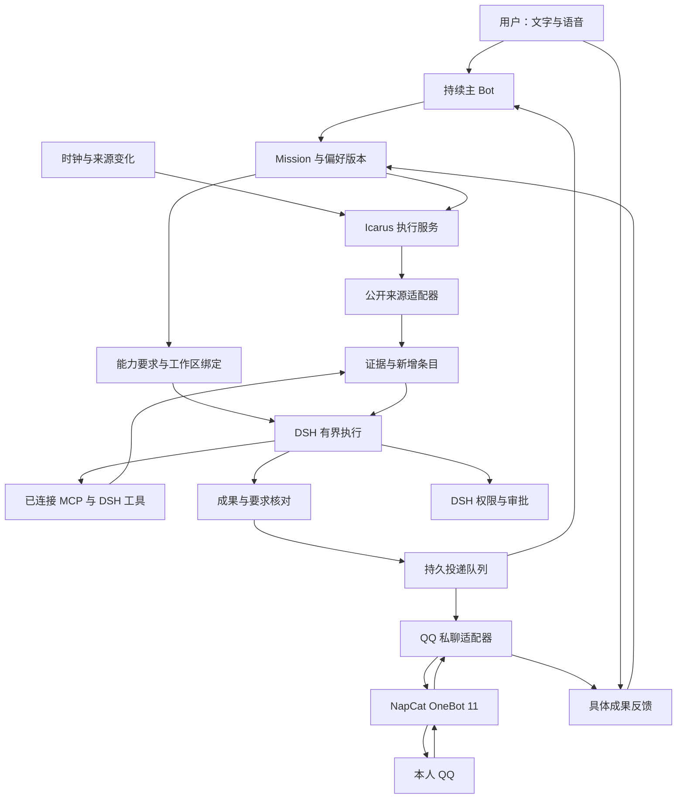

# Icarus：持续关注与行动的个人 AI 搭档

版本：1.3 · 日期：2026-10-15 · 状态：M1、M2 已完成；来源采集、按需扩展及反馈待实现

## 1. 决策与关键假设

Icarus 定位为 DeepSeek Harness 中专注科研与工程的个人 AI 搭档，从“持续关注某件事，并在重要变化发生时采取行动”切入。**以策展体验获得日常使用，以 Mission 承载持续委托，以稳定人格形成长期关系。** 产品名为 Icarus，工程名为 `dsh-icarus`，作为 DeepSeek Harness 的独立业务插件，与 DS Bot 集成。

用户交代目标与简报时间，Icarus 记住项目背景与个人兴趣，持续阅读公开来源，解释发现与目标的关系，给出明确判断，并沿着有价值的发现继续调查。科研任务交付有依据的分析；工程任务在授权范围内按规格交付可运行代码。用户反馈进入下一轮选择与行动，持续减少重复信息与操作。论文、兴趣内容和申请动态共享执行机制，各自保留偏好与成果要求。桌面、QQ 与语音使用同一 Mission 和成果记录。

用户可以按需求连接免费的 MCP 或安装 DSH 插件，扩展可访问的资料与执行能力。Icarus 结合目标推荐具体扩展，说明用途和费用条件，核查连接后的实际能力，并在持续委托中使用。来源采集与扩展调用共同服务同一目标，成果解释它们怎样推进用户的研究或项目。

| 关键假设 | 撤掉后，结论是否成立 |
|---|---|
| A1：目标用户持续关注少数主题，且信息筛选占用实际时间 | 产品的高频价值失效；需要重新选择场景 |
| A2：DSH 与 DS Bot 可以提供稳定身份、模型执行及权限能力 | 业务方向仍成立；本插件架构失效，需要重新确定宿主 |
| A3：用户愿意通过收藏、明确评价或文字纠正表达价值 | 持续监测仍成立；个性化改善缺少可靠反馈依据 |
| A4：至少一台执行主机在约定时段在线 | 在线期间仍可使用；离线期间的持续监测与准点交付失效 |
| A5：用户愿意为省去部署维护、持续收到有用成果付费 | 开源自用价值保留；商业托管路线失效 |
| A6：专用 QQ 账号在 NapCat 中持续在线，本人好友私聊可用 | 桌面与语音仍成立；QQ 准点推送和反馈闭环失效 |
| A7：用户所需扩展能在当前宿主与工作区运行，并取得对应账号授权 | 原生公开来源仍可运行；依赖该扩展的资料读取或行动暂停，保留缺少的条件 |

A1、A3、A5 需要真实使用记录。A2 的 BotBridge 与委托执行链已完成，采集与反馈仍待实现。A4 在自托管部署中由用户提供，在商业托管中由服务提供。A6 在 M5 用真实账号验收，NapCat 的商业使用授权另列为托管接入条件。

## 2. 两条路线的裁决

| 维度 | 策展情报官 PDF | Mission Loop PRD | Icarus 的决定 |
|---|---|---|---|
| 用户入口 | 每天有期待的内容与兴趣反馈，具体且容易理解 | 长期目标与主动交付，覆盖面更广 | 用“替我持续关注这件事”创建委托，日报是自然交付形式 |
| 运行基础 | 采集、排序与投递；任务生命周期较弱 | 持久任务、预算与 outbox 更完整 | 采用 Mission，区分委托、单次执行和交付状态 |
| 人格 | 带有角色特色的内容策展 | 角色主要承担差异化包装 | 一个稳定主 Bot 负责判断与解释，工作过程形成连续记忆 |
| 反馈 | 审美画像突出；容易把点击当成价值 | Mission 偏好隔离更清楚 | 保留原始反馈，记录实际采用，解释下次选择如何变化 |
| 行动深度 | 日报与监测为主 | 持续监测为主 | 增加与发现关联的有界调查，交付比较、精读或本地材料 |
| 商业模式 | 免费源数限制，25 元订阅解锁功能 | 开源核心与托管服务，39 元试价 | 完整核心开源，收费购买托管与维护；39 元为价格实验 |

**融合路线优于两者单独推进。** 策展提供可感知的日常价值；Mission 使同一委托跨日期和会话持续存在；进一步调查让情报进入用户实际工作。稳定人格参与选择与判断，形成用户能够理解、质疑和持续交往的主体。

PDF 中生态数量、覆盖率和收入推算缺少足以复算的直接依据，部分发布时间表述也互相冲突。本项目的商业预算采用自身试用数据。实现依据以已安装源码和上游正式接口为准。

## 3. GNOSIS 与哲学材料如何改变设计

GNOSIS 的正式实验记录显示：留出严格成功分别为 GNOSIS 101/150、fixed 96/150、global 93/150，主比较 Holm p 均为 0.656250；冻结执行阶段的费用改善在计入学习与验证后发生变化。P1 三个候选均覆盖全部 36 次执行，选择性验证节省为零。P2 同批任务中，fixed 和 GNOSIS 都成功 20/36，工具失败分别为 651 与 112。[正式交付](<../../GNOSIS Agent/docs/GNOSIS-正式实验交付-2026-10-08.md>)、[P1](<../../GNOSIS Agent/docs/GNOSIS-P1实验交付-2026-10-09.md>)、[后续研究](<../../GNOSIS Agent/docs/GNOSIS-下一步科研计划-2026-10-13.md>)。

这些结果直接约束本产品：

- 成功依据为委托要求与真实产物。抓取成功、模型回合结束、记忆写入分别记录。
- 成本包含采集、解释、反馈整理与重跑；模型的全部辅助调用进入预算。
- 用户反馈必须关联具体成果，并在下一次执行中明确装载。保存偏好与采用偏好分别可追踪。
- 调整检索和偏好属于正常业务行为；修改执行代码属于独立开发活动。产品不依赖无人监督的自修改来维持运行。

[Herta 哲学](PHILOSOPHY/Herta/PHILOSOPHY.md)的核心贡献是连续主体与可检查的证据：主 Bot 记得承诺，直接阅读结果，并对自己的推荐负责。两篇 [Claude 文章](<PHILOSOPHY/Claude/Article 1.txt>)、[文章二](<PHILOSOPHY/Claude/Article 2.txt>)提供稳定、自信、理解语境的交互方向；它们作为二手哲学材料使用。Icarus 的人格原则见根目录 [PHILOSOPHY.md](../PHILOSOPHY.md)。

## 4. 首批用户与完整使用场景

依据 [M3_BEGIN 用户需求调研](M3_BEGIN.md)，首批用户聚焦已有 DSH 使用习惯、热衷 Agent 与自动化的 AI 发烧友，尤其是其中的研究生与个人开发者。他们有持续跟踪的主题，也有明确的研究或项目成果目标，能够直接评价调查与执行的价值。兴趣内容属于同一用户的生活场景。吴宗河本人的使用覆盖论文追踪与硕士申请动态，也覆盖白厄相关作品策展。

首批价值集中在持续发现信息、记住个人背景并可靠完成任务。研究生通过相关工作发现与方法比较推进研究；个人开发者通过技术和开源项目追踪判断集成价值，再按需开展工程调查。稳定人格与兴趣策展增强长期互动，角色互动和 AIGC 创作作为后续扩展方向。

**论文委托**：每天 21:00 收到值得阅读的 Agent 研究，了解方法改变了什么、证据支持到哪里，以及对当前研究有什么用。用户回复“把第二篇与 GNOSIS 的失败比较”，Icarus 创建关联调查，读取全文与已有项目材料，交付可打开的比较文档。

**申请委托**：持续关注 NTU EAI 的公开录取案例。发现后保留项目全名、申请轮次和原始发布时间，解释背景与用户的相关性。自报或中介案例保留来源属性，重复转载合并。

**兴趣委托**：为用户搜集关注角色与画师的公开作品，按真实图像内容解释选择。用户的“更喜欢这种构图”进入该委托的偏好，后续推荐使用它。预览是否可展示由来源权限决定，保留作者与原站链接。

**项目委托**：持续关注与当前产品有关的开源项目。Icarus 读取相关仓库变化和本地项目背景，判断集成价值；用户要求继续时，关联调查读取准确版本的接口文档，按规格修改代码并实际运行。研究者可连接 Zotero 或个人笔记库，开发者可连接 GitHub 与模型仓库，各自沿用同一任务机制。

三个场景共享同一个主 Bot。用户通过具体委托查看进展，主 Bot 按任务需要调用工作 Agent。

## 5. 发布范围

首个可交付版本必须完整覆盖：委托创建与修改、公开来源采集、按需扩展连接、日报与变化通知、分域偏好反馈，以及发现后的有界调查。桌面结果页与 QQ 私聊属于完整闭环；现有语音用于同一套交互。论文、申请和兴趣保留三个内置模板，通用委托同时支持开源项目与模型动态；具体工具由目标和已有能力决定。

| 原始需求 | 本产品处理方式 |
|---|---|
| 美图日报、论文日报、录取监测 | 三个内置委托模板，共用任务服务 |
| 长短期记忆 | 复用 Bot 身份与长期记忆；任务偏好和当前状态由 Icarus 管理 |
| 主动探索 | 在已授权主题与预算内发现关联线索，产出有界调查 |
| 常规自治与关键授权 | 沿用宿主执行权限；新增范围或外部动作提交具体预览 |
| 移动使用 | QQ 私聊接收成果、回传反馈和继续调查，关联认证成果页及已有审批；执行在常驻主机 |
| 语音 | 复用已安装输入与 Bot 语音；全双工单独验收后才能列入能力 |
| 长期 Goal | Mission 持久化，短执行单元推进；宿主 Goal 服务用于有限任务 |
| 多 Agent | 使用宿主现成执行能力；任务唯一负责人和产物版本由 Icarus 管理 |
| 自进化 | 反馈调整偏好与搜索策略；代码改进经过独立开发与业务验收 |
| 世界模型 | 保存目标、事实及证据关系；预测能力需单独验证 |
| 全域行动 | 调查使用已有授权工具；物理设备与自动交易不进入本产品发布范围 |
| 按需扩展 | 按目标推荐 MCP 与 DSH 插件；复用宿主安装、连接及权限能力，记录每个 Mission 所需的能力 |
| 个人资料 | 按用户选择引用项目文件、文献库或笔记；每次执行固定本次实际读取的材料与版本 |

## 6. 产品交互

### 6.1 创建与修改委托

用户通过文字或现有语音说出目标。模型形成 Mission，包含关注主题、可访问来源、交付时间和预算。能够从上下文确定的内容直接填写，展示可编辑卡片；仅在缺少执行必需信息时提问。

用户明确要求持续监测即构成该范围的授权。首次连接外部通知渠道时绑定本人接收身份，并授权该类消息；后续例行发送沿用授权。改变接收人、公开发布或扩大操作范围需要新的批准。

修改产生 `missionRevision`。已经开始的执行保留旧版本证据；提交前核对当前版本，过期成果进入历史，后续执行遵循新要求。

### 6.2 日报与变化通知

日报默认 21:00，使用用户选择的 IANA 时区。采集与阅读提前完成，21:00 发送已保存成果。默认 3–5 项是篇幅目标；没有合格新内容时如实显示本次结果，按用户的“空日报通知”设置决定是否推送。

变化监测默认每小时检查，可按来源限制调整。HTTP 条件请求、来源 ID 与内容指纹负责减少重复计算。程序检测到新增内容后，模型结合完整目标判断是否值得报告。重要性、审美和研究价值均由模型作语义判断，代码不维护意图词典或关键词拦截器。

每张卡片显示核心发现、为何值得关注、来源与时间。研究卡还显示全文或摘要的阅读范围。详情页可查看来源证据、执行时间与原始错误。首页重点展示“今天值得看什么”和“你交代的事情进展如何”。

分析成果给出明确结论与建议，说明依赖的关键假设及撤掉假设后的变化。证据缺失时，指出需要补充的具体资料。方案评审从业务目标与整体结构出发，判断机制是否满足要求及后续演进是否成立。

### 6.3 反馈与偏好

卡片支持“有用”“不感兴趣”“看过”和“收藏”，也接受自然语言纠正。没有反馈保持未知；打开链接只计阅读行为。一次点击不自动升级为永久偏好。

偏好按 Mission 隔离，区分用户明确要求与系统推断，保存原话、关联成果和适用期限。用户明确纠正立即产生新版本；系统推断保留解释并可撤销。每次执行固定一个偏好版本，晚到反馈从下一次执行生效。

稳定身份沿用 DS Bot 记忆。Icarus 保存任务偏好的唯一记录，通过引用向 Bot 提供；每次定时运行显式读取当前偏好版本。

### 6.4 从发现继续调查

成果可以直接转为 `investigate` 委托，关联原始发现、问题与交付要求。调查具有结束条件，可交付全文精读、方法比较或本地文档。工程调查按用户规格编写代码，使用项目标准命令实际运行并保存结果；需要访问项目或执行工具时沿用已有授权与宿主权限。

用户可以为某个主题预授权主动调查。每个委托默认最多同时运行一次，每次最多 10 分钟、8 次模型请求；总 token 上限由创建时的预算配置确定。达到任一上限就停止新增执行，保存实际进展。遇到范围之外的行动，提供已经完成的材料与待批准动作。

主动发现的新方向先关联到原有目标，说明价值与证据；要转成另一项长期委托时由用户决定。一次调查结束后仍保留原有监测。调查价值按是否推进用户目标评价，例如新论文形成方法比较，新开源项目形成集成判断与可执行改动。

### 6.5 人格与语音

主 Bot 具有稳定身份和自己的判断风格，直接读取证据与任务状态，对推荐和交付负责。遇到方案分歧时给出明确推进意见，依据整体业务结构判断价值；工作 Agent 返回结构化发现，主 Bot 据此表达意见。初始提供原创 Icarus 人格，也允许绑定用户现有 Bot；人格与任务存续不受会话换代影响。

语音复用 DS Bot 当前的录音、转写和浏览器朗读。挂断语音、停止朗读与取消任务是独立动作。取消长期委托必须通过任务操作执行。用户追问“第二篇为什么值得看”时，语音上下文携带当前成果 ID，避免仅凭聊天位置推断对象。

### 6.6 按需求推荐并连接扩展

用户描述目标后，模型根据完整目标和已有工具描述提出能力要求，关联可选扩展。推荐内容说明扩展能完成的具体工作、安装来源和准确包名，展示免费条件、账号要求及资料去向。能力要求使用自然语言，程序只校验工具标识、参数格式与访问范围；不建立用户意图关键词表。

优先推荐本地免费软件与免费基础 API。带额度的托管服务明确显示限额，视觉模型和远程计算分别说明费用。额度耗尽、账号失效和工具离线分别保存对应状态。用户已经有可用能力时直接复用，同类能力选定一个主要提供者。

用户选择扩展或明确提出安装请求后，沿用宿主执行本地安装和配置；登录与 OAuth 同意由本人完成。安装到所选 profile，连接绑定正确工作区，并用真实调用确认可用。已安装、已连接和已在当前执行会话调用分别记录。新增费用及对外动作遵守现有授权，具体动作超出委托范围时提交已完成材料和待授权动作。

Mission 保存必需能力和可选能力，运行前核查绑定的工具是否仍可用。必需能力缺失时展示缺少的扩展、认证或权限，以及可执行的配置入口；该部分暂停调度，其他独立来源继续采集。可选能力缺失时只使用实际可得资料，成果声明阅读范围。连接恢复后从已保存进度继续，后台会话必须继承该工作区的工具可见范围。

首个发布版本交付扩展推荐、连接核查和委托绑定，并用真实 MCP 与 DSH 插件验证整条调用链。日历、邮件和内容平台按用户目标选装；账号连接后也须遵守对应委托授权。角色互动与 AIGC 创作仍按后续扩展方向安排。

## 7. 本机能力与集成边界

核查日期：2026-10-14。以下记录来自已安装文件与源码，具体联调状态见各开发阶段。

| 组件 | 本机事实 | 工程决定 |
|---|---|---|
| 桌面宿主 | `E:/AI/dsh-harness/resources/app.asar` 中 `@deepseek-ai/dsh-desktop` 与运行时为 `0.2.0-rc.2` | 以该桌面版本为首个兼容目标 |
| 另一套 CLI 依赖 | `.dsh/profiles/node_modules/@deepseek-ai/dsh` 为 `0.1.2-rc.1` | 不用该版本的验证结果代替桌面兼容结果 |
| DS Bot | desktop profile 安装 `ds-bot@0.1.6` | 复用身份、聊天记忆与会话续接 |
| Bot 调度 | `schedules.js` 可选注入 `schedule`；服务需启用 Automation tasks | 开发时核查服务状态；现有提醒继续由原服务管理 |
| Bot 接口 | `channel.js` 注册带认证的 `/api/bot`；内部 `rt` 未成为公开 Cordis 服务 | 建设显式 BotBridge，固定版本；禁止直接改写 Bot 的 `state.json` |
| 宿主语音 | 随包包含 `dsh-experimental-voice-input-bundle@0.2.0-rc.2`，采用本地 SenseVoice；文档注明默认禁用 | 安装、启用及模型就绪分别检查 |
| Bot 语音 | v0.1.5 `voice.js` 按 listening、thinking、speaking 轮换，浏览器 TTS 朗读 | 可复用轮换语音；全双工尚需独立实现 |

语音源码：[DS Bot v0.1.5](https://raw.githubusercontent.com/Fei2411/DeepSeek-Bot/v0.1.5/ds-bot/src/client/voice.js)。Bot 的现有能力与安装入口见[上游仓库](https://github.com/Fei2411/DeepSeek-Bot)。

**集成采用独立 Icarus 插件与版本化 BotBridge。** Icarus 拥有任务与成果服务，向 Bot 暴露工具。桥接已实现稳定 Bot ID 与当前 Session 的解析及后台结果交付，后续补齐成果追问所需的任务上下文。优先复用宿主认证下的已有接口；现有接口缺失的操作通过维护在源码中的小范围上游扩展提供。新增桥接操作在真实宿主上验证身份解析、会话换代与交付。

无人值守调用使用宿主服务身份认证；同一 Bot 数据目录由唯一的 DS Bot runtime 管理。Icarus 通过版本化 BotBridge 连接该实例。

### 7.1 扩展接入与推荐来源

扩展通过宿主工具注册与现有权限执行，Icarus 保存任务需求及绑定引用。MCP 的进程和连接生命周期交给宿主或所选管理插件，DSH 插件安装沿用宿主 profile；凭据由原服务或宿主保管。接入前在桌面 `0.2.0-rc.2` 上核查版本，Web profile 的上游声明与本机桌面调用结果分别记录。

| 目标 | 推荐候选 | 接入定位 |
|---|---|---|
| 搜索与阅读网页 | SearXNG MCP、Fetch MCP；DSH ModSearch | 搜索与正文读取；ModSearch 的托管免费额度单列 |
| 操作动态页面 | Playwright MCP、`@anweat/dsh-browser` | 按已有能力选用一个主要浏览器提供者 |
| 研究与工程调查 | GitHub MCP、Hugging Face MCP、arXiv MCP、Context7 | 读取项目变化、研究资料和准确版本的接口 |
| 个人背景 | Zotero MCP、MarkItDown MCP、Obsidian MCP | 文献和项目资料按引用装载，成果关联实际阅读记录 |
| 日程与内容平台 | Google Workspace MCP、Bilibili MCP | 按需连接个人账号；具体读写动作绑定委托授权 |
| 扩展管理与成果展示 | dsh-market、MCP 管理插件、Vision Toolkit、Better Sidebar、GenUI | 管理连接、读取图像或呈现成果；反馈写入 Icarus 服务 |

候选的上游链接及使用关系见 [第三方说明](../THIRD_PARTY_NOTICES.md)。推荐目录保存扩展用途、来源和费用条件，模型负责匹配需求；安装与运行状态从实际宿主读取。

## 8. 架构与数据所有权

| 所有者 | 负责内容 |
|---|---|
| DSH | 模型与工具执行、执行权限、审批及会话事件 |
| DS Bot | Bot 身份、对话续接、稳定人格与已有长期记忆 |
| Icarus | Mission、来源游标、执行尝试、成果、反馈及投递状态 |
| 来源适配器 | RSS/Atom、arXiv、GitHub 与网页变化服务的协议接入 |
| 宿主或扩展管理插件 | MCP 连接、插件安装与实时工具注册；账号认证及凭据保存 |

选择 Node.js/TypeScript 与 SQLite 单主写入。前端使用宿主已有界面能力；凭据交给宿主保存。RSS/Atom 与 HTML 使用成熟解析库。RSSHub 可作为外部订阅源，changedetection.io 可作为变化服务，两者均为可选外部接入。

程序校验结构、预算及明确的访问权限，模型负责理解意义与措辞。来源正文作为资料传入，来源中的命令不获得宿主权限。

### 8.1 核心记录

| 记录 | 必须保存的字段 |
|---|---|
| Mission | id、ownerBotId、kind、objective、requirements、revision、status、schedule、timezone、budget、authorizationRef |
| Source | id、missionId、adapter、locator、cursor、lastCheckedAt、lastSucceededAt、health |
| Run | id、missionId、missionRevision、preferenceRevision、status、sessionId、lease、inputRefs、usage、errorRef |
| Observation | id、sourceId、nativeId、contentHash、publishedAt、observedAt、evidenceRef |
| Deliverable | id、runId、requirementResults、evidenceRefs、artifactRefs、content、createdAt |
| Feedback | id、deliverableId、itemId、action、comment、createdAt、supersedes |
| PreferenceRevision | missionId、revision、explicitRequirements、inferredPreferences、feedbackRefs、createdAt |
| Outbox | id、deliverableId、channel、destinationRef、status、attemptCount、receiptRef、nextAttemptAt |
| DeliveryWindow（M3） | id、missionId、missionRevision、windowKey、prepareAt、dueAt、timezone、status、deliverableId、outcomeRef；按一次交付汇集准备结果 |
| ObservationAssessment（M3） | observationId、missionRevision、preferenceRevision、runId、decision、reason、evidenceRefs；保存新增候选的实际评估 |
| QQBinding（M5） | id、ownerBotId、senderAccountRef、recipientRef、status、authorizedMissionIds、createdAt、revokedAt |
| DeliveryReceipt（M5） | id、outboxId、bindingId、messageId、acceptedAt |
| Inbox（M5） | id、bindingId、messageId、replyToMessageId、receivedAt、status、operationRef |

原始资料与成果文件保存在 Icarus 数据目录，数据库保存引用及摘要指纹。个人数据不进入代码仓库。用户可以导出或删除自己的任务和反馈，删除后同步清理对应派生索引。

M3 为 Mission 与其不可变 revision 增加 `workspaceRef`、`contextRefs`、`capabilityRequirements` 和 `deliveryPolicy`，保存执行工作区、项目或个人资料引用、能力用途与绑定，以及交付方式和空日报设置。Source 增加来源配置和下次轮询时间；Run 关联交付窗口、上下文与能力快照。快照固定实际材料版本、工具提供者及核查时间，引用凭据的标识，禁止复制凭据值。既有 M2 记录通过追加迁移兼容，历史 revision 保留原意。

引用原始数据时分别保存发布时间、观测时间和阅读范围。正文与工具结果保留可追溯证据，摘要片段、章节读取和全文读取明确区分。外部工具缓存可以复用，已用于成果的材料引用必须在工具重启后仍可读取。

### 8.2 状态与恢复

Mission 状态为 `active / paused / completed / cancelled`。循环委托维持 active，单次失败记录在 Run；一次成功日报不会把长期委托标记完成。

Run 状态为 `queued / running / awaiting_approval / succeeded / failed / cancelled / superseded / budget_exhausted`。只有要求核对完成且成果已持久化才进入 succeeded。是否投递、是否阅读、是否有用分别记录。

执行领取采用数据库事务与租约；成果提交校验有效租约及执行代次。重启先检查已有会话与成果，再决定恢复或重新执行。程序异常就地失败，调度层保存失败状态与原始错误；重试作为新的尝试登记。

观测去重采用来源原生 ID 与内容版本。跨来源的同一论文或同一案例可由模型提出合并，保留各自出处。投递先写入 outbox，再调用渠道。数据库中的唯一约束防止重复创建；发送超时或缺少确认回执时保存 `delivery_unknown`，核对渠道记录后再决定重发。

停机错过日报后，恢复时按最新来源生成一次补交并显示延迟。持续监测的扫描间隔与发现后的处理延迟分开显示。来源访问失败时显示具体故障，成功检查且内容相同时记为没有更新。

交付窗口以 Mission、revision 和 `windowKey` 唯一标识；日报窗口按约定交付时点生成 key，变化通知按固定观测批次生成 key。准备产生的多个批次关联同一窗口，最终只确认一份成果。窗口记录有内容、无合格内容或来源故障的具体结果；空日报关闭时保存抑制原因，来源全部失败时保存失败。ObservationAssessment 与 Run 输入引用共同记录候选的消费进度，恢复后读取已完成评估，尚未评估的条目继续排队。

### 8.3 调度、预算与审批

Icarus 数据库保存自己的 due time，Cordis 定时器负责唤醒与生命周期清理。已有 DSH Schedule 提醒保持独立，避免同一个 Mission 被两套调度重复启动。空轮询没有模型调用；一次最多 20 条新增候选进入评估，溢出候选留待后续批次。

来源轮询、成果准备和投递分别保存时间。日报依用户 IANA 时区创建交付窗口，提前准备；成果通过要求核对后写入 outbox，`nextAttemptAt` 首次设为交付时刻，到期后才允许发送。投递扫描独立调度，模型执行期间仍按时扫描到期成果。准备提前量由委托配置，首次启用立即采集；修改目标或暂停委托后，未发送窗口在发送前重新检查状态与 revision。

`deliveryPolicy` 区分日报与变化通知。变化通知由已持久化的新观测创建窗口，模型评估后有值得报告的发现才准备投递，无合格变化保存抑制结果；来源故障独立保存。窗口创建时固定观测批次及交付时点，重启复用原窗口，避免每次扫描重复创建通知。

模型请求开始前预留输入与最大输出预算，结束后按实际 usage 结算。并发执行共同使用 Mission 与用户总预算；价格信息缺失时展示 token 用量与费用未知，仍执行 token 硬上限。无活动、没有权限或预算不足时不启动探索。

扩展自身的模型或计算调用也属于实际成本。提供者返回用量时关联 Run，未返回时记录费用未知；需要收费且没有既有授权的调用保持待授权。账号未连接或必需工具不可用时，暂停依赖该能力的执行，避免重复空调用模型。

审批引用宿主 request ID，绑定 Mission revision 与具体动作。移动端答复需要核对绑定用户及当前有效请求。宿主重启后失效的审批重新发起；超时不自动放行。日报向已绑定本人发送沿用委托授权，向第三方发送另行批准。

## 9. QQ 触达与数据流

### 9.1 接入决定与部署

首个移动渠道采用 **NapCatQQ + OneBot 11 好友私聊**。NapCat 作为独立常驻进程登录专用 QQ 账号；Icarus 的 `src/delivery/qq/` 适配器连接本机 OneBot 正向 WebSocket，在同一连接上发送请求并接收入站事件。任务、偏好和模型执行由既有 Icarus 服务负责，QQ 只承担触达与交互。

腾讯官方消息文档声明自 2025-04-21 停止提供主动推送，本项目的定时日报因此采用 NapCat 协议服务。参考：[腾讯消息文档](https://github.com/tencent-connect/bot-docs/blob/main/docs/develop/api-v2/server-inter/message/send-receive/send.md)、[NapCat 网络配置](https://napneko.github.io/config/basic)、[OneBot 11 API](https://github.com/botuniverse/onebot-11/blob/master/api/public.md)。

OneBot 服务仅监听 `127.0.0.1`，启用 token 认证及数组消息格式，关闭原始请求调试输出。连接地址和凭据由宿主管理，日志不输出 token 或接收标识。QQ 登录由用户在 NapCat 完成，Icarus 不保存 QQ 密码或登录会话。开发时固定并登记实际 NapCat 版本，版本升级重新验证通信契约。

### 9.2 本人绑定与成果投递

桌面生成限时、一次性绑定码。用户用本人 QQ 向专用账号私聊提交绑定码，适配器从认证连接收到的事件取得 `self_id` 与 `user_id`，绑定到当前用户及 Bot；绑定码消费后失效。绑定授权包含该 Mission 的例行简报与反馈，用户可以解除绑定。只有匹配绑定身份的好友私聊进入任务服务。

QQ 复用持久 outbox，设置 `channel=qq`，`destinationRef` 指向绑定记录。到期后调用 `send_private_msg`，以 `echo` 关联本次请求与响应；只有成功响应且返回 `message_id` 才记录渠道接受。保存发送账号、`message_id` 与 Deliverable 的对应关系，明确区分渠道接受、本人收到与实际阅读。

消息包含简报结论、来源和成果标识，支持引用原消息反馈或追问。完整材料通过认证成果页查看，手机远程可达性作为部署验收要求；授权链接不携带长期凭据。

渠道明确拒绝发送时，保存 `failed` 与原始错误；请求超时或连接断开导致发送结果不明时保存 `delivery_unknown`，核对后再重发。重连检查登录身份与在线状态，已确认发送的 outbox 不再次发送。主机恢复后按既有补交规则交付并标明延迟。

### 9.3 反馈、调查与审批

入站私聊以发送账号、本人身份和 `message_id` 组成持久去重身份。引用消息通过发送回执关联 Deliverable；没有引用时，模型读取当前任务与最近成果判断对象，存在多个候选且上下文不足时询问具体成果。自然语言含义由模型理解，适配器只校验协议与身份。

模型将反馈交给既有偏好服务，追问交给 BotBridge，进一步调查交给 `investigate` 服务；新增操作沿用 Mission 预算与授权。入站处理状态和关联操作 ID 持久保存，重连重放同一事件时续接已有操作，避免重复创建反馈或调查。

QQ 审批提示关联当前宿主 request ID、Mission revision 与具体动作，答复须同时匹配本人身份及当前有效请求。过期请求明确失败，扩大范围的操作在批准前保持待审批。群聊与第三方收件人需要另行确定授权和交付契约。

### 9.4 完成依据与数据流

M5 在真实专用账号与本人手机上完成绑定、约定时间主动送达、引用回复及反馈采用；继续调查关联原成果，审批处理同一有效请求。实际断线及两端重启后，任务状态和回执可核查，重复事件只产生一次业务操作。当前 QQ 适配器尚未实现。

数据默认保存在用户机器。调用远程模型时，所选资料与必要偏好会发送给模型提供商；启用外部推送后，通知内容会发送给对应渠道。连接设置明确显示这些数据去向。原始录音默认仅用于识别。

NapCat 由用户独立部署，项目只连接其协议接口。其现行许可禁止商业使用；付费托管提供 QQ 接入前须取得相应授权，并登记实际部署版本的许可。第三方使用关系见 [THIRD_PARTY_NOTICES.md](../THIRD_PARTY_NOTICES.md)。

## 10. 商业化与产品指标

采用 **Apache-2.0 开源核心＋付费托管服务**。自托管版完整提供委托与反馈，不按源数量制造功能缺口。服务收费覆盖持续在线、升级维护与交付故障处理；模型使用 BYOK 或单独列明的计量费用。

首轮报价假设为 **39 元/月、BYOK、5 个活跃委托**，作为真实价格实验。套餐必须列明执行频率与计算预算，不提供无限调用承诺。实际贡献按实收减去主机、存储、通知及维护成本计算。

北极星指标：**每位活跃用户每周明确认可或实际采用的成果数**。同一成果在多个渠道发送只计一次，打开率作为辅助指标。观察 20–30 位目标用户连续使用 14 天，记录实际分母与退出原因。

发布目标为：在线时段日报在约定时间 ±5 分钟内送达率 ≥95%；有明确评价成果的有用率 ≥60%；每名持续使用者每周至少 3 次有价值成果。原始来源与用户纠正可追溯率要求 100%。这些是目标值，当前尚无 Icarus 实测结果。

商业托管进入条件：至少 20 名完成体验的目标用户中，至少 3 名实际支付 39 元；同时逐用户计算成本后有正贡献。支付人数与总体试用人数同时报告，禁止只在高满意者中计算转化率。

## 11. 实现顺序与发布验收

以下顺序用于工程依赖安排，首个发布版本执行第 5 节的完整范围。

1. 固定宿主兼容版本，完成 BotBridge 的身份解析与真实后台交付；建立任务数据和预算契约。
2. 完成来源采集、能力绑定与项目背景装载，连接成果核对、持久投递及执行恢复。
3. 完成三个业务模板与有界调查，接入现有语音和 QQ 私聊。
4. 在真实来源及本人账号上完成持续运行验收，记录业务价值与实际支出。

| 场景 | 发布时必须观察到的结果 |
|---|---|
| 论文日报 | 在约定时间收到有来源的真实成果；声明实际阅读范围；进一步调查生成可打开材料 |
| 开源项目关注 | 发现真实版本或仓库变化，解释对当前项目的具体影响；关联调查交付集成判断和实际运行结果 |
| 按需扩展 | 从目标推荐扩展，安装或连接后在后台会话真实调用；工具失效显示实际原因，恢复后延续原委托 |
| 个人背景 | 同一发现结合选定项目文件、文献或笔记解释价值；记录实际读取的版本，会话换代后仍可装载 |
| 申请监测 | 新案例保留项目与轮次；转载合并；来源失败单列 |
| 兴趣反馈 | 对具体作品的纠正进入下一次选择；论文委托的偏好不受影响 |
| 会话换代与重启 | Bot 身份及任务继续存在；已提交成果不重复生成；提交与投递遵循当前有效 revision |
| QQ 交互 | 本人手机在约定时间收到简报，引用回复进入原成果；重复事件只产生一次业务操作；审批引用同一有效请求；断线与重启保留投递状态 |
| 语音交互 | 语音创建委托与追问成果成功；关闭语音后任务状态仍可读取 |
| 预算与失败 | 上限阻止新的调用；真实失败可查看；所有辅助调用进入使用统计 |

当前插件入口、数据库、BotBridge 与 M2 执行链已完成，M3 的四种原生来源、资料与能力绑定、分批评估及交付窗口已完成真实业务联调。反馈、UI 与 QQ 适配器仍待实现；Fetch MCP、MCP 管理器与浏览器扩展已完成本机安装与后台调用，其余候选扩展保持候选状态。完整发布验收尚未执行。M3 的实施顺序与真实验证见 [M3 开发计划](M3_PLAN.md)。

## 12. 调研材料的采用关系

| 材料 | 进入本 PRD 的内容 |
|---|---|
| [M3_BEGIN 用户需求调研与扩展建议](M3_BEGIN.md) | 首批用户聚焦 AI 发烧友中的研究生与个人开发者；按需推荐并连接免费 MCP 和 DSH 插件，结合个人背景持续关注并采取行动 |
| [GPT Normal](GPT/Normal.md)、[GPT 深度报告](<GPT/deep-research-report (4).md>) | 统一长期目标与跨端任务身份；插件候选用本机接口重新核对 |
| [KIMI](KIMI/个人Agent十三项功能深度研究报告.md)及其 CSV 附录 | 偏好反馈与观测预算的研究方向；外部框架作为参考 |
| [Qwen](Qwen/拆解13项核心功能：以DeepSeek生态为基石构建下一代自主Agent系统.md) | 记忆、任务与执行分层；本项目使用宿主已有执行能力 |
| [Alpharxiv](Alpharxiv/Research.md) | 提前生成准点投递、显式装载偏好、语音与任务分离 |
| [Gemini Argon](Gemini/Argon.md)、[Flash](Gemini/Flash.md)、[选型指南](Gemini/贾维斯式个人AI助手选型指南.pdf) | 自主发现与人格交互的产品愿景；能力成熟度按源码界定 |
| [策展情报官](<PRD/DS Bot策展情报官_市场调研与PRD报告.pdf>) | 日常策展体验与分域兴趣 |
| [Mission Loop](PRD/DSBot_MissionLoop_PRD_2026-10-14.md) | 持久任务、预算、反馈与移动交付 |

直接核对的研究包括 [ReLiveGym](https://arxiv.org/abs/2610.00710) 的长期唤醒机制、[TIDE](https://arxiv.org/abs/2609.37544) 的反馈归因，以及 [SALMONN-duo](https://arxiv.org/abs/2609.34247) 的实时语音与异步执行分离。采用其问题结构，产品效果按本项目的真实使用评价。

外部参考：[DeepSeek Harness](https://github.com/deepseek-ai/deepseek-harness)、[DS Bot](https://github.com/Fei2411/DeepSeek-Bot)、[RSSHub](https://github.com/DIYgod/RSSHub)、[changedetection.io](https://github.com/dgtlmoon/changedetection.io)。
